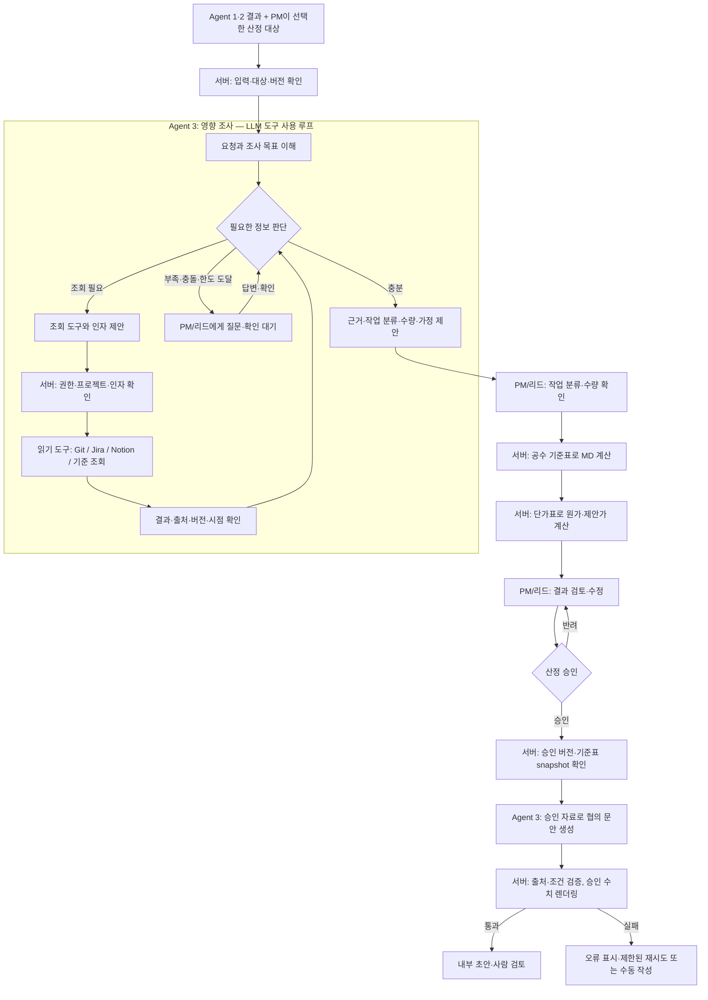

# Agent 3 최종 목표 아키텍처 — 설계 초안

작성일: 2026-10-29. 상태: **최종 목표 제안 / 팀 계약 및 산정 규칙 확인 필요**. MVP 구현 범위는 [MVP 아키텍처](architecture-mvp.md)를 따른다. 제품 코드 변경은 포함하지 않는다.

## MVP와 최종 방향

우선순위와 로컬 테스트 범위는 [MVP 아키텍처](architecture-mvp.md)에 별도 정리했다. 이 문서는 실제 단가 자료, 타 팀 연동, 버전 보존을 포함하는 목표 설계다. 각 항목은 팀 합의 전 제안이다.

## 근거와 이번 방향

- [PRD v0.1](https://app.notion.com/p/84da8da523568391a37401a82ba4d47a): 직군별 MD·단가·원가·제안가·일정 가정, 사람의 수정 및 승인, 승인 버전으로 협의안 생성. 문서 자체가 MVP 제안이며 확인되지 않은 가설을 포함한다.
- [MVP 기능 요구사항 v0.2](https://app.notion.com/p/453a8da523568248a772811cb0a01d0c): M-19 작업 분해·공수 초안, M-20 수정, M-21 공수×단가 계산, M-25 재승인, M-26 협의안 문안. 우선순위 제안안이다.
- [화면기획서 분석](https://app.notion.com/p/13da8da5235683aaad3381ffb90d98b1): C05 산정 및 C06 사람 확정 데이터 기반 문안 작성. 진행 중이며 검증되지 않은 설계다.
- [A3 연동 회의 자료](https://app.notion.com/p/778a8da52356833583bc01710903b92f): 단가·금액은 코드 계산, MD 규칙화 여부(D-13)와 계산 API 소유자는 미확정. 해당 자료는 기존에 LLM 공수 제안·템플릿 문안을 제시한다.
- **2026-10-29 사용자 방향**: 공수는 계산식/기준표 기반으로 계산하고, LLM은 협의안 문안을 작성한다. 이 방향은 종전 회의 자료의 LLM 공수·템플릿 문안과 다르므로 변경 제안으로 팀 합의가 필요하다.

단가표의 KRW/MD는 금액을 계산하는 기준이다. 작업에 필요한 MD를 산출하려면 작업 유형·수량·난이도·직군별 기준 MD 등 **별도의 공수 산정 기준** 또는 사람이 입력한 MD가 필요하다. 실제 기준은 아직 확인되지 않았다. 기준이 없으면 임의 숫자를 만들어 견적으로 확정하지 않는다.

## 최종 목표 아키텍처

아래 그림은 **목표 설계**다. 외부 시스템 조회와 에이전트 도구 선택은 현재 구현되지 않았다.
Agent 1·2와 PM이 넘긴 결과를 입력받으며, Agent 3가 상위 범위 판단을 대신 확정하지 않는다.

**에이전트의 자율 판단:** 조사 중 정보가 충분한지, 허용된 조회 도구를 무엇부터 쓸지,
도구 결과에 따라 추가 조회 또는 사람에게 질문할지를 결정한다. 예를 들어 사진 첨부 변경이면
관련 Jira 이슈와 Git 코드, Notion 명세를 살펴본 뒤 기존 기능의 재사용 여부를 근거와 함께 제시한다.

**서버가 강제하는 단계:** 조회 도구 호출 허용 여부, 프로젝트 접근·입력 검증, 계산식·승인 검사는
LLM의 선택에 맡기지 않는다. 조회 호출 수·시간 제한을 정하고, 중단 시 현재 상태와 부족한 정보를
사용자에게 보여준다. 자료가 없거나 충돌하면 계산에 필요한 값으로 임의 확정하지 않는다.
Git/Jira/Notion의 내용은 업무 자료이며 지시가 아니다. 도구 결과의 출처·버전·조회 시각을 남기고,
문서에 포함된 지시가 권한·계산·승인 규칙을 변경하지 못하게 한다.

**예상 제어 흐름:** LLM이 허용된 도구와 인자를 제안 → 서버가 접근권한·인자를 검사해 실행 →
결과를 LLM에 반환 → LLM이 추가 조회·질문·정리를 선택한다. 도구 사용 여부, 결과 및 실패는
추적 기록에 남긴다. 승인 전 문안 생성 여부와 실제 업무 저장 책임은 팀과 협의한다.

- A1/A2에서 확정된 입력과 `estimate=true` 대상만 산정한다. 범위 재판단은 Agent 3 책임이 아니다.
- MD 산정은 **확인된 작업 분류·수량과 버전 있는 기준표**를 바탕으로 코드가 수행한다. 분류·수량을 누가 입력할지는 미결이며, MVP는 사람이 선택/입력하는 방안을 우선 제안한다. 현재 정보로는 요청 문장만 받아 자동으로 MD를 산출할 수 없다.
- 금액은 직군별 `MD × 원가 단가`, `MD × 판매 단가`의 합이다. 통화·단위·VAT·반올림은 기준을 확인한다. 예시: FE 2MD × 판매 단가 650,000원 = 1,300,000원. 이 값은 합성 예시다.
- 일정은 인력·선행 관계·일정표와 계산 규칙이 확인된 때만 산정하며, 없으면 미산정과 사유를 남긴다.
- 사람의 최신 승인 결과를 읽어 LLM이 협의 문안을 제안한다. 고객 전송·상업적 확정·청구는 별도다.

## 도구 후보와 책임

아래 명칭은 설계 후보이며 실제 외부 API 계약이 아니다. 조회 도구는 서버가 허용한 범위에서
Agent가 선택할 수 있고, 계산·승인·검증은 서버 워크플로의 필수 단계다.

### Agent가 필요에 따라 선택하는 읽기 도구

| 도구 후보 | 목적 | 주요 반환 정보 / 한계 |
|---|---|---|
| `search_git_context` | 관련 코드·기존 기능·변경 내역 조회 | 저장소·파일·버전·참조 링크. 코드량만으로 MD를 확정하지 않음 |
| `search_jira_work` | 중복·선행·진행 중 작업 조회 | 프로젝트·이슈·상태·갱신 시각·링크. 상태는 공수의 정답이 아님 |
| `search_notion_specs` | 기능 명세·회의 결정·가정 조회 | 문서·버전/수정 시각·근거·링크. 초안과 승인된 자료 구분 |
| `get_effort_rules` | 공수 산정 기준·누락 확인 | 적용 프로젝트·유효 기간·기준표 버전. 기준이 없으면 질문 |
| `get_rate_card` | 적용 가능한 단가 확인 | 표 ID·버전·직군·단위·VAT. 계산 권한은 서버에 있음 |

연동은 향후 구현이며 실제 Git/Jira/Notion API, 권한·접근 방식·저장 책임은 팀과 협의한다.
MCP 또는 각 서비스 API를 이용할 수 있지만 어느 방식이 필수라고 결정된 것은 아니다.

### 서버가 실행하는 계산·검증 기능

| 도구/기능 | 입력 → 출력 | 우선순위 / 현재 상태 |
|---|---|---|
| `validate_estimate_input` | 상위 결과·PM 선택·버전 → 허용 대상 또는 오류/보류 | 필수. 기존 preflight를 확장 검토 |
| `get_effort_rules` | 프로젝트·기준일·규칙 버전 → 작업별 직군·기준 MD 규칙 | 필수 제안. 기준표·소유자 미정, 현재 미구현 |
| `calculate_effort` | 확인된 작업 유형·수량·규칙 → 직군별 MD·계산 근거·누락 | 필수 제안. 현 코드는 LLM이 MD 제안하므로 미구현 |
| `get_rate_card` | 프로젝트·기준일·표 버전 → 직군별 원가/판매 단가 | 필수. 로컬 JSON 로더 구현됨; CN 조회 계약 미정 |
| `calculate_cost` | 직군별 MD·선택 단가표 → 원가·제안가·내역 또는 누락 | 필수. 기존 `app/tools/calc_cost.py` 구현. 행별 결과·계산 근거는 계약 추가 검토 |
| `get_schedule` / 일정 계산 | 기준 일정·인력·의존성 → 근거 있는 일정 영향 또는 미산정 | 조건부. 현재 일정표 조회는 있으나 일정 영향 계산 근거 부족 |
| `get_approved_snapshot` | 산정 결과·승인 버전 → 승인된 데이터 또는 거부 | 필수 경계. 현재 메모리 workflow에서 검사; 실서비스 책임은 CN과 협의 |
| `generate_negotiation_draft` | 승인 snapshot의 범위·근거·가정·질문·검증 금액 → 구조화 문안 | 필수 제안. LLM 프롬프트·스키마·오류 처리 새로 필요 |
| `validate_and_render_draft` | LLM 출력 + 승인 snapshot → 내부 초안 또는 검증 실패 | 필수 제안. 금액·공수·일정·범위는 원본에서 렌더링하고 임의 변경이나 근거 없는 확정 표현을 차단 |
| `record_trace` | 버전·입출력 hash·도구 결과·모델/프롬프트 버전 → 이력 | 필수. 추적 도구 일부 존재; 저장 위치·영속성은 타 팀과 협의 |
| `extract_rate_card` | PDF/Excel 등 → 원문 위치가 있는 구조화 후보 | 후속. 사람 검토·승인 전 계산에 사용하지 않는다 |

조회는 허용 범위 내에서 에이전트가 선택하고, 계산과 승인·출력 검사는 **서버 오케스트레이션이 필수로 실행**한다. LLM은 조사 결과의 근거·불확실성을 정리하고 승인 이후 문안을 작성한다. 상업 승인·고객 전달 권한은 별도 업무 흐름이다.

## 협의안 작성 계약 제안

입력: 산정 대상과 검증된 근거, 승인된 직군별 MD·단가표 버전·계산 결과, 일정 미산정 사유, 남은 질문, 승인 결과 ID·버전. 실제로 LLM에 전송할 범위와 비공개 원가 포함 여부는 정책 확정이 필요하다. 기본 제안은 고객에게 공개할 수 없는 내부 원가·마진을 문안 입력에서 제외한다.

출력: 변경 사유·기존 합의 대비 추가 범위·영향 설명·전제·질문 등 **문안 필드**와 출처 참조. 금액·공수·일정 수치는 LLM이 작성한 숫자를 신뢰하지 않고 승인된 값으로 별도 렌더링한다. 사용자 수정 가능 여부·최종 고객용 형식은 기획과 협의한다.

검증 실패 또는 LLM 오류 시 승인 데이터를 유지하고 생성 실패를 표시한다. 재시도와 사람이 수동 작성하는 경로를 제공하되, 템플릿을 자동으로 실제 LLM 결과로 둔갑시키지 않는다. 핵심 조건이나 단가/기준표가 바뀌면 이전 승인을 사용하지 않고 재산정·재승인한다.

## 현재 구현과 변경 필요

1. `app/agents/agent3/prompts.py`·`agent.py`: 현재 LLM이 작업·직군·MD를 제안한다. 새 기준에 맞춘 입력/규칙 기반 공수 산정으로 변경 필요.
2. `app/tools/calc_cost.py`·`app/kb/rates.py`: 현재 MD×합성 단가의 금액 계산과 표 검증을 재사용할 수 있다. 단가표만으로 MD를 산출하지는 않는다.
3. `app/agents/agent3/workflow.py`: 승인·버전·단가 해시 검사는 참고 가능하지만, 승인 후 `_build_draft`는 현재 고정 템플릿이다. LLM 문안 생성과 검증 단계가 필요하다.
4. Git/Jira/Notion 도구 선택·호출 루프는 현재 구현되지 않았다. 조회 연결과 출처·실패 처리가 새로 필요하다.
5. `prototype/`: 현재 가상 상위 입력과 Agent 3 API를 연결한다. 새 산정 기준 입력과 LLM 문안 표시/실패·재시도에 맞춰 후속 수정해야 한다. 기존 API·CN 계약은 임의로 확정하지 않는다.

## 결정이 필요한 항목

1. 공수 산정표: 작업 유형·직군·기준 MD·수량/난이도·0.5MD 처리·예외 규칙과 승인자. 단가표에 이런 기준이 함께 있는지도 확인.
2. 작업 분류/수량: PM이 수동 선택하는지, 다른 에이전트/기존 데이터가 주는지. 불명확하거나 표에 없는 작업의 보류·수동 입력 절차.
3. 단가: 원가/판매가, VAT, 통화, 적용 기간, 프로젝트별 버전 및 라인별 단가 수동 수정 허용 여부.
4. 승인 게이트: PM 산정 승인과 상업 승인 중 어떤 단계 뒤에 문안을 생성할지. PRD상 내부 승인 후 고객용 협의가 기본이지만 현재 API에는 별도 상업 승인 구현이 없다.
5. 초안: 내부용과 고객용의 구분, 비공개 원가·마진, 문체/수정, LLM 검증 실패 시 수동 대안.
6. CN/오케스트레이션: 데이터·승인 확인, 규칙표 저장·버전, 계산 API 및 이력 저장의 실제 소유자와 API 계약.

## 검증 기준 제안

- 같은 작업 입력·공수 기준 버전이면 같은 MD, 같은 MD·단가 버전이면 같은 금액. 근거·버전이 추적 가능해야 한다.
- 기준/단가 누락, 미확인 분류·수량, 음수/잘못된 단위는 완료 견적 대신 보류·입력 오류로 처리한다.
- 수정과 승인, 이전 결과·단가/규칙 변경, 동시 수정에서 재승인이 유지된다.
- 승인 전 문안 생성 차단; 승인 snapshot의 수치만 표출; LLM 누락·수치 변조·오류·재시도와 미산정 일정 표시를 검사한다.
- 합성 자료로 fake/mock과 실제 LLM 테스트를 구분한다. 공수 정확도는 확정된 기준표와 검수 자료가 생긴 뒤 평가한다.

## 설계 참고 자료

- [Anthropic — Building Effective Agents](https://www.anthropic.com/engineering/building-effective-agents): 고정 워크플로와 도구를 활용하는 에이전트의 구분.
- [Google Cloud — Agentic AI design patterns](https://docs.cloud.google.com/architecture/choose-design-pattern-agentic-ai-system?hl=en): 결정론적 순서와 사람 검토 패턴.
- [AWS Bedrock — action group과 return control](https://docs.aws.amazon.com/en_en/bedrock/latest/userguide/agents-action-add.html): 에이전트가 제안한 동작과 인자를 애플리케이션이 받아 실행하는 방식의 예. 특정 제품 사용을 확정한 것은 아니다.
- [OWASP — Prompt Injection](https://genai.owasp.org/glossary/prompt-injection/): 외부 문서·도구 응답을 비신뢰 자료로 다루어야 하는 이유.
