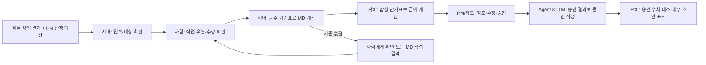

# Agent 3 MVP 아키텍처 — 설계 초안

작성일: 2026-10-29. **목표 설계 및 일부 테스트 구현**. 현재 구현 설명은 [Agent 3 MVP 실행 문서](agent3-mvp.md), 확장 방향은 [최종 목표 아키텍처](agent3-architecture-proposal.md)를 참조한다.

## 계약 기준과 범위

[MVP 사용자 시나리오](https://app.notion.com/p/2dfa8da52356837f8db4812924d44179)는 **가상의 고정가 도급 프로젝트**에서 변경 요청을 다룬다. 금액·MD·기간은 설계 예시다. [필요 데이터 정의](https://app.notion.com/p/26fa8da5235683218782810a08f7ad4c)는 맨먼스는 인력·기간, 도급은 합의된 산출물 기준으로 구분한다. 두 문서는 Notion에서 미검증 상태이므로 확정된 실제 계약 조항으로 취급하지 않는다.

MVP는 고정가 도급의 합의 범위 밖 변경 요청을 대상으로 영향 산정과 내부 협의 초안을 확인한다. MD를 사용하는 것은 내부 공수·금액 **산정 단위**이며 원계약이 맨먼스 계약이라는 의미는 아니다. 가격·유상/무상·발송·최종 합의는 사람이 결정한다.

## MVP 아키텍처 그림

아래는 **구현 목표**다. 현재 준비된 합성 사례별 기준표를 이용한 공수 계산이 구현되어 있다. 작업 확인·범용 기준 적용과 LLM 협의 문안 작성은 아직 구현되지 않았고, 협의안은 코드 템플릿으로 작성한다.

MVP에서는 Git·Jira·Notion 자동 조회와 자율 도구 선택 루프를 필수로 구현하지 않는다.
LLM이 승인 결과로 협의 문안을 작성하는 역할을 우선 검증하고,
도구 선택을 포함한 조사 에이전트는 [최종 목표 설계](agent3-architecture-proposal.md)에서 다룬다.

## 처리 흐름

1. 상위 Agent 1·2 및 PM 검토 결과를 샘플 JSON으로 전달한다. 산정 대상·결과 버전을 확인한다.
2. PM/리드가 확인한 작업 유형·직군·수량을 입력한다. **작업별 공수 기준표가 확보된 경우에만** 해당 버전의 기준 공수와 계산식으로 MD를 계산한다. 미확인 유형이나 기준표가 없으면 필요한 입력을 요청한다. 임시 대안으로 사람이 MD를 입력할 수 있으나 자동 산정된 결과로 표기하지 않는다.
3. 샘플 단가표의 직군별 단가로 MD×단가를 코드에서 계산한다. 원가·판매 제안가·VAT 기준은 구분한다. 실제 단가표는 추후 전달 후 검증해 사용한다.
4. PM/리드가 검토·수정·승인한다. 현재 로컬 검토자는 테스트 참조이며 인증·상업 승인이 아니다.
5. 승인된 최신 결과를 LLM에 전달해 협의안 **문안**을 작성한다. 승인된 범위·공수·금액·일정을 원본으로 대조해 렌더링하고, 검증에 실패하면 재시도 또는 수동 작성으로 넘긴다. 원가/마진을 고객용 문안에 포함할지는 결정 전이며 기본적으로 제외한다.
6. 화면에 내부 초안을 표시·복사한다. 고객 발송·계약 확정·청구는 수행하지 않는다. 일정 산정 근거가 없으면 미산정으로 남긴다.

## MVP 도구

| 도구 | 역할 | 상태 |
|---|---|---|
| 입력·승인 대상 검사 | 상위 PM 검토, 산정 대상, 최신 결과 확인 | 일부 기존 구현, 실제 인증·최신성 계약 미완료 |
| 공수 기준 조회·계산 | 작업 유형·수량·직군 → 기준별 MD와 근거 | 합성 사례별 기준 구현. 범용 기준·산식 미확정 |
| 단가 조회·금액 계산 | 직군 MD·단가 버전 → 원가·제안가 | 기존 JSON 및 `calc_cost` 재사용 후보 |
| 승인 snapshot 검사 | 승인 버전·변경 여부 확인 | 기존 메모리 workflow 참고, 영속 저장 미구현 |
| LLM 문안 생성 | 승인된 결과 → 협의안 문안 | **새로 필요**. 현재는 템플릿 |
| 문안 검증·표시 | 승인 수치와 대조하고 내부 초안 표시 | **새로 필요**. 검증 방식 확정 필요 |

MVP 입력은 샘플 데이터이며 문서 업로드·PDF/엑셀 자동 추출·실제 회사 단가 등록은 후속이다. 별도 서비스 백엔드·인프라는 담당 팀과 계약을 맞춘다.

## 확정이 필요한 사항

- 상세 단가표에 **작업 유형별 기준 공수**가 포함되는지. 없다면 공수 기준표를 별도로 정의해야 한다.
- 작업 분류·수량을 누가 입력하고 검토하는지, 기준 밖 작업을 어떻게 처리할지.
- PM 산정 승인만으로 내부 문안 생성이 가능한지, 상업 승인 후 생성해야 하는지. 고객 전달 권한은 별도다.
- 고객용·내부용 문안의 수치, 일정·질문, 비공개 원가·마진 노출 기준.

## 확인 기준

같은 입력과 공수 기준 버전은 같은 MD, 같은 MD와 단가표 버전은 같은 금액을 반환해야 한다. 누락된 기준/단가는 임의 숫자로 채우지 않는다. 승인 전 초안 차단, 조건 변경 시 재산정·재승인, LLM 문안과 승인 수치 불일치 차단, 모델 오류 시 상태 보존을 검증한다. 실제 사용자 인증·DB 저장과 실제 LLM 품질은 별도로 검증한다.

## 테스트 기준표 구현 현황 (2026-10-29)

`data/kb/effort_rules.json`은 CR-A-001 리뷰·사진 예시에만 적용하는 합성 공수 기준이다. 모델은 작업별 기준 ID를 제안하고 서버는 기준의 MD를 사용해 단가를 곱한다. 모델이 보낸 MD는 사용하지 않는다. 입력이 다르거나 기준 ID·직군이 맞지 않으면 공수와 금액을 산정하지 않고 확인을 요청한다. 기준은 실제 견적에 사용할 수 없다. PM의 사유가 있는 수동 공수 수정은 계속 가능하며 재승인이 필요하다. 기준표 변경 시 기존 산정은 승인할 수 없다. 실제 기준표 확장 및 LLM 협의 문안 생성은 후속 작업이다.

### 합성 요청 30건 화면 테스트

`prototype/data/agent3-samples.json`의 Agent 1·2와 PM 합성 결과를 각 요청의 Agent 3 입력으로 사용한다. 실제 상위 에이전트 호출은 없다. `data/kb/effort_example_rules.json`은 검수 전 AI 작성 참조값을 개별 사례에만 묶은 테스트용 공수로 실제 견적에 쓰지 않는다. 산정 대상으로 선택되지 않은 사례는 NOT_REQUIRED, 산정 불가 예시는 WAITING_INPUT을 반환한다. `python prototype/run_demo.py --lab --port 8771`로 실행하면 사례별 가상 응답과 Gemini를 선택할 수 있다. 실제 Gemini는 질문·결과가 달라질 수 있다.
