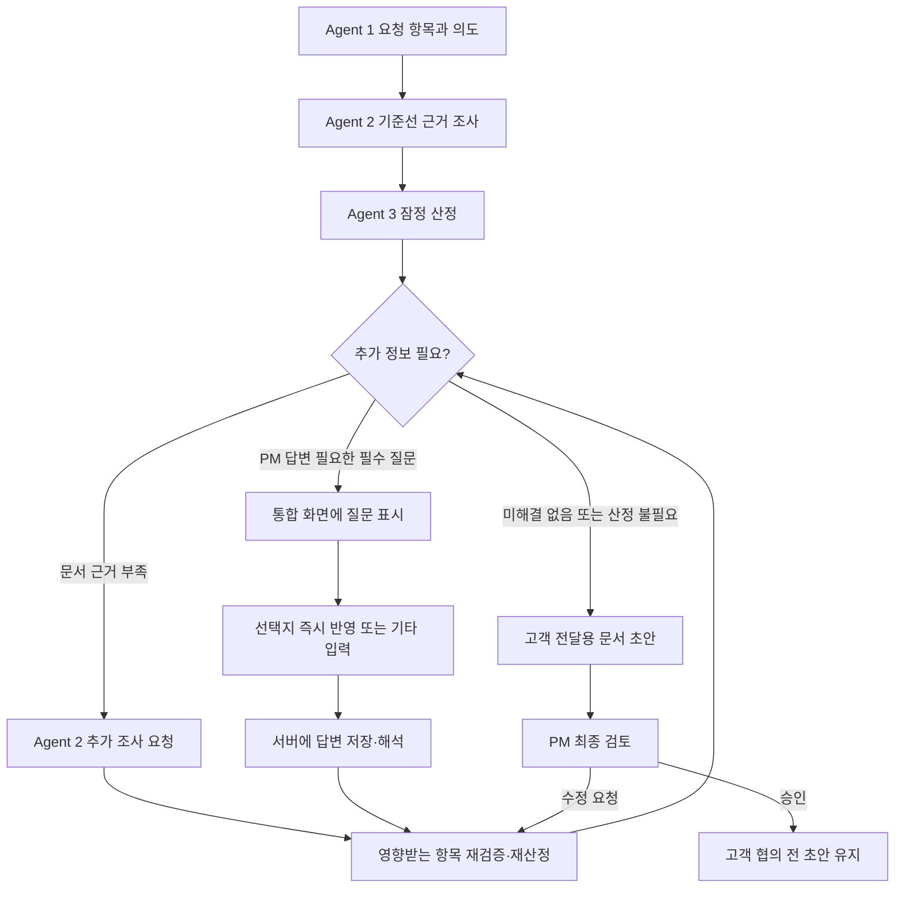

# Agent 3 오케스트레이션 연동 보완 구현 계획

- 작성일: 2026-11-09
- 상태: **구현 계획 / 팀 협의 필요**. 공통 계약이나 담당자의 작업 범위가 확정되었다는 뜻은 아니다.
- 범위: 통합 요청 분석에서 Agent 3 산정·추가 조사·PM 질문·재산정·고객 문서 초안 연결.
- 참고: [Agent 3 연동 계약 제안](orchestration-integration-contract-v1.md), [Agent 3 도구](orchestration-tools.md), [통합 요청 분석 계획](../prototype/integrated-request-analysis-plan.md), [MVP 아키텍처](architecture-mvp.md).

## 1. 목표와 현재 막히는 지점

PM이 통합 요청 분석 화면에서 필요한 질문에 답하고, 산정과 고객 전달용 초안 작성까지 진행 상황을 이어서 확인한다. **가능한 경우 근거 문서를 먼저 조사하고**, 문서로 해소할 수 없는 필수 질문만 PM에게 묻는다. PM은 잠정 결과와 초안을 마지막에 검토한다. 고객 발송·합의·서명은 별도다.

2026-11-09 실제 GPT 합성 요청 테스트에서 Agent 3은 8.5 MD·판매가 550만 원을 계산했지만 `NEEDS_INPUT`을 반환했다. 리뷰 기능에 관한 **후속 서면 변경합의서가 있는지** 확인해야 한다는 필수 질문이 있었고, 사진 저장 재사용과 구매자 확인 방식도 확인 사항으로 제시됐다. 이 금액과 기준은 실제 견적이 아닌 합성 테스트 값이다.

현재 통합 화면은 산정 응답을 받으면 결과를 보여주지만, 필수 질문을 그 자리에서 답변받아 재개하지 못한다. 최종 확인 시 추가 확인이 필요하다는 안내만 나온다. 기존 영향 산정 상세 화면은 통합 결과의 **읽기 전용 조회**라 개별 승인 버튼이 비활성화된다. 따라서 상세 화면으로 이동해 승인하는 것이 해결 방법은 아니다. 통합 화면의 고객 문서 초안 생성도 아직 연결되지 않았다.

### 현재 구현과 구분

| 영역 | 현재 확인한 상태 | 남은 연결 |
|---|---|---|
| 공통 실행 | `Engine`은 Agent 1 → PM 항목 확인 → Agent 2 → PM 검토 → Agent 3 → 리드 검토 순의 결정적 흐름을 제공 | Agent 3의 잠정 경로 및 필요한 질문·문서 생성 연동. 현 코드를 LLM 오케스트레이터 루프로 간주하지 않는다 |
| 질문·답변 | 공통 엔진에 질문 저장과 답변 API가 있고, Agent 3 `NEEDS_INPUT`이면 `WAITING_INPUT`으로 멈춤 | 통합 UI 연결, 답변 해석과 Agent 3 재실행 검증 필요 |
| Agent 3 | 별도 잠정 산정·재산정·문서 생성 서비스와 adapter·제안 계약이 있음 | 실제 공통 상태 포트·Agent 1/2 결과 변환·실행 흐름 연결 필요. 단독 서비스 구현을 통합 완료로 보지 않는다 |
| PM 질문 UI | 기존 확인창의 일반 선택 즉시 반영과 기타 입력 표시는 별도 작업 브랜치에서 수정 중 | 해당 UI 변경과 실제 질문 답변·재개 연동은 별개 |
| 고객 문서 | Agent 3의 문서 생성 도구가 별도로 있음 | 통합 흐름의 최신 산정 결과로 생성·조회하고 최종 검토에 묶기 |

## 2. 목표 흐름



그림은 **목표 동작**이다. 질문이 답변만으로 자동 해소되거나 모든 요청에 산정·변경합의서가 필요하다는 뜻은 아니다. 실제 다음 행동은 공통 상태와 허용 조건을 기준으로 결정한다.

## 3. 단계별 구현 계획

### 1단계 — 질문과 진행 상태를 통합 화면에 노출

- **Agent 3:** 필수 질문과 `needs`의 출처·대상·연결 항목·질문 ID·차단 여부를 반환하고, 기술 오류와 정보 부족을 분리한다. 기존 잠정 산정 서비스 결과를 먼저 재사용한다.
- **공통 오케스트레이션:** 실행 결과의 실제 단계·상태, 질문, 답변 가능 여부를 통합 화면이 조회할 수 있게 한다. 이미 완료된 Agent 1·2 결과와 요청 버전을 유지한다.
- **화면:** `NEEDS_INPUT`을 최종 검토 대기로 표시하지 않고, 진행 기록 안에 해결해야 할 질문과 다음 행동을 표시한다. 문서에서 먼저 확인해야 하는 사항과 PM이 답할 질문을 구분한다. 최종 확인 불가 이유를 보여준다.
- **질문창:** 일반 선택지는 한 번 누르면 반영하고, 기타를 고른 경우에만 입력란과 제출 버튼을 보여준다. 실제로 지원하지 않는 자동 수정·재실행은 완료된 것처럼 표시하지 않는다.
- **완료 기준:** 위 리뷰 예시에서 산정 결과와 필수 질문이 통합 화면에 함께 표시되고, 상세 화면의 비활성 승인 버튼으로 사용자를 유도하지 않는다. 답변 UI가 아직 서버에 연결되지 않았다면 미연결을 명시한다.

### 2단계 — 답변 저장·해석·재개

- **공통 오케스트레이션:** 케이스·질문 ID·답변·현재 `state_revision`을 검증해 저장한다. 중복 제출, 다른 케이스 질문, 오래된 버전은 구분해 처리하고 기존 기록을 보존한다. 답변 등록과 질문 해결은 별도 상태다.
- **Agent 3:** 답변이 계약 근거, 요청 범위, 작업 규모·가정, 공수 기준 중 무엇을 바꾸는지에 따라 재조사·재산정·기준 보완을 요청한다. 해결되지 않은 질문은 열린 상태로 유지한다.
- **Agent 1·공통 계약 확인:** 현재 `Engine.answer_question()`은 Agent 1의 답변 분석을 호출하고, 현재 Agent 1 구현은 재실행 시작점을 주로 Agent 1 또는 Agent 2로 반환한다. **Agent 3 질문에 대한 답변만으로 Agent 3 재실행이 보장되지 않는다.** 질문 소유자와 영향 범위에 따른 `agent3` 재실행 결정 및 결과 갱신을 관련 담당자와 합의한다.
- **화면:** 일반 선택은 즉시 전송, 기타는 입력 후 전송한다. 처리 중 중복 클릭을 막고 성공·실패 및 재시도 상태를 표시한다. 제출 실패 시 사용자의 답변을 보존한다.
- **완료 기준:** 같은 테스트 질문에 PM이 답하면 서버에 질문·답변 연결이 남고, 필요한 재조사/재산정 이후 최신 결과 또는 남은 질문이 나온다. 답변이 모호하면 해결 처리하지 않는다.

### 3단계 — Agent 2 추가 조사와 부분 재산정

- `more_evidence`는 바로 PM에게 묻지 않고 Agent 2에 대상 항목과 조사 주제를 전달하는 경로를 우선 검토한다. `focus` 인자와 공통 `needs` 형식은 Agent 2·오케스트레이션 담당자와 합의한다.
- Agent 2의 변경된 결과 ID·검증된 인용·기준선을 반영해 영향받은 Agent 3 항목을 재산정한다. 공유 작업·공유 질문이 있으면 연관 항목까지 재검증한다.
- 전역 조건, 공수 기준, 기준선 변경 등 부분 재산정이 안전하지 않은 경우 전체 재산정을 요구한다. 기존 결과와 이전 문서는 이력으로 두고 현재 승인은 무효화한다.
- **완료 기준:** 한 항목의 근거가 보완될 때 관련 없는 결과가 보존되고, 근거가 여전히 부족하면 확인 대기로 남는다. 늦게 도착한 구 버전 결과는 최신 상태를 덮어쓰지 않는다.

### 4단계 — 고객 전달용 문서 초안과 최종 검토

- 최신 잠정 산정과 Agent 2 근거를 공통 상태에서 받아 Agent 3의 문서 생성 도구와 연결한다. 변경 요청은 고객 협의 메일과 변경합의서 초안을, 단순 범위 확인은 확인 답변을 우선한다. 혼합 요청은 문서 범위를 팀과 합의한다.
- 실제 문서가 없는 동안 가상 문구를 결과로 표시하거나 최종 초안이 만들어졌다고 말하지 않는다. 수치·날짜는 검증된 서버 결과에서 가져오고 내부 원가·마진을 고객 문서에서 제외한다.
- PM의 질문 답변과 **최종 승인**을 구분한다. 현재 공통 엔진의 `lead_review`와 Agent 3 독립 세션의 검토·승인은 자동으로 서로 대체하지 않는다. 어떤 상태·snapshot을 단일 최종 검토로 승인할지 공통 담당자와 합의해 연결한다.
- PM이 수치·문구를 수정하면 해당 결과와 초안을 최신 버전으로 갱신하고 이전 승인 효력을 해제한다. 고객 발송·서명·합의·청구는 자동 처리하지 않는다.
- **완료 기준:** PM이 통합 화면에서 실제 초안을 확인하고 수정 또는 승인할 수 있으며, 승인 대상은 동일 버전의 근거·산정·문서 묶음이다.

### 5단계 — 운영에 가까운 예외 처리와 진행 표시

- 정보 부족은 실패가 아니라 조사·질문 대기로 표시한다. 모델 인증·할당량·타임아웃, 응답 형식 오류, 검색 실패, 기준표 누락, 버전 충돌은 원인과 재시도 가능 여부를 구분한다.
- 공통 엔진에는 출력 검증 실패 1회 재요청과 설정 기반 재시도 처리가 일부 있다. 현재 동작을 검증하고 중복 재시도·무한 루프·외부 호출 중복을 막는 공통 정책을 합의한다.
- 사용자에게는 실제 시작·완료·질문·실패 이벤트를 단계별로 보여준다. 모델 내부 사고과정을 그대로 노출한다고 가정하지 않는다.
- MVP의 메모리 상태는 서버 재시작 시 사라질 수 있다. 지속 저장·다중 워커·백엔드 복구는 별도 연동 과제이며 현재 완료된 것으로 표시하지 않는다.

## 4. Agent 3 담당과 팀 협의 경계

| 구분 | 우선 담당·논의 내용 |
|---|---|
| Agent 3 쪽 | `NEEDS_INPUT`/`needs`와 질문 매핑, 잠정 산정·문서 도구 재사용, 답변 반영 후 재산정, 계산·초안 검증, 관련 테스트 |
| 공통 오케스트레이션 | 상태·질문·답변·결과 버전, 실제 Agent 3 adapter/state port 연결, 재개·중복 호출·오류 처리, 최종 검토의 소유권 |
| Agent 1 | 질문 답변 분석과 항목 변경·영향 범위·재실행 단계 계약 |
| Agent 2 | 추가 조사 대상·`focus` 계약, 최신 기준선·인용 검증·부분 결과 전달 |
| 프론트 | 통합 질문 표시·원클릭/직접 입력·처리 중/실패·재개와 실제 문서 표시. 기존 개별 테스트 화면은 유지 |
| 업무 백엔드 | 향후 인증·영속 저장 및 사용자/업무 기록 연동 계약. AI 서버에서 가능한 상태·검증 구현을 선행할 수 있으나 책임 경계는 팀 합의 |

같은 파일이나 공통 DTO를 수정할 가능성이 있으므로 담당자 작업 브랜치와 계약을 먼저 확인한다. Agent 3 측 제안은 팀 공통 확정 규격이 아니다.

## 5. 우선순위와 검증 시나리오

1. **P0 — 질문 표시·답변 재개 계약 확정:** 위 GPT 사례를 재현하고 `WAITING_INPUT`의 질문/상태/답변·버전 연결을 먼저 확인한다.
2. **P0 — 필수 질문 답변 후 재실행:** 실제로 질문이 해결되는지, Agent 3 결과가 새 버전으로 갱신되는지 확인한다. 미해결 시 승인 차단을 유지한다.
3. **P1 — Agent 2 재조사와 부분 재산정:** 문서 조사 우선, 다항목·공유 작업·구 버전 충돌을 확인한다.
4. **P1 — 고객 문서 초안 및 PM 최종 검토:** 변경·범위 확인·혼합과 산정 대상 없음, 숫자 출처·내부 정보 제외를 검증한다.
5. **P2 — 오류·진행 표시 및 저장 연동:** 기술 실패와 업무 대기 구분, 재시도 한도, 재시작 복구 책임을 점검한다.

공통 검증: 일반 선택 1회와 기타 입력, 중복 클릭, 빈 답변, 미해결 답변, 질문 여러 건, 공유 질문, 산정 대상 없음, 일부 미산정, 만료 버전, 공급자 오류, 문서 없음 및 문서 변경 후 재검토. 먼저 모의 모델·고정 데이터로 반복 검증하고, 실제 GPT/Gemini 테스트는 합성 입력·허용된 기준선 및 호출 범위를 확인해 별도로 실행한다.

## 6. 팀에 확인할 결정 사항

1. 공통 상태·DTO는 누가 소유하고, Agent 3 세션 ID·결과 버전·질문·답변을 어떤 필드로 연결하는가?
2. Agent 3 질문에 대한 답변이 들어오면 어느 담당이 해결 여부와 재실행 범위를 결정하는가? 기존 `answer_question`과 잠정 Agent 3 adapter 중 어떤 경로를 사용할 것인가?
3. Agent 2 추가 조사의 입력(`focus`, 항목 ID)과 결과 병합 방법은 무엇인가?
4. PM 마지막 검토의 승인 주체와 저장 API는 무엇이며, 기존 개별 Agent 3 승인과 어떻게 구분할 것인가?
5. 최초 연결에서 실제 변경합의서·메일 중 무엇을 생성하고 어떤 조건에서 생성할 것인가?
6. 모델 선택·실행 상태·질문 이력·재시작 복구를 AI 서버와 업무 백엔드가 어디까지 맡을 것인가?

## 7. 클라우드팀 API 명세 대조 — 2026-11-09

출처: 팀에서 공유한 백엔드 HTTP API·Facade 명세와 `weave-backend`의 `dev` 체크아웃 `9cc6ec0`. 코드 확인: [질문·답변 API](https://github.com/Weave-B2B/weave-backend/blob/9cc6ec0/src/main/java/com/weave/changerequest/controller/ReviewQuestionController.java), [질문 저장 요청](https://github.com/Weave-B2B/weave-backend/blob/9cc6ec0/src/main/java/com/weave/changerequest/dto/SaveReviewQuestionsRequest.java), [AI 분석 컨트롤러](https://github.com/Weave-B2B/weave-backend/blob/9cc6ec0/src/main/java/com/weave/common/ai/controller/AiAnalysisController.java), [영향 산정 컨트롤러](https://github.com/Weave-B2B/weave-backend/blob/9cc6ec0/src/main/java/com/weave/estimate/controller/EstimateController.java). 공유 명세의 팀 접근 링크는 확인 후 추가한다. 확인 시점이 다른 자료이므로 실제 배포 상태나 최신 원격 브랜치 구현 완료의 증거는 아니다.

### 7.1 질문·답변: 기존 CR-15 사용 검토

- 명세의 B/CR-15는 `PUT /api/v1/projects/{projectId}/change-requests/{changeRequestId}/review-versions/{reviewVersionId}/questions`이다. 요청은 `expectedItemRevision`, `expectedQuestionRevision`, `reason`, 저장 후 유지할 **질문 전체 목록** `questions`를 받는다. 각 질문은 기존 `questionAnswerId`, 선택적 `requestItemId`, `question`, 선택적 `answer`를 사용한다.
- 성공 응답은 검토 상세와 `questionRevision`, 질문 상태·답변 이력을 반환한다. 409에는 `CR_ITEMS_OUTDATED`, `CR_QUESTIONS_OUTDATED`, 동결·구버전 오류가 있다. 최신 항목·질문을 다시 조회하고 충돌을 알리는 방식으로 처리한다. 빈 목록이나 일부 목록을 무심코 PUT하면 다른 질문이 제외될 수 있으므로, 단건 추가 API처럼 호출하지 않는다.
- `ANSWERED`는 답변이 저장됐다는 뜻이다. Agent 3 블로킹 질문 해소, 산정 가능·승인 가능 또는 AI 재개를 자동으로 뜻하지 않는다. 공통 엔진의 `POST /cases/{case_id}/questions/{question_id}/answer`는 **별도 AI 서버의 로컬 실행 API**다. 두 API를 현재 같은 계약으로 보지 않는다.
- 검토 상세 조회 및 충돌 후 최신 목록 조회 경로를 확인하고, BE UUID(`projectId`, `changeRequestId`, `reviewVersionId`, `requestItemId`, `questionAnswerId`)와 AI `case_id`·`item_id`·`question_id`의 대응을 정해야 한다. 기존 명세의 UUID와 AI 내부 테스트 식별자를 임의로 동일시하지 않는다. 여러 항목에 걸친 AI 질문과 BE의 단일 `requestItemId`·버전 전체 질문 간 매핑도 협의가 필요하다.
- 로컬 `ReviewQuestionController`에는 CR-15 PUT이 존재한다. 제품 연동에서는 FE→BE의 인증·회사/프로젝트 권한과 검토 버전 정책을 거치고, BE가 검증된 답변을 전달하는 방식을 합의한다. 프로토타입의 브라우저→AI 직통 경로를 정식 BE 인증으로 취급하지 않는다.

### 7.2 단가표: A-30~33의 실제 구조 사용

- 명세상 `GET /api/v1/projects/{projectId}/rate-cards/current`는 `currentRateCard` 또는 `null`을 반환하고, A-32는 버전 상세를 반환한다. `rateCardVersionId`는 UUID, `hoursPerMd`, `rateCurrency`, `roleRates[].jobRoleCode`, `internalRate`, `sellingRate`가 명시돼 있다. 명세는 단가가 **1 MD 기준**이라고 설명한다.
- Agent 3에 넣을 때 BE 버전 UUID·통화·직군 코드·원가/판매가를 분명하게 보존한다. `currentRateCard: null`, 누락 직군, 다른 통화, 0원과 미설정을 구분하고, 단가표 부재를 0원으로 처리하지 않는다. `hoursPerMd`는 명세상 값으로 보존하되 임의 시간 환산이나 반올림 규칙을 추가하지 않는다.
- 현재 AI 서버의 합성 기준표와 BE 응답은 형식·ID 체계가 다르다. 어댑터와 공식 산식의 소유자·공유 방식, 소수점 반올림·검증, 동결된 산정 버전의 단가 snapshot을 합의한 뒤 연결한다. 아직 BE 단가 조회를 AI 서버에서 실행하거나 공식 계산이 연동된 것은 아니다.

### 7.3 초안 작업과 공통 AI 작업 상태

- E-01 `POST /api/v1/agreements/proposal-ai-jobs`는 `reviewVersionId`와 선택적 `inputHash`를 받아 `202`와 `aiAnalysisId`, `status`를 반환한다. 명세상 최신 **동결된** 검토 버전과 항목별 C의 PM 확정 판단이 필요하고, `UNCLEAR`가 있으면 등록할 수 없다. `202`는 초안 생성 완료가 아니다.
- 사용자가 원한 통합 흐름의 **중간 승인 최소화·잠정 초안**과 E-01의 현행 동결·PM 확정 전제는 그대로 자동 치환할 수 없다. 잠정 초안을 AI 내부에만 보관할지, BE의 공식 협의안 작업으로 언제 전환할지 E·공통 오케스트레이션 담당과 정책을 정한다. 현재 Agent 3 잠정 문서와 E의 공식 협의안 버전을 동일시하지 않는다.
- 명세는 G-17 상태·결과 조회, G-12 재시도, G-13 실패 목록 REST를 미구현으로 표시한다. 로컬 코드에서도 `AiAnalysisController`는 엔드포인트가 없는 상태다. `AiAnalysisFacade`의 `request`/`complete`/`fail`은 **Java BE 내부 메서드**이며 Python AI가 직접 호출할 HTTP API가 아니다.
- C-01 설명에서는 AI 연동 전 분석이 `QUEUED`에서 멈출 수 있다고 명시한다. BE 작업 접수·AI 실행·결과 수신·저장 연결은 확인되지 않았으며, 큐 또는 HTTP 전달·콜백·멱등 키와 결과 스키마를 추측해 구현하지 않는다. 202/QUEUED/PENDING을 완료나 초안 생성으로 표시하지 않는다.

### 7.4 API 연결 전 순서와 검증

1. 우선 로컬 AI 프로토타입에서 질문 표시·답변 후 재개를 독립적으로 검증한다. 이 로컬 기능을 CR-15 저장이나 BE 공식 승인이라고 표시하지 않는다.
2. BE 검토 상세의 조회·수정 revision과 CR-15 전체 목록 교체 의미, AI 질문 ID↔BE UUID 대응·다중 항목 질문 표현을 담당자와 확정한다. 질문 저장 성공 뒤 AI 재개 실패 시 재시도·중복 방지 정책도 정한다.
3. A-30/32 응답→AI 단가 모델 변환을 합의하고 정상·단가표 없음·직군 누락·0원·통화 불일치·기준 버전 변경을 계약 테스트한다. 실제 공식 산식·소수점·스냅샷을 검증한다.
4. E-01 동결·확정 조건과 잠정 초안 정책을 합의한다. BE가 실제 실행을 전달하고 결과를 수신·조회하는 API 또는 큐 계약이 제공된 뒤 통합한다.
5. FE에서 질문 대기→BE 답변 저장→AI 재개→결과 재조회, 버전 충돌·중복 전달·오래된 결과·서버 재시작·권한 거부를 양 서버와 함께 테스트한다.

**현 단계에서 코드를 통해 BE 연동이 완료됐다고 주장할 수 없다.** 명세는 Agent 3 연동 설계를 구체화하기에 충분하지만 D 상세, AI 작업 전달·결과 수신, 식별자 대응, 잠정 초안의 공식 업무 반영 조건은 여전히 확인이 필요하다.

## 8. Agent 2 추가 조사 전달 초안 및 로컬 구현 메모

Agent 2에 이미 `assess_scope` 어댑터가 있으며, 도구 인자는 `item_ids`와 선택적 `focus`다. Agent 3은 직접 Agent 2를 호출하지 않는다. 아래는 **오케스트레이터가 선택할 행동의 초안**이다.

```json
{
  "action": "assess_scope",
  "args": {
    "item_ids": ["CR-A-001-1"],
    "focus": "리뷰 기능에 관한 변경합의서 존재 여부"
  },
  "reason": "산정에 필요한 계약 근거를 추가 확인합니다."
}
```

- Agent 3의 `more_evidence`에서 `item_ids`와 `topic`을 읽어 Agent 2의 `item_ids`와 `focus`로 변환한다. `app/orchestration/evidence_handoff.py`는 현재 케이스 항목을 검사하고 이 **제안 행동만 생성**한다. 다른 종류의 `needs`, 다른 케이스 항목, 중복 ID는 거부한다. 기준선·권한·모델·상태 버전은 도구 인자가 아니라 신뢰된 호스트가 공급한다.
- Agent 2 어댑터는 판정 요약·근거 개수·결과 ID·추가 필요 정보와 기술 오류를 반환하고, 전체 근거를 상태에 저장하는 인터페이스를 제공한다. 오케스트레이터는 조사 결과가 실제로 대상을 해소하는지 판단하고 필요한 경우 Agent 3을 재호출한다. 조사 실패나 근거 없음은 해소로 간주하지 않는다.
- 2026-11-09 로컬 구현에서 Agent 3 질문에 PM이 직접 답하는 경로와 답변 후 Agent 3 재산정, 새 질문의 식별자 분리, 위 제안 형식과 실제 Agent 2 어댑터 간 계약 테스트를 추가했다. 공통 실행 엔진에서는 기존 순차 워크플로를 사용한다.
- **아직 연결되지 않은 것:** 공통 상태 포트에 Agent 2·3 어댑터를 붙여 오케스트레이터 에이전트가 `needs`를 읽고 조사 도구를 실제 자동 호출하는 루프, 조사 결과 후 Agent 3 부분 재산정, 공식 BE 저장·인증, 고객 문서 통합 생성. 기존 순차 엔진의 `more_evidence`는 확인 필요 신호로 화면에 표시하고, 미구현 자동 조사나 PM 승인 완료로 가장하지 않는다.
- 추가 협의: `focus` 의미·길이, `item_ids`와 질문 범위, 근거·인용 검증과 답변 반환, 오래된 기준선·버전 충돌, 반복 조사 한도와 unresolved/오류 구분. 팀 공통 DTO로 확정되면 이 초안을 그 계약에 맞춰 리팩터링한다.

### 2026-11-09 통합 메일 초안 연결

로컬 공통 엔진의 현재 산정 결과로 고객 협의 메일을 생성하는 `POST /cases/{case_id}/email-draft`를 추가했다. 요청은 공통 상태 revision과 Agent 3 결과 ID를 확인하며, 필수 질문·미산정이 남거나 결과·기준이 바뀌면 생성하지 않는다. LLM은 연결 문장만 작성하고 공수·고객 제안가·일정은 서버 결과에서 삽입한다. 초안은 고객 합의·발송 전이며, 공식 BE 저장과 인증, 변경합의서 생성은 미연결이다. 이 기능은 로컬 테스트용이며 여러 항목의 별개 산정 결과가 중복 작업을 포함할 수 있으므로 PM이 합산 전에 작업 범위를 확인해야 한다.
