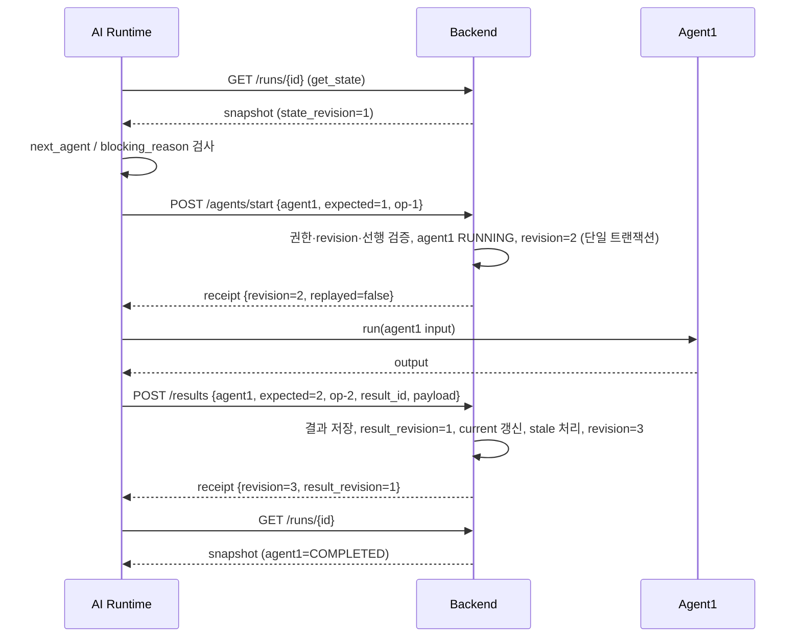
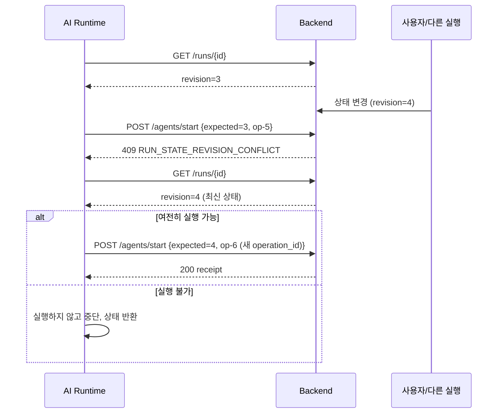
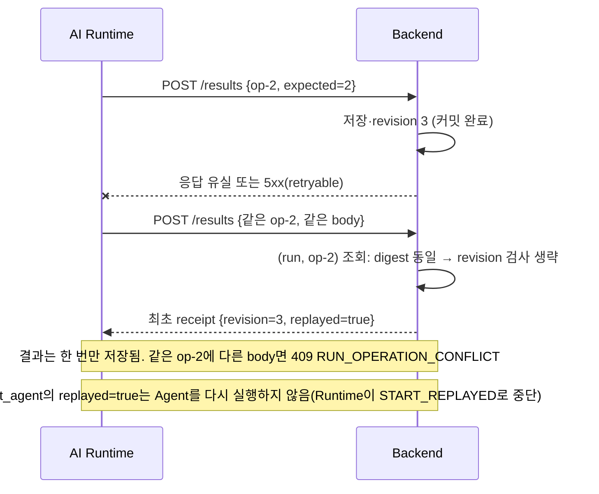
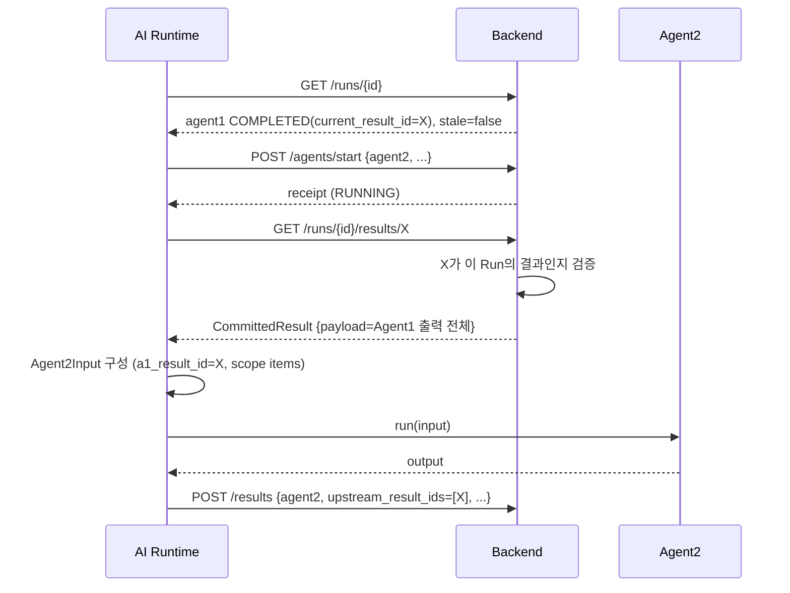

# Backend API 계약 명세 초안 (AI Server ↔ Backend Run 상태 관리)

- 상태: **초안 / 미합의**. Backend에는 이 문서의 API가 하나도 구현되어 있지 않다.
- 작성 기준: `weave-ai-agent`(브랜치 `fix/#20-orchestration-dto`) 코드와 `weave-backend`(`feat/#59`) 소스를 직접 읽고 작성.
- 표기 규칙
  - **[확인]** 코드에서 직접 확인한 사실
  - **[제안]** 설계상 제안(합의 전까지 확정 아님)
  - **[미확인]** 읽지 못했거나 코드에 없어 알 수 없음
- 이 문서는 코드 변경 없이 작성했다. `FakeRunStateClient`는 계약의 기대 동작을 고정하는 테스트 도구이며 Backend 구현의 증거가 아니다.
- 관련 문서: [dto-integrated-design.md](./dto-integrated-design.md)

---

## 1. 문서 목적 및 범위

목적: AI Server의 `RunStateClient` Protocol(6개 메서드)에 대응하는 Backend API 초안을 만들고, 기존 Backend 구조와의 차이·재사용 가능성·합의 필요 사항을 정리한다.

범위 안
- Protocol 6개 메서드에 대응하는 AI Server 전용 API 초안
- 상태 전이, revision, 멱등성, 오류 매핑, stale 전파, RUNNING 복구, 인증 제안
- Protocol에는 없지만 Backend 연동에 필요한 API 식별(§6-2)

범위 밖: Backend 구현, DB 스키마 변경, AI Server HTTP client, Protocol·Runtime·Fake 변경, 화면(프론트) API 상세, Supervisor.

## 2. 시스템 책임 분리 (확정된 아키텍처 기준)

| 주체 | 책임 |
|---|---|
| Backend | Run 식별·생성, 상태와 `state_revision` 영속, Agent별 current/stale, 결과·수정 이력 저장, 권한·상태 전이 검증, 멱등성 |
| AI Server | 실행 순서 결정(Runtime, 이후 Supervisor), Agent 호출, 재시도, 검토 대기 시 중단·재개 판단 |
| 공통 규칙 | Backend는 실행 순서를 제어하지 않는다. AI Server는 Run의 최종 상태를 독자 영속하지 않는다. 커밋된 결과만 다음 Agent 입력으로 쓴다. |

## 3. AI Server 현재 Protocol 분석 (모두 [확인], `app/orchestration/run_state.py`)

### 3-1. 메서드와 DTO

| 메서드 | 요청 | 응답 | 비고 |
|---|---|---|---|
| `get_state(run_id)` | `run_id: str` | `RunStateSnapshot` | |
| `get_result(run_id, result_id)` | 2개 str | `CommittedResult` | 3단계에서 추가 |
| `start_agent(req)` | `StartAgentRequest` | `StateChangeReceipt` | 3단계에서 추가 |
| `commit_result(req)` | `CommitResultRequest` | `StateChangeReceipt` | |
| `record_edit(req)` | `RecordEditRequest` | `StateChangeReceipt` | |
| `request_review(req)` | `RequestReviewRequest` | `StateChangeReceipt` | |

공통 타입: `Stage = "agent1"|"agent2"|"agent3"`, `RunStatus = "QUEUED"|"RUNNING"|"WAITING_INPUT"|"WAITING_PM_REVIEW"|"COMPLETED"|"FAILED"` (`schema/schemas.py`), `AgentExecutionStatus = "NOT_STARTED"|"RUNNING"|"COMPLETED"|"FAILED"|"SKIPPED"`, `ResultExecutionStatus = "COMPLETED"|"FAILED"`. 모든 DTO는 `extra=forbid`.

**RunStateSnapshot**

| 필드 | 타입 | 필수 | 규칙 |
|---|---|---|---|
| `run_id` | str | O | |
| `state_revision` | int ≥ 0 | O | |
| `status` | RunStatus | O | Run 전체 상태 |
| `agents` | `{agent1,agent2,agent3: AgentState}` | O | 세 키가 모두 있어야 함 |
| `pending_review` | PendingReview \| null | X | |

**AgentState**: `status`(기본 NOT_STARTED), `current_result_id`(null 가능), `result_revision`(≥1, null 가능), `upstream_result_ids`(기본 []), `stale`(기본 false). 규칙: `current_result_id`와 `result_revision`은 함께 있거나 함께 없다. `COMPLETED`는 `current_result_id` 필수.

**PendingReview**: `agent_type: Stage`, `target_result_id: str|null`, `reason: str`.

**StartAgentRequest**: `run_id`, `agent_type: Stage`, `expected_state_revision: int≥0`, `operation_id: str(min 1)`.

**CommitResultRequest**: `run_id`, `expected_state_revision`, `operation_id`, `agent_type`, `result_id: str`, `execution_status`(기본 COMPLETED), `upstream_result_ids: list[str]`(기본 []), `result_payload: dict`, `requested_run_status: RunStatus`(기본 "RUNNING").

**CommittedResult**: `run_id`, `agent_type`, `result_id`, `result_revision ≥1`, `execution_status`, `upstream_result_ids`, `result_payload: dict`, `created_at: datetime`, `is_current: bool`(조회 시점에 현재 포인터인지). (`created_at`·`is_current`는 D-9로 추가됨)

**RecordEditRequest**: `run_id`, `expected_state_revision`, `operation_id`, `agent_type`, `target_result_id: str`, `new_result_id: str(min 1)`, `edited_by: str`, `edited_payload: dict`, `reason: str|null`. 수정은 새 result revision 커밋이며 응답 `StateChangeReceipt`에 새 `result_id`·`result_revision`이 담긴다. (D-5로 변경됨. 이전 `changes: dict`는 제거됨. 수정 시각은 Backend가 부여한다.)

**RequestReviewRequest**: `run_id`, `expected_state_revision`, `operation_id`, `agent_type`, `target_result_id: str|null`, `reason: str`, `kind: "PM_REVIEW"|"INPUT"`(기본 PM_REVIEW, D-1로 추가). `PendingReview`에도 같은 `kind`가 있다. (요청자 필드는 **없다**.)

**StateChangeReceipt**: `run_id`, `operation_id`, `state_revision`, `status`(RunStatus), `result_id`(null 가능), `result_revision`(null 가능), `replayed: bool`(기본 false).

### 3-2. 오류 계층과 재시도 ([확인])

| 예외 | code | retryable | 의미 |
|---|---|---|---|
| `RunNotFound` | `RUN_NOT_FOUND` | false | |
| `ResultNotFound`(RunNotFound의 하위) | `RESULT_NOT_FOUND` | false | |
| `StateRevisionConflict` | `STATE_REVISION_CONFLICT` | false | `expected_revision`/`actual_revision`(선택) 보유. 재조회 후 새 operation_id |
| `OperationConflict` | `OPERATION_CONFLICT` | false | 같은 operation_id에 다른 요청 |
| `InvalidStateTransition` | `INVALID_STATE_TRANSITION` | false | |
| `StatePersistenceError` | `STATE_PERSISTENCE_ERROR` | **true** | 같은 operation_id로 재시도 |

Runtime의 재시도 정책 ([확인], `runtime.py`): 저장 실패는 같은 operation_id로 최대 3회, revision 충돌은 재조회 후 새 operation_id. HTTP 오류 중 위 6가지로 매핑되지 않는 것(401/403/400/네트워크)은 현재 Protocol에 대응 예외가 없다 → §11.

### 3-3. Fake가 고정한 동작 ([확인], `fake_run_state.py`)

계약 후보 동작이지만 Backend와 합의되기 전이므로 **합의 대상**이다.

1. **멱등성**: `operation_id`별로 `(요청 digest, 최초 receipt)`를 저장한다. digest는 요청 타입명 + 요청 JSON(`expected_state_revision` 제외)의 sha256이다. 같은 operation_id·같은 digest면 **revision 검사 전에** 최초 receipt를 `replayed=True`로 반환한다. digest가 다르면 `OperationConflict`.
2. **CAS**: `expected_state_revision != 현재` → `StateRevisionConflict`. 쓰기마다 revision이 정확히 1 증가한다(`record_edit`, `request_review`, `start_agent` 포함).
3. **Run 상태 전이표** `_ALLOWED`: QUEUED→{RUNNING,FAILED} / RUNNING→{RUNNING,WAITING_INPUT,WAITING_PM_REVIEW,COMPLETED,FAILED} / WAITING_INPUT→{RUNNING,FAILED} / WAITING_PM_REVIEW→{RUNNING,FAILED} / COMPLETED→{RUNNING} / FAILED→{RUNNING}.
4. **start_agent**: 대기 상태(WAITING_* 또는 pending_review 존재), Agent가 이미 RUNNING, 선행 Agent가 COMPLETED가 아니거나 stale이면 `InvalidStateTransition`. 통과하면 해당 Agent와 Run을 RUNNING으로 전이한다. 기존 결과 포인터는 유지.
5. **commit_result**: `requested_run_status` 전이를 검사한다. COMPLETED면 새 `AgentState`(stale=false)를 만들고 `result_revision = 해당 agent의 누적 커밋 수 + 1`을 Backend가 부여한다. FAILED면 Agent 상태만 FAILED로 바꾸고 **기존 포인터 유지**, Run 상태는 요청값과 무관하게 FAILED. 둘 다 `pending_review`를 비운다. 결과(성공·실패 모두)를 `result_id`로 저장한다.
6. **record_edit**: `target_result_id`가 해당 Agent의 현재 결과가 아니거나, Agent가 RUNNING이거나, `new_result_id`가 이미 쓰였으면 `InvalidStateTransition`. 새 result revision(`n+1`)을 만들어 `current_result_id`를 옮기고 stale=False로 두며, 결과가 있는 하위 Agent를 stale로 표시한다. 수정본은 대상 결과의 `upstream_result_ids`를 이어받는다. Run 상태·`pending_review`는 바꾸지 않는다.
7. **request_review**: Run 상태가 RUNNING일 때만 가능. `kind=PM_REVIEW`(기본)는 `WAITING_PM_REVIEW`, `kind=INPUT`은 `WAITING_INPUT`으로 전이하고 `pending_review`(kind 포함)를 저장한다. Agent 상태는 바꾸지 않는다. 대기 해제는 Protocol 밖(테스트 전용 `simulate_review_resolved`)이다.
8. Fake는 `commit_result`가 Agent의 RUNNING 여부를 요구하지 않는다(허용적). 검토 해제, Run 생성, stale 지정, RUNNING 해제는 **테스트 전용 메서드**(`create_run`, `simulate_review_resolved`, `simulate_stale`, `set_agent_status`)로만 가능하다.

### 3-4. Runtime이 Backend에 기대하는 것 ([확인], `runtime.py`)

- 호출 순서: `get_state → (RunInputProvider.load) → start_agent → Agent 실행 → commit_result → get_state`.
- A2/A3 입력은 `get_result(upstream)`의 payload를 `Agent1Output`/`Agent2Output`으로 다시 파싱해서 만든다 → **`result_payload`는 Agent 출력 전체 JSON(Meta 포함)이어야 한다.**
- A3 시작 전 PM 검토가 `REVIEWED`이고 `target_result_id == A2.current_result_id`여야 한다. 아니면 `request_review(agent2, target=A2 result)`.
- NEEDS_INPUT 출력은 `request_review(kind="INPUT")`로 표현한다(WAITING_INPUT). A3 사전 PM 검토와 `WAITING_FOR_REVIEW` 등 그 외는 `kind="PM_REVIEW"`.
- 실행 실패는 `FAILED` + `result_payload={"error": ...}` 커밋. 성공은 `requested_run_status`가 A3(IMPACT_DRAFT_READY/NOT_REQUIRED)만 `COMPLETED`, 나머지 `RUNNING`.
- `result_id`는 AI Server가 `"{agent}-{case_id}-{uuid8}"` 형식으로 발급한다(`ids.new_result_id`). payload의 `meta.result_id`, `meta.upstream_result_ids`도 AI Server가 채운다.
- Runtime 실행 입력으로 `RunInputs(agent1_input, rate_card_id, pm_review|None)`를 `RunInputProvider.load(run_id)`로 받는다. **Provider의 HTTP 구현은 없다.**

## 4. Backend 기존 API 및 데이터 구조 분석

### 4-1. 확인한 파일
`common/ai/{controller,service,facade,entity,dto}`, `scope/{controller,service,analysis,exception,dto}`, `changerequest/{entity,exception,service/ChangeRequestAuditService}`, `global/{auth,exception}`, `common/security/JwtSecurityConfiguration`, `db/manual/*.sql`, `docs/*.md`. 전체 Java 파일 428개 중 위 범위만 읽었다.

### 4-2. 항목별 확인 결과

| # | 항목 | 결과 |
|---|---|---|
| 1 | Run/작업 단위 식별 | **[확인] Run 개념 없음.** `grep`으로 `run`, `state_revision`, `operation_id`를 찾았으나 관련 코드 없음. 분석 작업 단위는 `ai_analysis`(PK `ai_analysis_id` UUID, 키 `review_version_id` + `analysis_type`). 분석 대상은 `ChangeRequest → ReviewVersion`. AI 입력의 `context.case_id`는 `changeRequestId`, `context.analysis_id`는 비움(주석: "G가 요청 저장 시 만든다"). |
| 2 | Agent 결과 저장 | **[확인]** `ai_analysis.result`(jsonb 문자열), `input_snapshot`(jsonb), `analysis_status`(QUEUED/COMPLETED/FAILED 등 문자열), `error_code`, `retryable`, `retry_count`, `completed_at`, `requested_by`, `model_id`, `prompt_version`, `input_hash`. 타입은 `SCOPE`(Agent2 범위 분석), `DECOMPOSITION`(Agent1 분해로 추정, 주석 외 검증 못함), `PROPOSAL_DRAFT`. **Agent3(공수)에 해당하는 타입 없음.** |
| 3 | Agent별 결과 조회 API | **[확인]** G의 `AiAnalysisController`는 **빈 클래스**(주석에 G-17/12/13 예정). 조회는 C의 `GET /api/v1/projects/{p}/change-requests/{cr}/scope-analysis[?aiAnalysisId=]`(+`/history`, `/comparison`)만 있다. Agent1·Agent3 조회 API는 확인하지 못함. |
| 4 | 결과 revision | **[확인]** `ai_analysis`에 결과 revision 컬럼 없음(행이 곧 한 시도, 재호출=새 행). `review_version`에 `item_revision`, `question_revision`, `review_version_no`가 있고 `ChangeRequest`는 `@Version`(`lock_version`). Run·결과 단위 revision은 없음. |
| 5 | 상태 변경·이력 | **[확인]** 상태 이력 테이블은 Run용으로 없음. 감사는 `ChangeRequestAuditService`/`ScopeAuditRecorder` → `CommonFacade.recordAudit(AuditRecord(companyId, projectId, targetType, targetId, action, actorId, before, after, reason, occurredAt))`. 항목·질문답변 이력 테이블 마이그레이션(`request-item-history`, `question-answer-history`) 존재. |
| 6 | 사용자 수정·검토 이력 | **[확인]** PM 판단은 `pm_judgment(request_item_id, company_member_id, scope_status IN_SCOPE/OUT_OF_SCOPE/UNCLEAR, judgment_reason, judged_at)`. AI 라벨은 `AiScopeLabel`(4값, APPROVED_CHANGE 포함). 검토 버전 동결(`frozen_at`). `PMReview`에 해당하는 "검토 문서 단위"(review_id, revision, target_result_id, status PENDING/REVIEWED)는 없음. |
| 7 | 권한 검증 | **[확인]** 컨트롤러가 `CurrentMember`(userId, companyId, companyMemberId, memberRole ADMIN/PM/MEMBER)를 받는다. 운영: JWT subject + `X-Company-Id`로 ACTIVE 회사 구성원 검증(`JwtCurrentMemberProvider`), local: `X-Dev-*` 헤더. 프로젝트 접근은 서비스 계층(`ScopeAccessChecker.requireChangeRequest(member, project, cr)`)에서 확인. `SecurityFilterChain`은 일부 경로만 `authenticated()`이고 `anyRequest().permitAll()`이며 주석상 G 인증을 전역 강제하지 않는다. |
| 8 | URL·응답 규칙 | **[확인]** `/api/v1/projects/{projectId}/change-requests/{changeRequestId}/...`, 비동기는 202 + 분석 ID. 응답은 record DTO를 그대로 반환(래퍼 없음). |
| 9 | 공통 오류 응답 | **[확인]** `ErrorResponse(code, message, retryable)`. `GlobalErrorCode`: `GLOBAL_INVALID_INPUT` 400, `GLOBAL_UNAUTHORIZED` 401, `GLOBAL_FORBIDDEN` 403, `GLOBAL_NOT_FOUND` 404, `GLOBAL_CONFLICT` 409, `GLOBAL_INTERNAL_ERROR` 500(retryable=true). 파트별 코드는 `SCOPE_…`, `CR_…` 접두어. |
| 10 | 트랜잭션·동시성 | **[확인]** 서비스 `@Transactional`. `OptimisticLockingFailureException` → **구분 코드 없이** `GLOBAL_CONFLICT` 409. 진행 중 분석 중복은 `SCOPE_ANALYSIS_IN_PROGRESS` 409로 서비스에서 확인(`latest.status`가 COMPLETED/FAILED가 아니면 진행 중). `AiAnalysisService.complete/fail`은 이미 COMPLETED면 no-op(멱등). `PostgreSQL` 락·유니크 제약 전략 외 세부는 **[미확인]**. |

### 4-3. 중요한 기존 사실

1. **[확인]** `ScopeAnalysisService` 주석: "AI 서버로 보내고 결과를 받는 일은 G가 맡는다". 그런데 AI Server로 보내는 HTTP client는 코드에 **없다**(`RestClient/WebClient/RestTemplate` 검색 결과 없음). `AiAnalysisService.complete()`는 "Queue consumers call this"라고만 되어 있고 외부 호출 경로(컨트롤러·큐)가 없다.
2. **[확인]** 서비스 간 인증(서비스 토큰, API key, internal 경로) 코드 없음.
3. **[확인]** `ai_analysis.complete()` → `AiResultHandler.onCompleted`(SCOPE는 `ScopeAnalysisResultHandler`)가 같은 트랜잭션에서 결과를 검증하고 `item_evidence`를 저장, 검증 실패 시 결과 전체를 롤백한다. Agent2 결과를 commit할 때 이 처리기를 재사용할지가 중요한 결정이다(§15 D-3).
4. **[확인]** 입력 구성(`ScopeAnalysisInputBuilder`): `request_revision`을 1로 고정, 답변자는 pm 고정. AI Server의 `Context.request_revision`("원문 수정 시만 증가")과 의미가 다르다.
5. **[확인]** `rate_card_version` 엔티티/DTO(`RateCardVersion`, `RateCardSummaryResponse`: `rateCardVersionId` UUID, `rateCardVersionNo`)가 Backend에 있다. AI Server는 `rate_card_id`를 자체 KB(`app.kb.loader.rate_cards()`)에서 문자열 ID(예: `RC-SYNTH-2026H2-v1`)로 조회한다 → ID 체계가 다르다.
6. **[확인, 보안]** `application-secret.yml`에 실제 값이 들어 있는 파일이 작업 공간에 있다(값은 문서에 옮기지 않음). `.gitignore`에 등록되어 git 추적 대상은 아니다.

## 5. 양쪽 계약 차이 비교

| 항목 | AI Server 계약 [확인] | 기존 Backend 구현 [확인/미확인] | 차이 및 조치 |
|---|---|---|---|
| Run 생성 | Protocol에 **없음**(Fake `create_run`은 테스트 전용) | Run 없음. `ai_analysis` 행 생성(`requestScopeAnalysis`) | **신규 필요**: Run 생성 API(§6-2) |
| Run 조회 | `get_state → RunStateSnapshot`(agents, pending_review, state_revision) | `GET …/scope-analysis`는 상태·결과 요약만. Agent 3개 통합 상태·revision 없음 | **신규 API**. 일부 값은 `ai_analysis`에서 파생 가능 |
| Agent 시작 | `start_agent`(CAS + RUNNING 전이 + 선행 검증 + 멱등) | `ai_analysis.queued`(QUEUED)만 있음, RUNNING 전이·선행 검증 없음. `ANALYSIS_IN_PROGRESS` 중복 방지만 존재 | **신규 API** |
| 결과 저장 | `commit_result`(CAS, 멱등, result_revision 부여, current/stale 갱신, Run 상태 전이) | `AiAnalysisService.complete(id, output)`: 외부 API 없음, 멱등(COMPLETED면 no-op), revision·current·stale 없음, `AiResultHandler` 연동 | **신규 API**. `ai_analysis`/Handler 재사용 여부 결정(D-3) |
| 결과 조회 | `get_result(run_id, result_id) → CommittedResult`(payload 전체) | C의 범위 분석 조회(가공된 응답). payload 원문을 돌려주는 조회 API는 확인하지 못함(`AiAnalysisFacade.getAnalysis`는 내부 Facade) | **신규 API** |
| 사용자 수정 | `record_edit(target_result_id, edited_by, changes)` — history만 | `pm_judgment`, 항목·질문답변 이력, 감사 로그 | **일부 재사용**: 감사 기록. 수정의 새 revision 생성 여부는 D-5 |
| PM 검토 | `request_review` + `pending_review`, 해제 메서드 없음 | `pm_judgment`만 있고 검토 요청/대기 개념 없음 | **신규 API**(요청·해제) |
| ID 타입 | `run_id`, `result_id`: str | UUID | 매핑 규칙 필요(D-2) |
| 오류 | 6개 예외 + retryable | `ErrorResponse(code,message,retryable)`, 충돌은 `GLOBAL_CONFLICT` 하나 | 신규 코드 필요(§11) |
| 인증 | 없음(HTTP client 자체 없음) | 사용자 JWT 중심 | 서비스 인증 필요(§14) |

## 6. API 전체 목록

### 6-1. Protocol 대응 API (AI Server가 호출) — 모두 **신규 [제안]**

URL 접두어 `/internal/v1`는 사용자 화면 API(`/api/v1/projects/…`)와 인증 방식을 분리하기 위한 **제안**이다. 기존 URL은 변경하지 않는다. 모든 POST 본문은 해당 DTO에서 `run_id`(경로로 이동)만 제외한 JSON이며, 필드명은 snake_case 그대로 쓴다.

| # | Protocol | Method | URL | 성공 | 상태 변경 |
|---|---|---|---|---|---|
| A1 | `get_state` | GET | `/internal/v1/runs/{runId}` | 200 | X |
| A2 | `start_agent` | POST | `/internal/v1/runs/{runId}/agents/start` | 200 | O |
| A3 | `commit_result` | POST | `/internal/v1/runs/{runId}/results` | 200 | O |
| A4 | `get_result` | GET | `/internal/v1/runs/{runId}/results/{resultId}` | 200 | X |
| A5 | `record_edit` | POST | `/internal/v1/runs/{runId}/edits` | 200 | O |
| A6 | `request_review` | POST | `/internal/v1/runs/{runId}/review-requests` | 200 | O |

쓰기 API의 성공 코드를 201이 아닌 200으로 둔 이유: 멱등 replay도 같은 응답을 돌려주며, 성공/재전송을 `replayed`로 구분하기 때문이다(HTTP 상태로 구분하지 않는다).

### 6-2. Protocol에 없지만 필요한 API — 모두 **신규 [제안]**, 이번 문서에서 상세 설계하지 않음

| # | 목적 | 이유 |
|---|---|---|
| B1 | Run 생성(Run ID, 초기 state_revision 0, 초기 입력 고정) | AI Server에는 `create_run`이 없다. 생성 주체는 사용자 화면(자동/직접 실행 시작) |
| B2 | Run 입력 조회(`RunInputProvider.load`용: agent1 입력, rate_card, PM 검토) | §7-4 |
| B3 | 검토 완료/해제(PM이 검토 후 `pending_review` 해제, `WAITING_PM_REVIEW → RUNNING`) | Protocol에 해제 경로가 없다. Fake는 테스트 전용 메서드로만 가능 |
| B4 | 대기 해제(`WAITING_* → RUNNING`) | `resolve_review`로 해제 경로 추가(§14-1). 구조화된 사용자 입력 값 저장은 미정 |
| B5 | 진행 중 Run 조회, 비동기 Job 상태 조회 | 화면 연동 |
| B6 | RUNNING 복구/해제 | §13 |

## 7. API별 상세 명세 [제안]

### 공통 사항
- 인증·권한: §14. 모든 API는 서비스 인증 후, Run의 소속 프로젝트 기준으로 권한을 확인한다.
- Content-Type `application/json`. 오류 본문은 기존 `ErrorResponse(code, message, retryable)`를 쓴다(§11).
- 쓰기 API 공통 처리 순서(하나의 DB 트랜잭션): ① Run 행 잠금(`SELECT … FOR UPDATE` 또는 CAS) → ② `(run_id, operation_id)` 조회: 있으면 digest 비교(같으면 replay, 다르면 `OPERATION_CONFLICT`) → ③ `expected_state_revision` 비교 → ④ 도메인 검증·상태 변경 → ⑤ 결과·이력·operation 기록 → ⑥ `state_revision + 1` → ⑦ Receipt 반환. **Fake와 동일하게 멱등 검사를 revision 검사보다 먼저 한다.**

### A1. Run 상태 조회 (`get_state`)

- 목적: 현재 Run의 최신 상태를 반환한다. 권한 `READ`.
- `GET /internal/v1/runs/{runId}`, Path `runId`, Query 없음.
- 응답 200 (`RunStateSnapshot`)
```json
{
  "run_id": "run-001",
  "state_revision": 4,
  "status": "WAITING_PM_REVIEW",
  "agents": {
    "agent1": {"status": "COMPLETED", "current_result_id": "agent1-CR-001-1a2b3c4d", "result_revision": 1, "upstream_result_ids": [], "stale": false},
    "agent2": {"status": "COMPLETED", "current_result_id": "agent2-CR-001-5e6f7a8b", "result_revision": 1, "upstream_result_ids": ["agent1-CR-001-1a2b3c4d"], "stale": false},
    "agent3": {"status": "NOT_STARTED", "current_result_id": null, "result_revision": null, "upstream_result_ids": [], "stale": false}
  },
  "pending_review": {"agent_type": "agent2", "target_result_id": "agent2-CR-001-5e6f7a8b", "reason": "Agent 3 실행 전 PM 검토 필요"}
}
```
- 실패: 401, 403, 404(`RUN_NOT_FOUND`), 5xx.
- 멱등/상태 변경: 읽기 전용. 같은 트랜잭션 스냅샷에서 Run·Agent 상태·`state_revision`이 서로 일관되어야 한다(읽기 중 쓰기와 섞이면 안 됨).

### A2. Agent 실행 시작 (`start_agent`)

- 목적: Agent 실행을 **승인**하고 RUNNING으로 전이한다. 승인된 경우에만 AI Server가 Agent를 실행한다.
- `POST /internal/v1/runs/{runId}/agents/start`
- 요청
```json
{"agent_type": "agent1", "expected_state_revision": 1, "operation_id": "operation-001"}
```
  `agent_type ∈ {agent1,agent2,agent3}`(그 외 400), `expected_state_revision ≥ 0`, `operation_id` 1자 이상.
- Backend 처리(원자적, 공통 순서의 ④):
  1. Run 존재, 2. 권한, 3. revision, 4. Run 상태가 `WAITING_INPUT`/`WAITING_PM_REVIEW`이거나 `pending_review`가 있으면 거부, 5. 해당 Agent가 RUNNING이면 거부, 6. 선행 Agent(`agent2←agent1`, `agent3←agent1+agent2`)가 COMPLETED이고 stale이 아닐 것, 7. Run 전이 `→RUNNING` 검증, 8. Agent를 RUNNING으로(결과 포인터 유지), 9. `state_revision+1`, 10. Receipt.
- 응답 200 (`StateChangeReceipt`)
```json
{"run_id": "run-001", "operation_id": "operation-001", "state_revision": 2, "status": "RUNNING", "result_id": null, "result_revision": null, "replayed": false}
```
- 실패: 400, 401, 403, 404 `RUN_NOT_FOUND`, 409 `RUN_STATE_REVISION_CONFLICT`/`RUN_OPERATION_CONFLICT`/`RUN_INVALID_STATE_TRANSITION`, 5xx.
- 멱등: 같은 operation_id + 같은 요청 → 최초 receipt를 `replayed=true`로 반환(Agent를 **다시 RUNNING으로 만들지 않음**). AI Server는 `replayed=true`면 Agent를 실행하지 않는다(Runtime이 `START_REPLAYED`로 중단).
- **재전송 시 응답에 포함되는 `state_revision`은 최초 응답 값**이다(Fake 동작). 최신 revision은 `get_state`로 다시 읽는다.
- 유의: 상태 조회와 RUNNING 전이는 별도 호출이지만 승인(검증 + RUNNING 전이)은 Backend 내부에서 단일 트랜잭션·Run 행 잠금으로 원자적이어야 한다. 서로 다른 operation_id로 동시에 들어온 두 start 중 정확히 하나만 성공해야 한다(나머지는 409).

### A3. Agent 결과 커밋 (`commit_result`)

- 목적: Agent 실행 결과(성공·실패)를 저장하고 상태를 갱신한다.
- `POST /internal/v1/runs/{runId}/results`
- 요청
```json
{
  "agent_type": "agent1",
  "expected_state_revision": 2,
  "operation_id": "operation-002",
  "result_id": "agent1-CR-001-1a2b3c4d",
  "execution_status": "COMPLETED",
  "upstream_result_ids": [],
  "result_payload": {"...": "Agent 출력 전체(Meta 포함)"},
  "requested_run_status": "RUNNING"
}
```
  `execution_status`는 `COMPLETED|FAILED`, `requested_run_status`는 RunStatus 6값, 기본 `RUNNING`(DTO 기본값 유지 시 생략 가능).
- Backend 처리:
  1. Run·권한·revision 검증, 2. **해당 Agent가 RUNNING인지 확인**(Fake는 요구하지 않음 → 제안 D-6), 3. `upstream_result_ids`가 같은 Run의 커밋된 결과이며 선행 Agent의 **현재 결과**인지 확인, 4. `result_id` 중복 확인(같은 Run 안 유일), 5. 결과 저장 및 **`result_revision` 할당**(Agent별 1부터 단조 증가), 6. COMPLETED면 `current_result_id`/`result_revision`/`upstream_result_ids` 갱신·`stale=false`, 하위 stale 갱신(§12), FAILED면 포인터 유지·Agent 상태만 FAILED, 7. `requested_run_status` 전이 검증(FAILED 커밋은 Run을 FAILED로), 8. `pending_review` 해제, 9. `state_revision+1`.
- 응답 200: `StateChangeReceipt`(`result_id`, `result_revision` 채움).
```json
{"run_id": "run-001", "operation_id": "operation-002", "state_revision": 3, "status": "RUNNING", "result_id": "agent1-CR-001-1a2b3c4d", "result_revision": 1, "replayed": false}
```
- 실패: 400(payload 누락·크기 초과), 404, 409(revision/operation/전이/`result_id` 재사용), 413(크기, D-8), 5xx(저장 실패, retryable).
- 멱등: 같은 operation_id+같은 요청 → 중복 저장 없이 최초 receipt. 같은 `result_id`가 다른 operation_id로 오면 409(결과 ID는 불변). **동일 `result_id`·동일 payload의 다른 operation_id 재사용 허용 여부는 D-7.**
- 크기·저장 위치: [미확인] 기존 요청 크기 제한 설정. 제안: jsonb 컬럼 저장 + 상한 설정(예: 1~5MB, 합의), 초과 시 413 `RUN_PAYLOAD_TOO_LARGE`. S3 `ObjectStorage`는 대용량일 때만 후속 검토.
- `FAILED` 커밋의 `result_payload`는 `{"error": {...}}` 형태다([확인] Runtime 구현).

### A4. Agent 결과 조회 (`get_result`)

- `GET /internal/v1/runs/{runId}/results/{resultId}`
- 응답 200 (`CommittedResult`) — 현재 포인터가 아닌 과거 결과도 조회 가능.
```json
{
  "run_id": "run-001", "agent_type": "agent1", "result_id": "agent1-CR-001-1a2b3c4d",
  "result_revision": 1, "execution_status": "COMPLETED", "upstream_result_ids": [],
  "result_payload": {"...": "..."}
}
```
- **[확인, 구현됨] 추가 필드**: `created_at`(저장 시각), `is_current: bool`(현재 포인터인지)를 D-9로 `CommittedResult`에 추가했다. Backend는 `is_current`를 저장하지 말고 조회 시 `current_result_id`와 비교해 계산해야 한다.
- 검증: `resultId`가 **해당 `runId`의 결과**일 때만 반환한다(다른 Run/프로젝트의 result_id를 넣어도 404 `RUN_RESULT_NOT_FOUND`, 존재 여부를 노출하지 않음). 존재하지 않으면 404.
- 읽기 전용, 멱등.

### A5. 사용자 수정 이력 (`record_edit`)

- `POST /internal/v1/runs/{runId}/edits`
- 요청
```json
{"agent_type": "agent2", "expected_state_revision": 3, "operation_id": "operation-010",
 "target_result_id": "agent2-CR-001-5e6f7a8b", "new_result_id": "agent2-CR-001-9c0d1e2f", "edited_by": "<company_member_id>",
 "edited_payload": {"...": "수정된 Agent 출력 전체"}, "reason": "항목 보정"}
```
- 현재 계약([확인], 변경 후): 수정은 새 result revision 커밋. 필드는 `new_result_id`, `edited_payload`, `reason`(선택), `edited_by`. 수정 시각은 Backend가 부여한다.
- Backend 처리 [제안]: Run·권한·revision, `target_result_id`가 해당 Agent의 **현재 결과**인지(아니면 409), Agent가 RUNNING이 아닌지, `new_result_id`가 Run 내에서 유일한지, `edited_by`가 인증된 사용자와 일치/허용되는지, 새 revision 저장(+감사 로그 `recordAudit`), 하위 Agent stale 표시, `state_revision+1`.
- **방향 결정(D-5, 사용자 확정)**: 사용자 수정은 별도 이력만 남기지 않고 **새 result revision을 커밋**한다. 기존 결과 행은 불변으로 두고 `current_result_id`를 새 결과로 옮기며, `commit_result`와 같은 stale 전파(§12)를 적용한다. 수정 이력은 새 revision 자체와 감사 로그로 추적한다.
- **Protocol 변경 [구현됨: Protocol·Fake·테스트]**: `RecordEditRequest`에 `new_result_id`, `edited_payload`, `reason`을 추가하고 `changes`를 제거했다. 반환 타입은 `StateChangeReceipt` 그대로이며 새 `result_id`·`result_revision`을 담는다. 수정본의 `upstream_result_ids`는 대상 결과에서 이어받는다. `edited_by`는 DTO에 남겨 두었고 HTTP client가 행위자 헤더로 보낸다. **Backend는 아직 구현되지 않았다.**
- 응답 200 `StateChangeReceipt`, 오류·멱등은 A2와 같다.

### A6. PM 검토 요청 (`request_review`)

- `POST /internal/v1/runs/{runId}/review-requests`
- 요청
```json
{"agent_type": "agent2", "expected_state_revision": 3, "operation_id": "operation-011",
 "target_result_id": "agent2-CR-001-5e6f7a8b", "reason": "Agent 3 실행 전 PM 검토 필요"}
```
- 처리: Run 상태가 RUNNING일 때만 → `WAITING_PM_REVIEW`로 전이, `pending_review = {agent_type, target_result_id, reason}` 저장, `state_revision+1`. 같은 Run에 이미 `pending_review`가 있으면 409.
- `target_result_id`가 있다면 해당 Agent의 현재 결과여야 한다 [제안].
- 응답 200 `StateChangeReceipt`(`status="WAITING_PM_REVIEW"`).
- **한계**: 검토 요청자 필드가 없다(AI Server가 시스템 주체이므로 불필요하다고 판단, 필요하면 감사 로그의 actor를 서비스 주체로 기록). 검토 상태(PENDING/REVIEWED)는 Backend의 사람 검토 흐름(B3)에서 다룬다.
- **`WAITING_INPUT`과의 구분**: §9-3, D-1.

## 8. 공통 Request/Response DTO (JSON 계약)

모든 필드는 snake_case. 위 §3-1과 1:1 대응이며, 새 필드는 [제안] 표시된 것만 추가 후보다.

| DTO | 필드 | 비고 |
|---|---|---|
| `StateChangeReceipt` | `run_id, operation_id, state_revision, status, result_id?, result_revision?, replayed` | |
| `RunStateSnapshot`/`AgentState`/`PendingReview` | §3-1 | |
| `ErrorResponse` | `code, message, retryable` + [제안] `current_state_revision?` | revision 충돌 시 재조회 없이 최신 값을 알릴 수 있음. 선택 |

타입 매핑 [제안]: `run_id`는 Backend에서 UUID 문자열, `result_id`는 AI Server가 발급한 **불투명 문자열**로 저장(`varchar`, Run 내 유일)하고 Backend UUID와 별도 키를 둔다. 이유: 이미 payload의 `meta.result_id`와 PM 검토 `target_result_id`가 이 문자열로 묶여 있다(`preflight_a3`가 일치 검사).

## 9. 상태 전이표

### 9-1. Run 상태 ([확인] Fake `_ALLOWED`, **미합의**)

| 현재 \ 다음 | QUEUED | RUNNING | WAITING_INPUT | WAITING_PM_REVIEW | COMPLETED | FAILED |
|---|---|---|---|---|---|---|
| QUEUED | | O | | | | O |
| RUNNING | | O | O | O | O | O |
| WAITING_INPUT | | O | | | | O |
| WAITING_PM_REVIEW | | O | | | | O |
| COMPLETED | | O | | | | |
| FAILED | | O | | | | |

### 9-2. Agent 상태 (Fake 동작에서 추정, **미합의**)

| 현재 | 다음 | 계기 |
|---|---|---|
| NOT_STARTED / COMPLETED / FAILED / SKIPPED | RUNNING | `start_agent` |
| RUNNING | COMPLETED | `commit_result(COMPLETED)` |
| RUNNING | FAILED | `commit_result(FAILED)` |
| COMPLETED | (stale=true) | 상위 변경(§12). status는 COMPLETED 유지 |
| 그 외 → SKIPPED | | **현재 정의 없음** [제안: 미정, D-1] |

### 9-3. 대기 상태 구분

| 항목 | 현재 구현 [확인] | 제안 |
|---|---|---|
| `RunStatus`에 `WAITING_INPUT`, `WAITING_PM_REVIEW` | **둘 다 enum에 있음** | 유지 |
| `WAITING_PM_REVIEW` 진입 | `request_review`(RUNNING에서만) | 유지 |
| `WAITING_INPUT` 진입 | `request_review(kind="INPUT")`로 진입(D-1 반영). Runtime은 NEEDS_INPUT에 이를 사용 | 진입 경로는 `kind`로 해결. 해제(`WAITING_INPUT → RUNNING`)는 `resolve_review`로 추가됨(§14-1). 질문 목록 저장 방식은 Backend 설계 필요 |
| 해제 | `resolve_review`(Protocol·Fake·Backend 구현, §14-1) | B3/B4로 Backend가 사용자 행위에 의해 `→RUNNING`, `pending_review` 비움 |
| 차이 | PM 검토: 이미 나온 결과를 사람이 승인/수정(A3 선행 조건). 입력 대기: 결과가 불완전해 사용자 답변이 있어야 같은 Agent를 다시 실행 | 두 상태를 같은 `pending_review`로 섞지 않는다 |

## 10. 멱등성 및 revision 정책 [제안, Fake 동작 기준]

1. `state_revision`: Run당 정수, 0에서 시작, **모든 상태 변경 쓰기(start/commit/edit/review 요청/검토 해제/입력 제출/복구)마다 +1**. 읽기는 변경 없음. Backend 내부 변경(예: 화면에서 PM이 검토 완료)도 반드시 +1해서 AI Server의 낙관적 락이 동작하게 한다.
2. 낙관적 락: `UPDATE analysis_run SET state_revision = state_revision + 1 … WHERE run_id = ? AND state_revision = ?`(영향 행 0이면 충돌) 또는 Run 행 `SELECT … FOR UPDATE`. 기존 `@Version` 패턴과 같은 계열이나, 기존 핸들러는 `GLOBAL_CONFLICT`로만 변환하므로 **revision 충돌은 별도 코드로 매핑해야 한다**(AI Server가 충돌을 재조회로, 일반 409를 재시도 금지로 구분하기 위함).
3. `operation_id`: 범위는 **Run 단위**(`UNIQUE(run_id, operation_id)`). 저장 항목: `operation_id`, 요청 타입, 요청 digest(sha256, `expected_state_revision` 제외), 최초 receipt(JSON), 생성 시각. 보존 기간 [제안]: Run 수명 동안 또는 최소 24~72시간(재시도 창보다 길게).
4. replay 규칙: 같은 operation_id & 같은 digest → 최초 receipt + `replayed=true`(**revision 검사 이전**). 같은 operation_id & 다른 digest → 409 `RUN_OPERATION_CONFLICT`. 서로 다른 요청 타입이 같은 operation_id를 쓰면 digest가 달라 충돌이다.
5. `result_id` 불변: 한 번 저장된 `result_id`의 payload는 바뀌지 않는다. 같은 `result_id`를 새 operation으로 재커밋하면 409(D-7에서 완화 여부 결정).
6. `result_revision`은 Backend가 Agent별로 부여한다(AI Server가 지정하지 않음). FAILED 커밋도 `result_revision`을 소비하는 것이 현재 Fake 동작이지만 Receipt에는 FAILED의 revision이 들어가고 Agent 포인터는 이동하지 않는다 → 합의 확인(D-6).
7. 직접 실행과 자동 실행의 동시 접근: 같은 Run을 두 주체가 동시에 시작하면 A2의 CAS와 "Agent RUNNING이면 거부"로 하나만 성공한다. 별도 락 API는 두지 않는다.

## 11. 오류 코드 및 HTTP Status 매핑

기존 `ErrorResponse(code, message, retryable)`를 그대로 사용한다. 코드 접두어는 기존 파트별 관례(`SCOPE_…`, `CR_…`)를 따라 `RUN_…`을 제안한다.

| AI Server 예외 | Backend 코드 [제안] | HTTP | retryable | AI Server 처리 |
|---|---|---|---|---|
| `RunNotFound` | `RUN_NOT_FOUND` | 404 | false | |
| `ResultNotFound` | `RUN_RESULT_NOT_FOUND` | 404 | false | |
| `StateRevisionConflict` | `RUN_STATE_REVISION_CONFLICT` | 409 | false | 재조회 후 새 operation_id |
| `OperationConflict` | `RUN_OPERATION_CONFLICT` | 409 | false | |
| `InvalidStateTransition` | `RUN_INVALID_STATE_TRANSITION` | **409** 권장 | false | |
| `StatePersistenceError` | `GLOBAL_INTERNAL_ERROR` 재사용 또는 `RUN_PERSISTENCE_ERROR` | 500/503 | **true** | 같은 operation_id로 재시도 |
| (현재 Protocol에 없음) 인증 실패 | `GLOBAL_UNAUTHORIZED` | 401 | false | 설정 오류로 중단 [AI 측 예외 추가 필요] |
| 프로젝트 접근 권한 없음 / 다른 Run | `GLOBAL_FORBIDDEN` | 403 | false | 〃 |
| 잘못된 Body·미지원 `agent_type` | `GLOBAL_INVALID_INPUT` | 400 | false | |
| payload 너무 큼 | `RUN_PAYLOAD_TOO_LARGE` | 413 | false | |

판단 근거
- `InvalidStateTransition`은 409 권장: 기존 Backend는 상태 충돌에 409(`SCOPE_REVIEW_VERSION_FROZEN`, `SCOPE_ANALYSIS_IN_PROGRESS` 등)를 쓴다. 422는 기존에 쓰이지 않는다.
- 같은 409인 revision 충돌·operation 충돌·전이 오류는 **본문의 `code`로** 구분한다. AI Server의 HTTP client가 변환 시 HTTP 상태가 아니라 `code`를 기준으로 삼아야 한다.
- 5xx 중 `GLOBAL_INTERNAL_ERROR`는 `retryable=true`로 이미 정의되어 있어 `StatePersistenceError`로 변환 가능하다. 단, 쓰기가 **커밋된 뒤 응답이 유실**된 경우(타임아웃)에도 같은 operation_id 재시도가 안전하려면 §10의 멱등성이 반드시 구현되어야 한다.
- 인증/권한/입력 오류는 AI Server의 현재 오류 계층에 대응 예외가 없다 → 이후 HTTP client 구현 시 **재시도하지 않는 별도 예외**(예: `BackendRejected`)를 추가해야 한다. 지금은 Protocol 변경이 금지라 제안만 한다.

## 12. stale 전파 정책 [제안]

현재 상태 [확인]
- `AGENT_PREREQUISITES`는 `agent2←agent1`, `agent3←agent1+agent2`.
- `workflow_rules.next_agent`는 `COMPLETED`가 아니거나 `stale`인 **첫 Agent**를 다음 실행 대상으로 고른다. 즉 stale이면 고정 순서로 자동 재실행 대상이 된다.
- Fake는 `commit_result`(COMPLETED)와 `record_edit`에서 결과가 있는 하위 Agent를 stale로 표시한다(`AGENT_PREREQUISITES` 기준: agent1 변경 → agent2·agent3, agent2 변경 → agent3). 새 커밋된 Agent 자신의 stale은 해제된다. FAILED 커밋은 전파하지 않는다. 이는 D-4 제안과 같은 규칙이며 Fake에만 구현돼 있고 Backend 구현은 아직 없다.
- 기존 `RERUN_TABLE`(`schema/schemas.py`, 기존 `Engine`이 사용)은 `request_changed → a1, a2, pm_review, a3`, `baseline_or_evidence → a2, pm_review, a3`, `pm_review_changed → a3`, `estimate_input_changed → a3`를 무효화한다. 여기에는 `pm_review`가 별도 대상이지만 RunState에는 PM 검토 객체가 없고 `pending_review`만 있다.

제안 (Backend가 `commit_result`/`record_edit` 트랜잭션 안에서 수행)

| 사건 | 새 stale 대상 | 추가 처리 |
|---|---|---|
| Agent1 결과 새로 생성(재실행 COMPLETED) | agent2, agent3 | `pending_review` 해제하고 PM 검토 결과는 무효로 기록 |
| Agent1 결과 수정(D-5 ②) | agent2, agent3 | 〃 |
| Agent2 결과 새로 생성 | agent3 | `pending_review`가 이전 agent2 결과를 가리키면 해제(PM이 새 결과를 다시 검토해야 함) |
| Agent2 결과 수정 | agent3 | 〃 |
| Agent3 결과 새로 생성 | 없음 | |
| 새 결과 커밋된 Agent 자신 | stale=false | |

원칙
- stale은 삭제가 아니다. 결과와 포인터는 유지하고 `stale=true`만 표시한다(기존 `Engine`의 "STALE로 보존"과 동일).
- 하위의 stale 결과는 **선행 Agent가 최신(COMPLETED, not stale)이 될 때까지** `start_agent`가 거부된다(Fake와 동일).
- 원문(`request_revision`)·기준선·근거 변경은 AI Server에서 오지 않고 Backend 사용자 행위로 일어난다. 이때 Backend가 `RERUN_TABLE`의 대응을 적용해야 하므로 **별도 stale 지정 API 또는 내부 서비스 호출**이 필요하다(B1~B6과 함께 D-4에서 결정).
- 수정 이력(A5, 현재 계약)만으로는 stale을 만들지 않는 것이 현재 Fake 동작이다. 수정이 하위 결과에 영향을 주는지 정책 합의가 필요하다.

## 13. RUNNING 복구 설계 [제안, 정책은 확정하지 않음]

현재 [확인]: Runtime은 어떤 Agent든 RUNNING이면 `AGENT_RUNNING`으로 중단한다. 복구 로직·타임아웃 없음. AI Server가 `start_agent` 승인 후, `commit_result` 전에 죽으면 Agent는 영구히 RUNNING으로 남는다.

| 방식 | 장점 | 단점 | 필요한 필드/API |
|---|---|---|---|
| started_at + timeout | 가장 단순, 새 API 없음 | 긴 실행/지연과 죽음 구분 불가, 정상 실행의 중복 실행 위험 | `started_at`, 정책 timeout(Agent별) |
| lease(`lease_expires_at`) | 소유자 명시, 만료 후 새 start 가능 | 갱신 로직 필요 | `lease_owner`, `lease_expires_at`, start 시 lease 발급 |
| heartbeat | 장시간 실행에 적합 | AI·Backend 모두 구현 부담, 호출 증가 | `last_heartbeat_at`, `POST …/agents/{agent}/heartbeat` |
| 관리자 수동 복구 | 가장 안전, 자동 오판 없음 | 운영 부담 | `POST …/agents/{agent}/release`(ADMIN 전용, 감사 로그) |

권장 [제안]: 단계적으로 **① 데이터 필드만 먼저 확보**(`agent_started_at`, `attempt_no`, `lease_owner`, `lease_expires_at`, `last_heartbeat_at`)하고 ② 초기 복구는 관리자 수동 해제(+ 감사 로그), ③ 이후 lease 방식으로 확장. 이번 문서에서는 정책을 확정하지 않는다. 함께 결정할 것: 복구(해제) 시 Agent를 FAILED로 둘지 이전 상태로 되돌릴지, 해제가 `state_revision`을 올리는지(권장: 올림).

AI Server 측 영향: Runtime의 `START_REPLAYED`/`AGENT_RUNNING` 중단은 현재 보수적 동작이다. lease가 생기면 만료된 RUNNING은 새 start로 승인되고 그 응답이 `replayed=false`로 오도록 구분해야 한다.

## 14. 인증 및 권한

현재 [확인]: §4-2 #7. 사용자 JWT + `X-Company-Id`로 `CurrentMember` 생성, 프로젝트 접근은 서비스 계층 검사. 서비스 간 인증은 코드에 없다.

필요한 검증 [제안]
- 모든 Run API: 인증된 호출자만(401), 호출자가 Run이 속한 **프로젝트에 접근 가능**(403). 다른 프로젝트/다른 사용자의 Run은 존재 여부를 노출하지 않도록 404 또는 403으로 통일한다(결정 필요).
- `result_id`는 반드시 **경로의 Run에 속한 것**만 조회. Run 간 교차 접근 차단.
- `operation_id` 중복 방지 범위: Run 단위(§10).

AI Server ↔ Backend 인증 방식 (결정 필요, D-10)

| 안 | 내용 | 장점 | 단점 |
|---|---|---|---|
| A. 사용자 JWT 전달 | 화면 요청 시 AI Server가 받은 JWT를 Backend에 전달 | 기존 `CurrentMember` 그대로, 사용자 감사 자연스러움 | 장시간·재시작 후 복구 시 토큰 만료, 비동기 Job에 부적합 |
| B. 서비스 토큰 + 행위자 헤더 | AI Server 전용 서비스 자격(공유 시크릿/서명 JWT/mTLS) + `X-Actor-Company-Member-Id` | 장시간·복구에 적합 | 행위자 신뢰·위조 방지 필요, 신규 인증 구현 |

권장 [제안]: **B를 `/internal/v1/**`에 한정**하고 사용자 화면 API는 기존 JWT를 유지. 서비스 자격은 사용자 권한보다 넓으므로 Run API가 접근 가능한 프로젝트 범위는 Run이 가진 `project_id`로 고정(서비스가 임의 프로젝트를 조회하지 못하게 호출 시 `run`에서 프로젝트를 얻고 그 외 입력으로 바꾸지 않음). 네트워크도 내부 전용으로 제한.

데이터·보안 추가 항목
- `result_payload`에는 요청 원문·계약 근거 인용이 포함될 수 있다(민감 정보 가능성). 로그에는 payload 전문을 남기지 않는다. 크기 제한은 §7 A3.
- 사용자 수정·검토 이력은 감사 로그로 남긴다(기존 `CommonFacade.recordAudit` 재사용 가능).
- S3 등 외부 저장소 사용 여부: 현재 payload는 DB(jsonb)를 가정한다. S3를 쓰면 Backend의 `ObjectStorage`와 presigned URL 접근 권한을 별도 설계해야 한다. **이번 계약에서는 사용하지 않는다.**
- JWT 서명 키 등 비밀 값은 문서·코드에 기록하지 않는다.

### 14-1. Backend 구현 기록 (`weave-backend` `feat/#59`, 구현·테스트 완료 범위만)

- 구현: Run 생성(`POST /internal/v1/runs`, 변경요청당 1개·멱등), A1 `get_state`, A2 `start_agent`, A3 `commit_result`, A4 `get_result`, A5 `record_edit`(`POST …/edits`), A6 `request_review`(`POST …/review-requests`). 코드: `com.weave.run`, 스키마: `db/manual/V20261110__analysis_run_state.sql`.
- **서비스 인증은 `X-Internal-Token` 헤더**(설정 `app.internal.service-token`, 비어 있으면 전부 401). 기존 JWT 리소스 서버가 `Authorization: Bearer`를 먼저 검사해 401로 거절하므로 Bearer는 쓰지 않는다. 행위자는 `X-Actor-Member-Id`(UUID). 헤더 누락은 400이다(위 제안의 401과 다름). 프로젝트 접근은 `CommonFacade.assertProjectAccess`로 검증(비멤버 403).
- 동시성: Run 행 `PESSIMISTIC_WRITE` 잠금 후 같은 트랜잭션에서 멱등 조회 → revision 검사 → 검증/반영 → operation 기록. 같은 operation_id 재전송은 revision 검사보다 먼저 판별해 `replayed=true`로 최초 receipt를 반환한다.
- 오류: `RUN_*` 코드, revision 충돌은 `expected_state_revision`/`actual_state_revision` 포함 409.
- **Fake와의 차이 (Backend가 더 엄격)**: commit은 해당 Agent가 RUNNING이어야 하고, 이미 쓴 `result_id`는 `RUN_RESULT_ID_CONFLICT`, COMPLETED 커밋의 `upstream_result_ids`는 선행 Agent 현재 결과와 일치해야 한다. Fake는 이 세 가지를 검사하지 않는다(정렬 필요).
- A5: 수정은 새 result revision 커밋이다(원본 행 불변, `edited_by`/`edited_from_result_id`/`edit_reason` 기록). 대상은 해당 Agent의 현재 결과여야 하고 Agent가 RUNNING이면 거부, 새 `result_id` 재사용은 `RUN_RESULT_ID_CONFLICT`, 수정본은 대상의 upstream을 이어받고 결과가 있는 하위 Agent를 stale로 표시. Run 상태는 바꾸지 않는다. `edited_by`는 호출 사용자(`X-Actor-Member-Id`)와 같아야 하며 다르면 403(Fake에는 없는 검사). 수정 후 Agent 상태는 COMPLETED(FAILED였던 Agent도 수정본이 성공 결과가 됨).
- A6: Run이 RUNNING일 때만 `WAITING_PM_REVIEW`(PM_REVIEW) 또는 `WAITING_INPUT`(INPUT)로 전환, `pending_*` 저장. `target_result_id`가 있으면 Run에 속한 결과여야 함(아니면 404). 대기 중에는 `start_agent`가 거부된다.
- B4 `resolve_review`(`POST …/review-resolutions`): 본문 `expected_state_revision`, `operation_id`, `resolved_by`(호출 사용자와 같아야 함, 아니면 403), `decision`(`APPROVED`|`REJECTED`), `comment`. 대기(WAITING_*)와 pending이 있을 때만 가능(아니면 409 `RUN_INVALID_STATE_TRANSITION`), Run을 RUNNING으로 되돌리고 pending을 비우며 revision +1, 결정은 `run_review_resolution`에 감사 이력으로 남는다. 다음 실행 대상은 정하지 않는다(REJECTED도 동일, 이후 처리는 AI Runtime 몫). AI Protocol `resolve_review`/`ResolveReviewRequest`, Fake에 같은 계약을 추가했다.
- 미구현: Runtime이 `resolve_review`를 호출하는 재개 로직(현재 Runtime은 대기에서 중단만 함), INPUT 대기의 사용자 입력 값 저장·조회(`comment` 외 구조화 입력은 미정), 입력 조회 API, RUNNING 복구 필드, 비동기 Job, AI HTTP client, Backend·AI 실연동 계약 테스트. 동시 요청 경합 테스트는 아직 없다(단일 스레드 검증만).

#### 14-1-1. AI `HttpRunStateClient` 및 live 계약 테스트 (구현·검증 완료 범위)

- `app/orchestration/http_run_state.py`: `RunStateClient` HTTP 구현(헤더 `X-Internal-Token`, `X-Actor-Member-Id`). 오류는 body `code`로 매핑하고 5xx/전송 오류만 재시도 가능(`StatePersistenceError`). 신규 `RunAccessDenied`(401/403), `RunRequestRejected`(400/413/422)는 재시도 불가.
- `tests/test_http_run_state.py`: `httpx.MockTransport` 단위 테스트 22건.
- `tests/test_run_state_contract.py`: 같은 시나리오를 Fake(`strict_commit=True`)와 실제 Backend에 실행. live는 `WEAVE_BACKEND_URL`, `WEAVE_INTERNAL_TOKEN`, `WEAVE_ACTOR_MEMBER_ID`, `WEAVE_PROJECT_ID`가 있을 때만 동작(없으면 skip). Backend 기동기는 `ContractServerLauncherTest`(`WEAVE_CONTRACT_SERVER=true`, 포트 18089).
- 결과: Fake 13 + live 13 모두 통과 → Backend JSON이 Pydantic(`extra="forbid"`)에 그대로 파싱됨을 확인.
- **한계**: live 검증은 `CommonFacade`/`ChangeRequestFacade`를 stub한 서버로 수행해 프로젝트/멤버 권한 검증은 검증되지 않았다. 동시성 경합, 운영 DB 연동은 미검증.
- Fake는 기본(strict_commit=False)에서 Backend보다 느슨하다. strict 모드에서 Backend 규칙(RUNNING 필수, result_id 재사용 금지, upstream 일치)을 따른다.

#### 14-1-2. Runtime 재개 (`resume`) 와 `resolve_review.requested_run_status` (구현·테스트 완료 범위)

- `ResolveReviewRequest.requested_run_status: "RUNNING"(기본) | "COMPLETED"` 추가(AI Protocol·Fake·Backend DTO/엔티티 모두 반영, 기존 요청은 기본값으로 호환).
  Backend는 `COMPLETED`를 `APPROVED`이면서 모든 Agent가 최신(비 stale) COMPLETED일 때만 허용한다(아니면 `RUN_INVALID_STATE_TRANSITION`). 대기→COMPLETED 직접 전이를 허용하는 대신 해제 시점에만 허용한다.
- `OrchestrationRuntime.resume(run_id, resolved_by, decision, comment)`: PM_REVIEW 대기를 `resolve_review`로 해제한 뒤 APPROVED면 `run()`으로 이어 실행한다.
  마지막 Agent(agent3) 검토 승인 + 전부 최신 COMPLETED면 `COMPLETED`로 해제(재실행 없음). REJECTED는 해제만 하고 `REVIEW_REJECTED`로 중단한다.
  INPUT 대기는 해제하지 않고 `INPUT_RESUME_UNSUPPORTED`로 중단한다(입력 저장·조회 계약 미확정).
- 검증: Backend `com.weave.run.*` 통과, AI 계약 테스트 Fake 14 + live 14 통과. **한계**: A3 사전 검토(agent2 대상) 승인 후 실제 진행은 `RunInputProvider`가 PM 검토 결과를 제공해야 하며(Backend 저장·조회 미구현), 없으면 다시 대기한다.

#### 14-1-3. 입력 문서(`run_input`)와 호환 정책 (구현·테스트 완료 범위)

결정(D-12 해소 방식): Backend는 Run 범위의 불변 입력 문서 `run_input`(kind, input_revision, payload)을 두고 **payload 내용은 해석하지 않는다**(AI의 `Agent1Input`/`PMReview` DTO 그대로 저장). 기존 `pm_judgment`와의 매핑은 후속 과제다.

| API | 설명 |
|---|---|
| `POST /internal/v1/runs` | 선택 필드 `agent1_input`(객체), `rate_card_id`를 받으면 최초 입력(REQUEST_INPUT)을 **한 번만** 고정한다(이미 있으면 유지). 필드가 없으면 기존 동작 그대로 |
| `GET /internal/v1/runs/{id}/inputs` | `{run_id, agent1_input, rate_card_id, pm_review|null, pm_review_revision|null}`. 최초 입력이 없으면 404 `RUN_INPUT_NOT_FOUND` |
| `POST /internal/v1/runs/{id}/inputs` | `{expected_state_revision, operation_id, kind:"PM_REVIEW", submitted_by, payload}`. 새 input_revision 추가 + `state_revision` +1, Agent 상태·결과는 변경 없음. `submitted_by`는 행위자와 같아야 함(아니면 403). operation_id 멱등(replay), revision 충돌 409 |

- AI: `RunInputs`는 `run_state.py`로 이동(runtime에서 재노출), `RunInputsView`(응답, 모르는 필드 무시), `SubmitInputRequest`, `RunInputNotFound`, `HttpRunStateClient.get_inputs/submit_input/create_run(inputs=)`, `BackendRunInputProvider`.
- **호환 정책**: Backend 응답 DTO(`RunStateSnapshot`, `AgentState`, `PendingReview`, `CommittedResult`, `StateChangeReceipt`, `RunInputsView`)는 `extra="ignore"`로 Backend의 필드 추가에 깨지지 않게 하고, 요청 DTO는 `extra="forbid"`를 유지한다.
- 검증: Backend 전체 344건 통과(영속 테스트 포함). 공유 계약 테스트 Fake/live 모두 통과, 그중 `test_runtime_end_to_end_with_backend_inputs`는 **실제 Backend에서 Runtime이 입력을 조회해 A1→A2→(PM 검토 제출)→resume→A3→COMPLETED**까지 수행한다. 한계: 권한 facade는 stub, 입력 자체의 정합성(예: PMReview target_result_id가 현재 A2 결과인지)은 Backend가 검증하지 않고 AI preflight가 검증한다.
- 미구현: 사용자 추가 입력(`answers`) 저장·반영, 기존 `pm_judgment`/`request_item` 연동, REQUEST_INPUT 수정(새 revision) API, INPUT 대기 재개.

#### 14-1-4. AI 서버 Run API 연결 (구현·Fake 테스트 완료 범위)

설정: `backend_base_url`, `backend_internal_token`, `backend_timeout_sec`(미설정이면 503 `BACKEND_NOT_CONFIGURED`). 행위자는 `X-Actor-Member-Id` 헤더(필수)를 Backend 호출에 그대로 전달한다.

| API (`/api/v2/runs`) | 동작 |
|---|---|
| `POST ` | Run 생성 + 최초 입력(`agent1_input`, `rate_card_id`) 고정 → 201 Snapshot |
| `GET /{run_id}` | Backend `get_state` 중계 |
| `POST /{run_id}/orchestrations` | `Runtime.run` (동기) → `RuntimeResult` |
| `POST /{run_id}/pm-review` | PM 검토 제출(`submitted_by`=행위자) → `StateChangeReceipt` |
| `POST /{run_id}/resume` | `{decision, comment}` → `Runtime.resume` |

오류 매핑: RunNotFound 404, revision/operation 충돌·잘못된 전이 409(충돌 시 `actual_state_revision` 포함), 접근 거부 403, 요청 거부 422, 저장 오류 503, 기타 502.
검증: Fake 라우트 테스트(`test_run_routes.py`)와, 실제 Backend를 거치는 live 테스트(`test_run_routes_live.py`: 생성→오케스트레이션→PM 검토 제출/replay→resume→COMPLETED, 404 매핑)를 통과했다. 한계: live 서버는 권한 facade를 stub했고 인증 오류(401/403) 경로는 검증하지 못했다.  직접 실행(단일 Agent 상태 연동) API, 비동기 Job, 프론트↔AI 서버 인증 정책은 미구현/미확정이다.

#### 14-1-5. 직접 실행 API (구현·Fake/live 테스트 완료 범위)

| API (`/api/v2/runs/{run_id}`) | 동작 |
|---|---|
| `POST /agents/{agent}/executions` | 지정 Agent 하나만 `start_agent`→실행→`commit_result`(재실행 포함, 동기). 다음 Agent로 이어가지 않는다. `outcome=COMPLETED`는 "요청한 Agent가 커밋됨"이며 Run 상태는 `run_status`를 본다 |
| `POST /agents/{agent}/edits` | `{target_result_id, expected_state_revision, operation_id, edited_payload, reason}` → Runtime이 출력 스키마 검증·새 `result_id`(operation_id에서 결정)·upstream을 채워 `record_edit`. **새 result revision 커밋(D-5)**, 하위 결과는 Backend가 stale 처리 |
| `GET /results/{result_id}` | 결과 상세(과거 revision 포함) |

- A3 직접 실행에서 PM 검토가 없으면 검토 대기를 만들지 않고 `PREFLIGHT_BLOCKED`로 중단한다(→ `pm-review` 제출 후 재실행). 선행 결과가 없거나 stale이면 `START_REJECTED`.
- 수정은 `target_result_id`(사용자가 본 결과)를 반드시 받는다: 현재 결과가 아니면 거부, 같은 `operation_id` 재전송은 replay. 스키마 불일치는 422 `INVALID_EDIT_PAYLOAD`.
- 수정으로 stale이 된 하위 Agent는 직접 실행(또는 오케스트레이션)으로 다시 돌린다. 자동 재계산은 하지 않는다.
- 검증: Fake(`test_run_routes.py`)와 실제 Backend(`test_run_routes_live.py`)에서 실행→수정(replay·stale 전파)→하위 재실행→과거 결과 불변까지 통과. 한계는 §14-1-4와 같다(권한 stub, 동기 호출).

## 15. 미확정 사항 및 의사결정 목록

각 항목: 현재 AI 구현 / 기존 Backend / 권장안 / 결정 필요.

| ID | 주제 | AI Server 현재 | 기존 Backend | 권장안 | 결정 필요 |
|---|---|---|---|---|---|
| D-1 | WAITING_INPUT 경로, SKIPPED 전이 | `request_review(kind)`로 WAITING_INPUT 진입 반영됨. SKIPPED는 만들 방법 없음 | 해당 개념 없음 | SKIPPED는 `commit_result(execution_status=SKIPPED)` 확장 후보이나 정책 확정 전 미사용. 해제 경로는 B4 | SKIPPED·해제만 남음 |
| D-2 | Run 소유 단위·ID | `run_id: str`, `Context.case_id` | 분석 단위는 `review_version`, CR은 `change_request_id` | 새 `analysis_run`(1 Run = 1 검토 버전 분석 흐름) 신설, UUID. 직접→자동 전환에서도 같은 Run 유지 | **필수** |
| D-3 | 결과 저장소 재사용 | payload 전체 JSON을 `commit`으로 전달 | `ai_analysis`(result jsonb, 상태, error)와 `AiResultHandler`(SCOPE는 `item_evidence` 저장) | Run 상태 테이블은 신설하고, `ai_analysis` 행을 "커밋된 결과"로 재사용(컬럼 추가는 합의). Agent2 커밋 시 기존 Handler 호출 여부는 별도 결정 | **필수** |
| D-4 | stale 전파·외부 변경 처리 | Fake는 stale을 갱신하지 않음. `simulate_stale`만 | 원문/기준선 변경 이벤트(`BaselineChangedListener` 등) 존재, Run 연동은 없음 | §12 표 채택, 외부 변경은 Backend 내부 호출로 stale 처리 | **필수** |
| D-5 | 수정이 새 revision을 만드는가 | `record_edit`: 이력만 | `pm_judgment`·이력 테이블은 항목 수준 | 결과를 덮어쓰지 않고 새 revision 생성(②)이 계획서 원칙과 일치. 계약 변경(`RecordEditRequest`) 필요 | **방향 확정: 새 revision 커밋.** Protocol·Fake 변경은 미구현 |
| D-6 | commit 시 Agent RUNNING 요구, FAILED의 revision 소비 | 요구하지 않음, FAILED도 revision 소비 | | RUNNING일 때만 commit 허용(재시도 정책은 start 단계에서) | 필요 |
| D-7 | 같은 `result_id` 재커밋 | AI가 재시도마다 새 ID(Meta 주석: "재시도도 새 ID") | `complete()`는 이미 COMPLETED면 no-op | 같은 `result_id` + 다른 operation_id → 409 | 필요 |
| D-8 | payload 크기·저장 위치 | 제한 없음 | 설정 미확인 | DB jsonb + 상한 합의 | 필요 |
| D-9 | `CommittedResult` 필드 | `created_at`·`is_current` 추가 완료 | | `is_current`는 조회 시 계산 | 반영됨(Protocol·Fake) |
| D-10 | 서비스 간 인증 | 없음 | 없음 | §14 B안 | **필수** |
| D-11 | RUNNING 복구 | 중단만 | 없음 | §13 단계적 | 필요(데이터 필드는 지금 설계) |
| D-12 | 입력 데이터 제공 | §7-4 | | 아래 표 | **필수** |

### 7-4. 최초 입력 데이터 (D-12)

AI Server가 `RunInputs(agent1_input, rate_card_id, pm_review)`로 필요로 하는 데이터와 Backend 대응 [확인/미확인].

| AI Server가 필요한 값 | 저장 주체 | Backend 현황 | 차이·조치 |
|---|---|---|---|
| `agent1_input`(context, received_at, sender_role, message_text, subject, answers…) | Backend | 요청 원문은 `request_source` 계열 엔티티가 있음(필드 상세 **미확인**), 답변은 `question_answer`(+이력) | 필드 매핑·`context.request_revision`(Backend는 1로 고정) 의미 정렬 필요. Run 생성 시 입력 스냅샷을 고정할지 결정 |
| 요청 구조화 결과(A1 items) | AI→Backend 커밋 | `request_item`은 사람이 확정한 항목(`RequestItem`, 이력 있음) | AI 결과(`agent1` 결과)와 PM 확정 항목의 관계 정의 필요. 현재 Runtime은 A1 items를 그대로 PM 확정 항목으로 간주 |
| `rate_card_id` | Backend | `rate_card_version`(UUID, 프로젝트별). AI는 자체 KB의 문자열 ID로 검증 | ID 체계 불일치 → 매핑 또는 AI KB 연동 방식 합의 |
| 기준선·계약서·견적서 근거 | Backend(A·F 파트) | `baselineId`, 청크(`ChunkView`), 문서 | AI Server는 자체 KB(`app.kb.loader`)를 사용 중. 어느 쪽이 정본인지 합의 필요 |
| `pm_review`(PMReview: review_id, review_revision, target_result_id, reviewer, reviewed_at, status, items[item_id, ai_label, pm_label, estimate, reason, evidence_refs]) | Backend | `pm_judgment`는 항목별 `scope_status`(3값)·reason·judged_at·member만 있음. **review_id/revision/target_result_id/status/estimate/ai_label이 없음**, 라벨 enum 불일치(AI 4값 vs PM 3값) | 검토 문서 모델(헤더+항목) 신설 또는 `pm_judgment` 확장 필요. `target_result_id`가 A2 현재 결과와 일치해야 Agent3가 실행됨 |
| 사용자 추가 입력(answers) | Backend | `question_answer` | Agent1/2/3 `answers` 구성 규칙 합의 |

## 16. Backend 구현 순서 제안 [제안]

1. **합의**: D-1, D-2, D-3, D-5, D-10, D-12 (구현 전 필수).
2. DB: `analysis_run`(run_id, project_id, state_revision, status, 생성자, 입력 스냅샷 참조), `analysis_run_agent`(agent별 status, current_result_id, result_revision, upstream_result_ids, stale, started_at 등 RUNNING 복구용 필드), `analysis_run_result`(result_id UNIQUE per run, agent_type, result_revision, execution_status, payload, upstream_result_ids, created_at), `analysis_run_operation`(UNIQUE(run_id, operation_id), 요청 타입, digest, receipt), `analysis_run_pending_review`/이력. (실제 DDL은 별도 작업)
3. 읽기 API 먼저: A1(get_state), A4(get_result) + 오류 코드/예외 핸들러(`RUN_*`).
4. 쓰기 API: A2(start) → A3(commit) → A6(request_review) → A5(record_edit), 모두 §7 공통 처리 순서와 멱등성·CAS 포함.
5. 화면 연동 API: B1(Run 생성), B2(입력 조회), B3/B4(검토·입력 해제), stale 처리.
6. 서비스 간 인증, 감사 로그, RUNNING 복구 필드·관리자 API.
7. **계약 테스트**: AI Server의 `tests/test_run_state_client.py`, `test_run_state_start_agent.py`가 고정한 동작(멱등, CAS, 전이, 선행 조건)을 Backend 실제 구현에 동일하게 적용하는 공용 시나리오로 재사용. Fake 통과가 아니라 **Backend 통합 테스트**로 검증.
8. 마지막으로 AI Server에 HTTP `RunStateClient`와 `RunInputProvider` 구현(오류 코드 → 예외 변환 포함). 이 때 인증/권한 예외, Protocol 확장(D-5, D-9)이 필요하면 별도 변경으로 진행.

---

## 부록 A. 시퀀스 다이어그램

### A-1. 정상 실행 (Agent1)


### A-2. revision 충돌


### A-3. operation_id 재시도 (응답 유실/저장 실패)


### A-4. 결과 조회 후 다음 Agent 입력 구성


## 부록 B. 이번 작업에서 확인하지 못한 것 [미확인]

- Backend: `ChangeRequest.progressStatus`/`ReviewVersion.reviewStatus` 값 정의, `request_source` 필드 상세, Agent1(DECOMPOSITION)/Agent3 연동 코드의 유무(소스 일부만 확인), 요청 크기 제한 설정, DB 락·유니크 제약 세부, 프론트엔드(`weave-frontend`)·인프라(`weave-infra`)의 AI 호출 경로.
- 실제 Backend 구현이 없으므로 이 문서의 어떤 API도 동작 검증을 하지 않았다.
