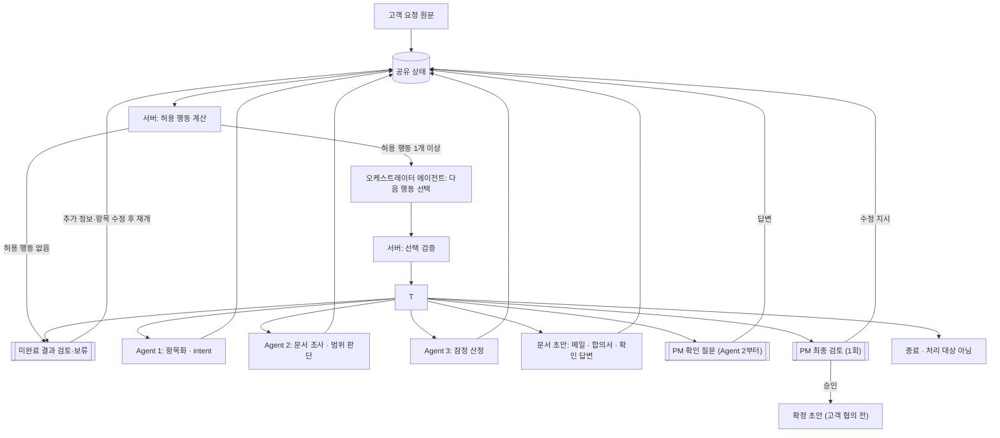

# 통합 요청 분석 오케스트레이션 계획

작성일: 2026-11-03 · 개정: 2026-11-10 · 상태: 목표 설계 및 구현 계획

이 문서는 통합 요청 분석의 **목표 설계**다. 기존 순차 엔진과 API는 [현행 오케스트레이션 구현](orchestration-design.md), Agent 3의 상세 작업은 [Agent 3 연동 구현 계획](../agent3/orchestration-integration-implementation-plan.md)을 참고한다.

**2026-11-10 로컬 P0 구현 메모:** `supervisor_runtime.py`·`supervisor_start.py`를 통해 Agent 1 초기 실행·질문 답변 후 재분석, 중앙 LLM의 Agent 2·3 행동 선택, 도구별 미해결 정보 보존, 상위 결과 변경 시 산정 무효화, 잠정 문서의 PM 최종 승인 경로를 추가했다. 로컬 API는 `/prototype/supervisor/cases`에서 시작·조회·단계 실행·질문 답변·최종 검토·보류 재개를 제공하며 `prototype/analysis-demo.js`에서 호출한다. **이는 목표 설계 전체 완료를 뜻하지 않으며**, Agent 1 질문의 사전 문서 조사·PM 일괄 질문, 영속 저장·인증·업무 백엔드 연동, 실제 모델 E2E 검증은 별도 과제다. 아래 2장의 표는 작성 당시 설계 갭을 포함하므로 현재 코드와 함께 읽는다.

## 1. 목표와 범위

테스트 화면의 맨 앞에 **요청 분석** 메뉴를 추가한다. PM이 고객 요청 원문을 붙여넣으면 오케스트레이터 에이전트가 필요한 에이전트만 골라 호출하고, PM은 꼭 필요한 질문과 마지막 최종 검토 1회에만 개입한다. 최종적으로 **고객과 검토할 변경합의서 초안**을 화면에 표시한다.

이 계획은 로컬 프로토타입 기준이다. 프로젝트·기준선·단가표는 준비된 합성 데이터를 기본으로 사용하고 사용자가 변경할 수 있게 한다. 실제 인증, 고객 발송·회신 수집, 전자서명, 업무 DB와 자동 기준선 확정은 이번 구현에 포함하지 않는다. 임시 공수 기준과 단가표는 실제 견적 기준이 아니다.

**문서 단계 구분:** AI가 잠정 산정·협의 메일·변경합의서 초안을 함께 만들고 → PM이 최종 검토 1회에서 승인·수정한다. 프로토타입에서 고객 회신 없이 생성한 합의서는 '고객 협의 전 초안'으로 표시한다. 생성·다운로드는 고객 합의나 서명이 아니다. 향후 고객 협의가 완료되면 그 결과를 별도로 반영해야 한다.

## 2. 현재 구현과 새로 필요한 작업

| 구분 | 현재 확인된 코드 | 통합 화면에서 필요한 작업 |
|---|---|---|
| 공통 흐름 | `app/orchestration/engine.py`와 `/cases/...`에 실행·질문 답변·재개·재시도 및 Agent 1→2→3 흐름이 있다. 현재는 Agent 1의 필수 질문 또는 항목 확인에서 멈춘다. | Agent 1의 질문을 잠정 보류한 채 안전하게 조사할 수 있는 항목을 Agent 2에 넘기도록 변경한다. 현재 동작이 이 계획을 이미 지원하는 것은 아니다. |
| 요청 유형 분기 | Agent 1 `Item.intent`가 change_request·confirmation·defect·status_check 등을 이미 분류한다. 현행 엔진도 `intent`로 대상을 골라 `confirmation`을 Agent 2에 전달한다. | 새 런타임의 허용 대상과 Agent 2 어댑터 계약을 맞추고, 잠정 질문 전달과 견적 대상 연결을 검증한다(6.3). |
| 개별 API | `/agent1/items`, `/agent2/assessments`, `/agent3/impacts`가 있다. 기존 화면에도 개별 실행과 수동 연결이 있다. | 통합 메뉴는 단일 서버 측 실행 흐름을 사용한다. 브라우저가 세 에이전트를 따로 호출하며 상태를 조립하는 중복 경로는 만들지 않는다. 기존 개별 화면은 진단용으로 유지한다. |
| Agent 3 검토 | 별도 `Agent3Workflow`에 공수 수정·재계산·PM 승인과 고객 전달용 메일 초안 생성이 있다. | 공통 엔진의 기존 `lead_review`를 산정 승인으로 간주하지 않는다. Agent 3 Workflow를 통합 상태와 연결하고 승인을 PM 최종 검토 1회로 일원화한다. 구체적인 계약은 팀 협의가 필요하다. |
| 오케스트레이터 에이전트 | 없음. `Engine`이 코드로 각 Agent의 `run()`을 순서대로 호출한다. Agent 2 내부(`ToolAgent2`)만 문서 도구를 스스로 선택한다. | 서버 허용 행동 계산 위에 다음 행동을 고르는 오케스트레이터 에이전트 루프와 도구 래핑을 추가한다(6장). |
| 질문 | 공통 답변 API와 통합 화면의 Agent 3 질문 답변·재산정 경로가 있다. | 목표 루프에서 답변 후 필요한 도구를 다시 선택하고 미해결 상태를 보존하도록 연결·검증한다. 단순 답변 등록을 질문 해결로 취급하지 않는다. |
| 문서 초안 | 통합 화면은 고객 협의 메일을 생성할 수 있다. Agent 3 독립 도구는 메일·변경합의서 초안을 지원한다. | 공통 상태의 최신 결과로 문서 도구를 호출하고, 통합 화면에서 변경합의서와 최종 검토를 연결한다. PDF는 후속이다. |
| 저장 | 공통 엔진과 Agent 3 세션 모두 메모리 기반이다. | 로컬 세션으로 시연하고, 재시작 시 초기화되는 한계를 표시한다. 서버 재시작 후 복원·여러 사용자 접근은 별도 저장 설계가 필요하다. |

## 3. 화면 구성

왼쪽 메뉴 맨 앞에 **요청 분석**을 배치한다. 기존 변경 요청 목록과 에이전트별 테스트 메뉴는 유지한다.

```text
┌ 요청 분석 ─────────────────────────────────────────────┐
│ 프로젝트 [합성 프로젝트 ▼]  기준선 [BL-2 ▼]             │
│ 고객 요청 원문                                          │
│ ┌────────────────────────────────────────────────────┐ │
│ │ 고객 메일이나 메시지를 여기에 붙여넣으세요.        │ │
│ └────────────────────────────────────────────────────┘ │
│ 모델 [GPT ▼]   단가표 [합성 단가표 ▼]   [분석 시작]    │
├────────────────────────────────────────────────────────┤
│ 진행  요청 분석 → 범위 검토 → 영향 산정 → 문서 초안   │
│                                                        │
│ AI: 요청을 기능 2건, 일정 조건 1건으로 정리했습니다. │
│ [항목·원문 카드]       관련 문서를 먼저 확인합니다…  │
│                                                        │
│ AI: R1의 사진 저장 방식을 확인해 주세요.              │
│ [기존 기능 재사용] [별도 구축] [미정] [직접 입력]     │
│                                      [답변하고 계속]  │
│                                                        │
│ 최신 결과: [요청 항목] [범위·근거] [산정] [문서]     │
└────────────────────────────────────────────────────────┘
```

- **입력 영역:** 원문은 수정 없이 보존한다. 첫 화면은 원문 붙여넣기가 주 동작이며, 프로젝트·기준선·단가표·모델의 로컬 기본값과 그 의미를 보여준다. 기본값이 유효하지 않으면 시작 전에 선택을 요청한다. 프로젝트·기준선과 Agent 1 필수 입력값은 로컬 프로토타입의 명시된 기본값 또는 선택값으로 채운다. 외부 업무 시스템에서 자동으로 확인했다고 표시하지 않는다.
- **대화형 진행 영역:** 실행 단계, 에이전트 결과 요약, 질문과 사용자의 답변을 시간순으로 표시한다. 실제 문서 근거와 PM 결정은 대화 문장만이 아니라 구조화된 카드로 함께 보존한다. 비동기 실행 중 진행 표시와 실패 시 재시도 버튼을 제공한다. 진행 표시줄은 요청 유형에 따라 실제 거치는 단계만 보여준다(예: 범위 확인 문의는 `요청 분석 → 범위 검토 → 답변 초안`).
- **최종 검토 화면:** 항목별 판정·근거, 잠정 산정, 문서 초안, 남은 확인 사항을 한 화면에 모으고 승인·항목별 수정 지시·반려를 제공한다. 자동 진행 결과에는 '잠정' 표시를 붙인다.
- **결과 패널:** 단계별 상세를 열어 요청 항목과 원문 위치, 각 범위 판단의 문서·버전·조항·인용, 작업·공수·금액·가정, 메일과 변경합의서 초안을 볼 수 있게 한다. 찾지 못한 문서 위치는 '없음'으로 표시한다.
- **모델 설정:** 테스트용 GPT/Gemini 선택과 모델 ID를 제공한다. 동일한 입력에도 모델별 제안은 다를 수 있고 재호출이 발생할 수 있음을 표시한다. 자격 증명은 서버에서만 읽는다.

## 4. 단계와 PM 개입 (최소화)

확정된 방향은 **중간 승인 없이 잠정 분석·산정·문서 초안을 준비하고, 마지막에 PM에게 되물어 승인받는 것**이다. 기존 단계별 승인을 통합하는 것은 이번 오케스트레이션의 설계 기준이며 다시 승인할 정책 선택 사항으로 두지 않는다. PM 개입은 다음 두 종류를 기본으로 한다.

1. **PM 확인 질문:** Agent 2 조사에서 항목과 확인할 사실이 명확해지고 PM 답변이 필요하다고 판정되면, 오케스트레이터가 Agent 3 호출 전에 질문한다. 요청당 자동 질문은 필요에 따라 1~4개를 순서대로 보여준다.
2. **최종 검토:** 범위 판정·잠정 산정·문서 초안을 한 화면에서 보고 승인, 항목별 수정 지시, 반려 중 하나를 선택한다. 정상 경로에서는 1회로 통합한다. 수정으로 결과가 바뀌면 최신 버전을 다시 확인한다. 추가 중간 승인이 필요한 단계는 추후 별도의 되묻기 지점으로 명시해 확장한다.

그 외 단계는 오케스트레이터 에이전트가 진행하고, 자동으로 만든 결과는 모두 **잠정**으로 표시한다. 아래 표는 대표 예시이며 고정 순서가 아니다. 오케스트레이터 에이전트가 상태와 에이전트의 `needs` 신호를 보고 필요한 에이전트만 호출·재호출한다(6장).

| 단계 | 실행 | PM 개입 |
|---|---|---|
| 0. 시작 | 원문·프로젝트·기준선·단가표·모델 검증 | 필수값 누락·기준선 불일치 때만 입력 요청 |
| 1. 요청 구조화 | Agent 1이 항목·`intent`·잠정 질문을 만든다. 원문 위치와 항목 ID를 보존한다. | 없음 |
| 2. 범위 검토 | Agent 2가 범위와 계약 근거를 조사하고, PM에게 확인해야 하는 사실을 항목별로 반환한다. | PM 확인 필요 판정이 나오면 질문 대기 |
| 3. 질문 정리 | 총괄 서버가 답변 대상을 확인하고 중복 질문을 합친다. Agent 2에서 PM 확인이 필요한 질문은 Agent 3 호출 전에 처리한다. 고객에게만 확인할 수 있는 사항은 별도로 관리한다. | 선택지 또는 기타 직접 입력 |
| 4. 잠정 산정 | 근거가 검증된 범위 밖 변경 항목을 Agent 3이 산정하고 서버가 공수×단가를 계산한다. 판단 보류·근거 없음 항목은 산정하지 않는다. | 없음 |
| 5. 문서 초안 | 변경 건은 협의 메일·변경합의서 초안, 확인 건은 범위 확인 답변 초안을 만든다. 내부 원가·마진은 제외한다. | 없음 |
| 6. 최종 검토 | 항목별 판정·근거, 잠정 산정, 문서 초안, 남은 확인 사항을 한 화면에 모은다. | **정상 경로 1회:** 승인 / 수정 지시 / 반려. 수정 후에는 최신 결과 재검토 |

- **수정 지시:** PM이 항목·판정·공수·문구를 고치면 오케스트레이터 에이전트가 영향받는 단계만 다시 실행하고 최종 검토로 돌아온다. 공수만 바뀌면 서버 재계산만 한다.
- **승인:** 승인 시점의 판정·산정·초안 버전을 확정 이력으로 남긴다. 확정이어도 '고객 협의 전 초안'이며 고객 합의나 서명이 아니다.
- **자동으로 확정하지 않는 것:** Agent 2의 범위 밖 판정을 유상·고객 합의로 확정하지 않는다. 금액·승인 상태는 최종 검토 전까지 잠정이다.
- **질문과 승인 횟수:** PM 확인이 필요한 요청에는 자동 질문을 1~4개 제시한다. 질문이 없는 요청은 최종 검토로 진행한다. 최종 검토와 수정 후 재검토는 질문 수와 별도로 기록한다.
- **향후 승인 확장:** 현재 중간 승인 지점은 기본적으로 비활성이다. 필요할 때 승인 대상·발생 조건·확인할 버전·중단/재개 동작을 명시한 체크포인트를 추가한다. 사실 확인 질문에 답한 것을 승인으로 취급하지 않는다.

## 5. 질문·중단·재개 설계

1. Agent 1 질문은 먼저 잠정 질문으로 보관하고, Agent 2가 문서로 검토한 뒤 `문서로 해소`, `PM/고객 답변 필요`, `추가 조사 실패`로 구분한다. 문서로 해소할 때는 실제 확인된 문서·버전·조항·인용과 질문의 연관성을 남긴다. 문서가 확인해 주는 기존 계약 조건과 고객이 이번에 원하는 바는 구별한다.
2. **Agent 2에서 PM 확인이 필요하면 바로 질문한다.** 대상 항목과 확인할 사실을 특정했고, 확인 결과가 범위 판단·산정 대상·구현 가정에 영향을 주며, 현재 문서로 해소할 수 없다고 판단한 경우다. 총괄 서버는 `ask_pm` 후보를 만들고 답변 확인 전까지 Agent 3의 산정·초안 호출을 차단한다. 문서에서 추가로 확인할 수 있는 계약 조항이 구체적이면 그 항목만 한 번 더 조사할 수 있다. 이미 PM이 확인할 사항으로 분류했으면 질문으로 진행한다.
3. PM이 직접 답할 수 없는 고객 대상 질문은 '고객 확인 필요'로 남기고, 블로킹이 아니면 메일 초안의 고객 확인 사항에 포함한다. 발송된 것처럼 기록하지 않는다. 확인 답변이 들어오면 출처·시점을 기록해 입력한다.
4. 답변을 받으면 관련 항목의 해소 여부를 먼저 확인한다. 요청 구성이 바뀌면 Agent 1, 계약 범위나 근거가 바뀌면 Agent 2부터 해당 항목을 재검토한다. 기술 확인이 산정 가정에만 영향을 주고 범위 근거가 이미 충분하면 그 답변을 Agent 3에 전달한다. ‘확인 중’이거나 내용이 불충분하면 질문을 미해결 상태로 보존한다.
5. 상위 입력이나 산정 공수·단가가 바뀌면 이전 산정 승인·메일·합의서 초안을 최신 결과로 사용하지 않는다. 이전 버전은 이력에 남기고 다시 승인한다. 충돌된 `state_revision`이나 결과 ID에는 최신 상태를 다시 보여준다.
6. 모델 오류·타임아웃은 업무상 정보 부족과 구별해 표시하고 실패 단계 재시도를 제공한다. 중복 클릭이나 동일 요청 재전송으로 승인·문서가 중복 생성되지 않도록 요청 ID와 버전 검증을 설계한다.

### 5.1 질문 대조와 화면 계약

- **대조 단위**는 관련 항목 ID와 정규화된 확인 항목 `field`의 조합이다. 예를 들어 `R2 + photo_upload_reuse`로 저장한다. Agent 2의 `Question.field`와 Agent 3의 부족 정보에 같은 키를 전달하도록 설계한다. 같은 항목이라도 확인 항목이 다르면 별도 질문으로 유지한다.
- **Agent 3 이후 새로 드러난 확인 사항**은 총괄 서버가 기존 질문·답변과 대조한다. 같은 확인 항목의 PM 답변이 산정에 필요해졌다면 기존 질문 ID를 유지한 채 필수로 전환한다. 이때 해당 사항은 문서 재검색 후보에서 제외한다. 답변이 이미 있으면 그 내용을 재검토하고, 새로운 사실이 필요한 경우에만 별도 질문을 만든다.
- **재조사 한도**는 같은 항목·확인 항목·기준선에서 추가 검색 1회로 둔다. 관련 판정이나 검증된 근거가 달라졌는지 비교해 산정 갱신을 결정한다. 검색 후보 수나 결과 ID만 달라졌다면 기존 상태를 유지하고, PM 확인이나 보류로 전환한다. 새 문서 버전이나 답변이 들어오면 해당 항목을 다시 검토할 수 있다.
- **질문 수**는 한 요청 버전에서 자동으로 새로 제시한 질문 ID 기준으로 최대 4개다. 필요하면 1개부터 바로 묻는다. 창을 다시 열거나 동일 질문을 이어 보여주는 동작은 새 질문으로 세지 않는다. 4개를 제시한 뒤에도 필수 확인이 남으면 미해결 목록과 함께 보류·수동 검토로 전환한다.
- **질문 카드**에는 질문, 관련 항목, 확인이 필요한 이유, 선택지 ID와 표시 문구, ‘기타 직접 입력’을 제공한다. 일반 선택지는 클릭하면 즉시 제출한다. 기타 선택 시 입력창을 펼치고 입력 후 제출한다. 서버는 현재 질문 ID와 상태 버전을 검증하고 선택지 ID 또는 직접 입력을 답변으로 저장한다. 다음 질문이 있으면 보여주고, 필수 확인이 해소되면 분석을 재개한다.

| 질문 예시 | 선택 | 후속 처리 |
|---|---|---|
| 기존 사진 업로드·저장 기능을 이번 변경에 재사용할 수 있나요? | 재사용 가능 | 답변을 산정 가정에 반영하고 관련 항목의 영향 산정을 진행 |
| 같은 질문 | 신규 개발 필요 | 신규 개발을 가정해 관련 항목의 영향 산정을 진행 |
| 같은 질문 | 아직 확인 중 | 질문과 현재 결과를 보존하고 기술 확인을 기다림 |
| 같은 질문 | 기타 직접 입력 | 입력한 조건의 충분성을 확인하고 관련 단계부터 재개 |

**예시:** Agent 1이 '기존 계약에 리뷰 기능이 포함됐나요?'라고 질문했다면 Agent 2가 기준선 기능명세에서 관련 조항을 확인하고 출처와 함께 해소를 제안할 수 있다. 반면 '이번 요청의 선택 사항인 사진을 실제로 포함할까요?'는 고객의 현재 의도이므로 기존 계약서에 사진 기능이 있다는 사실만으로 대신 답하지 않고 PM 또는 고객에게 확인한다.

## 6. LLM 오케스트레이션 설계

### 6.1 구조 요약: 오케스트레이터 에이전트 + 서버 가드레일

이 문서에서 **오케스트레이터 에이전트(Orchestrator agent)**는 전문 에이전트의 호출과 결과 종합을 결정하는 중앙 AI를 뜻한다. 전체 구조는 **멀티에이전트 오케스트레이션**, 상태·권한·버전·실제 호출을 관리하는 서버는 **오케스트레이션 런타임**으로 구분한다.

**오케스트레이터 에이전트가 다음 행동을 고르고, 서버는 허용되는 행동만 후보로 제공·검증한다.** 전문 에이전트(Agent 1·2·3)와 문서 생성, PM 질문·검토는 오케스트레이터 에이전트가 호출하는 도구로 감싼다. 에이전트끼리 직접 호출하지 않고, 모든 결과는 공유 상태에 기록된 뒤 오케스트레이터 에이전트가 다시 판단한다(중앙 조율형 / Agents as Tools).

```python
allowed = server.allowed_actions(state)        # 가드를 통과한 행동만
if not allowed:
    return server.pause_for_incomplete_review(state)
action = orchestrator_agent.choose(allowed, summarize(state))
server.validate(action, state)                 # 허용 밖·구버전·한도 초과 거부
result = TOOLS[action.name](action.args)
state.apply(result)
```

- **오케스트레이터 에이전트가 판단하는 것:** 어떤 항목을 어느 에이전트에 보낼지, `needs` 신호에 따라 재호출할지, 남은 질문이 블로킹인지·고객 확인 사항인지, 언제 최종 검토로 넘길지.
- **서버가 강제하는 것:** 실행 전제 조건, 금액 계산, 확정·승인 권한, 버전·중복·호출 한도(6.5). 오케스트레이터 에이전트의 선택은 이 제한을 우회할 수 없다.
- **다음 업무 행동은 후보가 하나여도 총괄이 선택한다.** 허용 후보는 현재 상태에서 실행할 수 있는 행동 목록이다. 서버의 입력 검증, 금액 계산, 상태 저장, 한도 초과 시 정지에는 별도 LLM 판단이 필요 없다.

### 6.2 아키텍처



- `[[ ]]` 노드는 PM 대기(중단·재개) 지점이다. 서버가 `WAITING_*` 상태로 멈추고, PM 응답이 들어오면 상태에 반영한 뒤 오케스트레이터 에이전트 루프를 재개한다.
- 대표 경로 (PM 개입 횟수):

| 요청 | 경로 | PM |
|---|---|---|
| 변경 요청 | A1 → A2 → A3 → 초안 → 최종 검토 | 1회 |
| 범위 확인 문의 | A1 → A2 → 확인 답변 초안 → 최종 검토 | 1회 |
| 확인 + "안 되면 추가" | A1 → A2(범위 밖) → 잠정 변경 전환 → A3 → 초안 → 최종 검토 | 1회 |
| 해석이 갈리는 변경 요청 | A1 → A2 → PM 질문 → 답변 확인 → 필요한 단계만 재검토 → A3 → 초안 → 최종 검토 | 확인 질문 1~4개 + 최종 검토 |
| 진행 문의·인사 | A1 → 종료·미지원 안내 | 0회 |

### 6.3 요청 유형: `intent` 기준

Agent 1의 `Item`에는 문장 형태인 `item_type`과 고객이 원하는 행동인 `intent`가 있다. 분기 정보는 이미 `intent`에 있으므로 새 분류 에이전트는 만들지 않는다. `item_type`과 `function` 항목의 처리는 바꾸지 않는다.

```python
# schema/schemas.py (현재)
Intent = Literal["change_request", "estimate_only", "confirmation", "defect",
                 "issue_report", "status_check", "constraint", "estimate_request"]
```

현행 엔진도 `intent`로 범위 판단 대상을 고른다. 다만 현행 엔진은 `status_check`와 `estimate_only`도 Agent 2 입력 대상으로 고르지만 Agent 2 도구 어댑터는 두 의도를 제외한다. 아래 표는 새 루프의 목표 정책이며, 공통 런타임에서 도구의 입력 조건과 맞춰야 한다.

| intent | Agent 2 | Agent 3 | 최종 결과 (최종 검토 대상) |
|---|---|---|---|
| `change_request` | 범위 판단 | 근거 검증된 범위 밖 항목 잠정 산정 | 협의 메일 + 변경합의서 초안 |
| `confirmation` | 범위 판단 | 호출 안 함. 단, 조건부 후속 요청이 있고 범위 밖이면 잠정 변경 전환 후 산정 | 범위 확인 답변 초안. 범위 밖이면 최종 검토에서 변경 전환 여부 선택 |
| `defect` / `issue_report` | 범위·하자 여부 판단 | 호출 안 함 | 하자 처리 안내 초안. 범위 밖이면 변경 전환 선택 |
| `estimate_request` | 같은 요청의 대상 항목 기준 | 대상 항목 산정 | 견적 안내. 대상이 불명확하면 블로킹 질문 |
| `status_check` | 호출 안 함 | 호출 안 함 | 종료·미지원 안내 (진행 조회 도구는 후속) |
| `constraint` | 참고 정보 | 참고 정보 | 그대로 전달 |
| 항목 없음 (인사·일정 공유) | 호출 안 함 | 호출 안 함 | 처리 대상 아님 |

- **의도는 요청 전체에서 하나를 고르지 않는다.** 항목마다 하나의 `intent`를 붙이고 요청은 여러 의도를 그대로 가진다. 확인·변경이 섞인 요청은 항목별로 진행하고 최종 검토에서 한 번에 보여준다.

```text
"리뷰 기능 범위 포함인가요? 그리고 사진 첨부 추가해주시고, 견적도 부탁드립니다."
R1 confirmation      → Agent 2 → 범위 확인 답변
R2 change_request    → Agent 2 → Agent 3 → 합의서 초안
R3 estimate_request  → R2 산정 요청으로 연결
```

- **한 항목에 의도가 겹치면** `intents` 리스트로 묶지 않고 항목을 나눈다(기존 `estimate_request` 분리와 같은 원칙).
- **조건부 요청**("포함인지 확인하고, 안 되면 추가해주세요")은 `confirmation`으로 두고 `조건부 후속: 범위 밖이면 추가 희망`과 원문 위치를 보존한다(예: `conditional_followup` 필드, Agent 1 담당자와 합의). Agent 2가 근거와 함께 범위 밖으로 판정하면 오케스트레이터 에이전트가 **PM에게 묻지 않고 잠정 변경 전환·산정까지 진행**하고, 전환 여부는 최종 검토에서 확정한다. 원래 분류는 이력에 남긴다.
- **애매한 분류:** `change_request`·`confirmation`·`defect`는 모두 Agent 2를 거치므로 오분류 영향이 작다. Agent 2를 건너뛰는 `status_check`·항목 없음만 보수적으로 적용한다. **기능·문서 대상이 언급됐는데 의도가 애매하면 `confirmation`으로 분류해 Agent 2로 보낸다.** 이 규칙은 Agent 1 프롬프트와 서버 허용 행동 계산 양쪽에 둔다.
- `estimate_only`와 `estimate_request`의 의미는 [Agent 1 연동 계약](../agent1/orchestration-integration-contract-v1.md)에 구분되어 있다. 다만 공통 런타임의 대상 항목 연결 및 산정 분기 정책은 팀 확인과 통합 검증이 필요하다(9장).

### 6.4 오케스트레이터 에이전트 도구와 입출력

| 도구 | 감싸는 대상 | 서버 사전 조건 |
|---|---|---|
| `analyze_request(mode, item_ids?, question_id?, answer_id?)` | Agent 1 항목화, 답변 해석(`analyze_answer`), 항목 재분리 | 원문·필수 입력 존재. 답변 분석이면 질문·답변 연결 필수 |
| `assess_scope(item_ids, focus?)` | Agent 2 범위 판단, 잠정 질문 확인, 추가 조항 조사 | 범위 판단 대상 intent 항목 + 유효 기준선 |
| `estimate_impact(item_ids)` | Agent 3 잠정 산정 + 서버 금액 계산 | 6.5의 잠정 산정 조건 충족 |
| `draft_documents(kind, item_ids)` | 협의 메일·변경합의서·범위 확인 답변 초안 | 문서 종류에 필요한 판정·산정 결과 존재. 생성 단계는 잠정이며 승인 불필요 |
| `ask_pm(question_id)` | PM 확인 질문 한 개 표시 | 현재 요청에 답변이 필요한 PM 질문이 있고 질문 한도 이내 |
| `request_final_review()` | PM 최종 검토 | 블로킹 질문 0, 대상 항목 판정 완료, 초안 생성 완료 |
| `request_incomplete_review(reason, item_ids)` | 미완료 결과 검토·수동 처리 전환 | 조사 실패·한도 초과·판단 보류 등 자동으로 완료할 수 없는 사유 존재. 블로킹 질문·미생성 초안이 있어도 허용 |
| `finish(reason)` | 종료·처리 대상 아님 안내 | 범위 판단 대상이 없거나 최종 승인 완료 |

- **오케스트레이터 에이전트 입력(상태 요약):** 원문, 항목 표(ID·`intent`·판정·근거 검증 여부·산정 여부), 미해결 질문과 분류, 에이전트의 `needs` 신호, 직전 행동 이력, 허용 행동 목록. 에이전트 결과 전문 대신 요약을 넣어 토큰을 줄인다.
- **오케스트레이터 에이전트 출력(구조화):** `{action, args, reason}`. `action`을 판별자로 하여 **행동별 args 스키마**를 검증하고 다른 행동의 인자나 알 수 없는 필드는 거부한다. `analyze_request`의 `mode`는 `initial`/`resplit`/`answer`로 구분하고 mode별 필수 인자를 검사한다. `draft_documents.kind`는 `negotiation_email`/`change_agreement`/`scope_response`로 제한한다. `assess_scope`는 `item_ids`와 선택적 `focus`, `ask_pm`은 기존 질문의 `question_id`, 종료·미완료 검토는 각각의 사유를 받는다. `reason`은 사용자에게 보여 줄 짧은 진행 설명이다.
- **호출 예시:** `{"action":"assess_scope","args":{"item_ids":["CR-A-001-1"],"focus":"사진 저장 범위 관련 조항"},"reason":"사진 저장 범위를 문서로 확인합니다."}`. 실행의 프로젝트·기준선·버전·권한은 서버 상태에서 주입하고 오케스트레이터 에이전트가 인자로 바꾸지 못하게 한다. 항목 ID·질문·답변 ID도 현재 실행에 속하는지 서버가 검증한다.
- **오케스트레이터 에이전트 기본 정책(프롬프트):** 6.3의 intent 표와 다음 규칙을 따른다.
  - 문서로 확인 가능한 질문은 PM에게 묻지 않고 Agent 2로 조사한다.
  - 고객 의도 질문은 블로킹이 아니면 메일 초안의 '고객 확인 사항'으로 넘긴다.
  - Agent 2가 PM 답변 필요로 분류한 항목은 총괄 서버에서 질문을 우선한다. 답변이 해소되기 전에는 Agent 3 호출을 허용하지 않는다(5장).
  - Agent 2의 `resplit`은 항목 분리가 필요한 이유다. 총괄이 재분리를 선택하면 해당 항목만 `analyze_request`로 보내고, 반환 결과를 보고 재검토 범위를 선택한다.
  - Agent 3이 부족 정보를 반환하면 총괄 서버가 기존 PM 질문과 대조한다. 같은 확인 사항이면 해당 PM 질문을 우선하고, 새로 확인할 수 있는 계약 조항이면 해당 항목의 추가 조사만 허용한다. 조사 결과에 따라 관련 항목을 재산정하거나 PM 질문·미완료 검토로 전환한다(5.1장).
  - PM이 공수만 수정 → 서버 재계산만, 에이전트 재호출 없음.
- **에이전트 반환 신호:** 각 에이전트는 부족한 정보를 `needs`(신규 필드, 예: `resplit`, `more_evidence`, `client_intent`)로 구조화해 반환한다. 형식은 세 에이전트 담당자와 합의한다. 신호 자체로 도구를 실행하거나 다음 에이전트에 제어권을 넘기지 않는다.
- **구현:** 기존 `Engine`을 상태·검증·버전의 단일 소유자로 두고, 그 위에 오케스트레이터 에이전트 루프를 추가한다. 오케스트레이터 에이전트는 GPT/Gemini의 구조화 출력(함수 호출)으로 구현하며 모델 설정은 3장과 같이 선택 가능하게 한다.

**예시:** Agent 3이 R1의 사진 첨부 계약 근거가 부족하다고 반환한다. 총괄이 Agent 2 추가 조사를 선택하면 서버는 R1과 현재 기준선을 검증해 실행한다. Agent 2의 인용이 해당 조건을 뒷받침하면 총괄이 R1 재산정을 선택할 수 있다. 같은 신호라도 이미 같은 범위를 조사했고 새 근거가 없다면 총괄은 동일 조사를 반복하지 않고, PM이 답할 수 있는 필수 질문 또는 미완료 검토를 선택한다.

### 6.5 서버 가드레일

- **Agent 2 실행:** 범위 판단 대상 intent 항목과 유효 기준선이 있을 때만.
- **잠정 산정:** Agent 2 판정이 범위 밖(조건부 전환 포함)이고, 인용 검증(`apply_guards`)을 통과했고, 해당 항목에 블로킹 질문이 없을 때만. 판단 보류·근거 없음 항목은 산정하지 않고 미완료 검토에 '판단 필요'로 표시한다. 중간 PM 승인은 요구하지 않는다. 현행 순차 엔진에는 PMReview 선행 조건이 있다. 통합 목표 루프는 이미 준비된 Agent 3 잠정 산정 어댑터를 연결한다. AI가 PM 검토 기록을 대신 생성하지 않는다.
- **금액:** 공수×단가는 서버가 계산한다. 오케스트레이터 에이전트·에이전트가 금액·날짜·승인 상태를 생성하거나 확정하지 않는다.
- **확정:** PM 최종 승인 없이는 어떤 결과도 확정되지 않으며, 확정 후에도 고객 전달·합의로 기록하지 않는다.
- **한도:** 케이스당 오케스트레이터 에이전트 결정 최대 12회(MVP), 같은 사유의 재호출은 항목당 2회. 초과하면 자동 호출을 멈추고 `request_incomplete_review`로 넘긴다. 미완료 검토는 정상 최종 승인과 구분하며, 미해결 사항과 현재까지의 결과를 표시한다.
- **미완료 검토:** PM은 추가 답변·자료 입력, 항목 수정·명시적 제외, 수동 처리·보류를 선택한다. 새로운 정보 없이 동일 루프를 자동 반복하지 않는다. PM이 원인을 해결하고 재개하면 새 실행 구간의 호출 예산을 서버가 부여하고 누적 이력은 보존한다. 필수 질문·미산정 항목을 자동으로 해결 처리하거나 전체 승인으로 통과시키지 않는다. 정상 완료 조건을 충족한 최신 결과만 최종 승인할 수 있다.
- **오케스트레이터 에이전트 오류:** 출력 스키마 오류나 허용 밖 행동은 1회 재요청한다. 다시 실패하면 미완료 검토 또는 기술 실패로 기록한다. 정상 경로에서는 신호를 고정 도구 호출로 바꿔 계속하지 않는다.
- **버전·중복:** `state_revision`, 결과 ID, 요청 ID로 오래된 결과·중복 실행을 차단한다. 상위 결과가 바뀌면 하위 산정·초안을 무효화하고 다시 생성한다.

### 6.6 상태와 데이터 연결

- **상태:** `분석 중`, `PM 질문 대기`, `미완료 검토 대기`, `보류`, `최종 검토 대기`, `확정 초안`, `처리 대상 아님`, `실패`. 기존 `WorkflowState.stage`·`RunStatus`와의 매핑은 검토 후 확정한다. Agent 1 뒤의 `pm_items` 대기와 `pm_review`·`lead_review`의 개별 승인은 기본 경로에서 제거하고 최종 검토로 통합한다. 질문·미완료 검토 대기는 승인 단계가 아니다.
- **Agent 1 질문:** `NEEDS_INPUT`과 미해결 질문을 삭제·해결 처리하지 않고 잠정 상태로 Agent 2에 넘긴다(5장). `Agent2Input.items`는 범위 확인 문의를 받지만, 잠정 질문 입력과 문서 기반 해소 결과는 별도 계약이 필요하다.
- **Agent 3:** `Agent3Workflow`의 산정 편집·재계산·메일 생성을 공통 상태에 통합한다. 기존 승인 후 문안 생성 경로와 구별되는 잠정 초안 생성 경로를 만들고, 실제 PM의 최종 확인에서만 승인 기록을 생성한다. 최종 승인은 판정·산정·메일·합의서의 동일 버전 스냅샷을 참조한다. 이후 내용이 바뀌면 승인 유효성을 해제하고 최신 결과를 다시 확인받는다.
- **추적:** 실행 단위에 `case_id`/`request_revision`/`state_revision`, 각 Agent 결과 ID, 항목별 `intent`와 출처(ai/pm), 기준선 ID·시점, 단가·공수 기준 버전, 질문·답변, **오케스트레이터 에이전트 결정 기록(허용 후보·선택·사유·재요청·중단 사유)**, 최종 승인 버전을 연결한다. 오케스트레이터 에이전트 결정 기록은 경로 재현과 평가에 사용한다.
- **API:** 화면은 `run`/`state`/`answer`/`review`(승인·수정 지시·반려)/`retry`를 기반으로 한다. 정확한 엔드포인트와 요청 형식은 구현 전 설계안이다.

### 6.7 비교 기준: 기존 순차 실행

기존 순차 엔진은 별도의 **비교 기준선**으로 사용한다. 같은 합성 입력에서 오케스트레이터 에이전트 경로와 기존 순차 경로를 비교해 경로 정확도, PM 개입 횟수, LLM 호출 수·지연·비용을 기록하고, 오케스트레이터 에이전트가 규칙보다 나은 판단을 한 사례와 잘못 선택한 사례를 정리한다.

## 7. 변경합의서 초안 항목

참조 양식: `Data/261019_B2B_dataset-commerce/01_모노마켓/CO-A-001-v1.0.pdf`는 **출력 양식의 예시**다. 기존 계약 범위 판단을 위해 자동으로 넣는 근거 문서가 아니다. 다만 별도로 이미 양측이 확정한 과거 변경합의서가 선택된 유효 기준선에 포함되어 있다면, Agent 2가 그 문서를 기존 범위의 근거로 검색할 수 있다. 이번에 생성 중인 미확정 초안은 기준선에 넣지 않는다.

| 항목 | 입력 출처 / 표시 |
|---|---|
| 문서명·작성일·프로젝트·고객사 | 로컬 입력 또는 PM 작성. 누락 시 미정 |
| 원계약·대상 변경 요청·기준선 | 확인된 식별자만 표시. 문서 원문 링크는 확인된 경우 제공 |
| 변경 전·후 범위, 제외 범위 | Agent 2 판정과 근거를 바탕으로 작성하고 최종 검토에서 확정. 판단 보류는 미정 |
| 작업·공수·고객 제안 금액·부가세 | 최신 산정 결과에서 코드로 채움. 최종 검토 전에는 잠정 표시. 내부 원가·마진 제외 |
| 일정 영향·적용일 | 확인된 값만 표기. 미산정·미확정은 명시 |
| 가정·의존성·고객 확인 사항 | 산정 결과와 PM 입력을 그대로 유지 |
| 검수·인도 기준 및 서명란 | 확인된 항목 또는 입력란. 실제 합의·서명 완료로 표시하지 않음 |

LLM은 서술 초안을 제안할 수 있지만, 금액·공수·날짜·승인 상태를 임의로 확정하지 않는다. 최종 검토 전에는 최신 잠정 구조화 데이터, 승인 후에는 승인된 스냅샷에서 수치와 출처를 렌더링하고 문안과의 불일치를 검증한다. 초안은 PM이 수정·확인하며 최종 문서 양식은 기획·백엔드와 협의한다.

## 8. 구현 순서와 완료 기준

1. **공통 상태와 도구 연결:** Agent 2·3 상태 포트를 붙이고 결과 ID, `needs`, 질문·답변, 실행 영수증을 같은 케이스에 저장한다. 런타임이 기준선·버전·권한을 주입하고 허용 행동과 인자를 검증한다.
2. **총괄 루프와 첫 통합 검증:** 총괄이 최신 상태 요약을 보고 한 번에 행동 하나를 선택한다. 결과를 저장한 뒤 다시 판단하며, 후보가 하나여도 이 절차를 거친다. 첫 검증은 Agent 3 근거 부족 → 총괄의 Agent 2 조사 선택 → 조사 결과에 따른 부분 재산정 또는 확인 대기다. 같은 신호라도 조사 이력·검증된 근거에 따라 경로가 달라지는지, 허용 밖 선택·구버전·반복 호출이 차단되는지 확인한다.
3. **PM 질문·재개:** Agent 2의 PM 확인 필요 판정이 있으면 Agent 3 호출 전에 질문한다. 기존 질문과 Agent 3 부족 정보의 대조, 질문 한도, 답변에 따른 재개 범위를 5.1장 기준으로 검증한다.
4. **대화형 화면:** 진행 메시지, 단계별 결과 카드, 선택지와 기타 직접 입력을 제공하는 PM 질문 카드, **최종 검토 화면(승인·항목별 수정 지시·반려)**과 오류 복구를 연결한다.
5. **문서 초안:** 협의 메일, 변경합의서, 범위 확인 답변 초안 생성과 미리보기·수정을 추가한다. 고객 확인 사항을 메일에 포함한다. PDF는 문서 양식 확정 후 검토한다.
6. **통합 검증:** intent별 경로(변경·범위 확인·하자·진행 문의·인사), 확인·변경 혼합 요청, 조건부 요청의 잠정 전환, 기능이 언급된 애매한 문의가 Agent 2를 건너뛰지 않는지, `needs` 재호출과 한도, 오케스트레이터 에이전트의 허용 밖 선택 거부·재요청 및 중단을 확인한다. Agent 1 질문이 문서로 해소된 경우, 블로킹/고객 확인 사항/최종 검토 표시로 올바르게 나뉘는지, 원문 의도를 문서로 오인하는지, 기준선이 없는 경우를 확인한다. 판단 보류·근거 없음 항목이 산정되지 않는지, 최종 검토 수정 지시 후 영향 단계만 재실행되는지, 모델 실패·재시도·중복 요청·구버전 충돌, 고객 문서의 내부 원가·마진 제외도 검증한다.
7. **모델·경로 비교:** 같은 합성 입력으로 GPT와 Gemini를 실제 실행해 근거·가정·공수·질문·초안과 오케스트레이터 에이전트 경로를 비교하고, 기존 순차 경로와의 차이(6.7)를 기록한다. 외부 호출 테스트와 가상 응답 테스트를 구분한다.

완료 기준: 한 화면에서 원문을 붙여넣어 실행하고, Agent 2가 PM 확인이 필요하다고 판정한 사례에서는 Agent 3 호출 전에 질문 카드를 표시한다. 필요한 경우 요청 버전당 새 질문을 최대 4개 보여주며, 5번째 필수 사항은 미해결 목록에 보존하고 미완료 검토로 전환한다. 이미 답한 질문은 중복으로 제시하지 않는다. 답변을 바탕으로 필요한 단계만 다시 실행하며, 판정·산정·문서의 최신 스냅샷을 최종 검토에 사용한다.

추가 검증 항목: 도구별 필수 인자·mode·kind 검증, 블로킹 질문이 남은 상태의 미완료 검토 진입, 허용 행동 0개와 호출 한도 초과 시 보류, 추가 답변으로 새 질문이 생기는 상황, 최종 승인 전 잠정 초안 생성과 승인 후 버전 변경을 검증한다. AI가 중간 PM 승인 기록을 생성하지 않는지도 확인한다.

## 9. 팀과 확인할 사항

- **확정 방향의 구현 공유:** 중간 승인을 제거하고 마지막 되묻기에서 최종 승인한다. PMReview·산정 승인·문안 확인의 기존 계약을 잠정 처리와 최종 승인으로 변경하는 방법을 담당자와 맞춘다. 필요 시 추가 승인 체크포인트를 확장한다는 방향도 공유한다. 승인 최소화 방향 자체를 재승인할 안건으로 두지 않는다.
- **세부 기준:** 블로킹 질문의 기준, 미완료 검토에서 제외·보류한 항목의 표시, 범위 내·승인된 변경 처리, PM의 금액 직접 수정 허용 여부와 추가 체크포인트의 발생 조건.
- **오케스트레이터 에이전트:** 오케스트레이터 에이전트 모델·비용, 결정 한도(12회)와 재호출 한도(2회), 실패 시 중단·재개 기준, 결정 기록의 보관 방식.
- **Agent 1:** 조건부 후속 요청 필드(`conditional_followup`), 애매한 의도의 `confirmation` 기본 분류, `estimate_only`와 `estimate_request`의 구분. `assemble.py`의 확인 요청 후처리가 원문에 확인 표현이 있으면 `function` 항목까지 `confirmation`으로 바꾸는 문제(확인·변경 혼합 요청에서 변경 요청 소실 위험)와 특정 문구 하드코딩.
- **Agent 2:** 잠정 질문 입력과 해소 결과 반환, 기존 `focus` 지정 추가 조사의 공통 상태 연결.
- **공통 신호:** 에이전트 재호출용 `needs` 필드 형식(`resplit`, `more_evidence`, `client_intent` 등).
- Agent 1·2의 다중 항목 계약, 원문 맥락과 질문·답변 재실행, Agent 3의 공유 작업 중복 방지 및 공수 기준의 타당성.
- 백엔드가 전달할 프로젝트·기준선 상태와 문서 버전, 확정된 변경합의서의 기준선 편입 시점, 과거 기준선 허용 여부.
- 최종 검토 승인 상태의 저장 주체, 재시작 복구·권한과 실제 배포 경계.
- 변경합의서 표준 양식·PDF 필요 시점, 실제 고객 전달·회신·서명 담당과 시스템 경계.
- 모델·검색 비용과 재시도 횟수, 테스트에서 사용할 문서·모델·임베딩 환경. Bedrock과 실제 백엔드 연동은 별도 검증.

## 근거

- AI 회의 후속 과업 정리(작성자 개인 대화 참고): 필요한 에이전트만 호출, 문맥 보존, PM 검토, 기준선·문서 버전 협의 및 로컬 통합 테스트 방향. 해당 대화에는 제안과 미확정 사항이 섞여 있으며 팀 공유 회의록은 별도 확인이 필요하다.
- [공통 엔진](../../app/orchestration/engine.py), [상태 저장](../../app/orchestration/state_store.py), [공통 API](../../app/api/routes.py), [Agent 3 API](../../app/api/agent3_routes.py), [공유 스키마](../../schema/schemas.py): 현재 구현 확인.
- [Agent 3 MVP 아키텍처](../agent3/architecture-mvp.md)와 [프로토타입 사용법](../prototype/run.md): 고객 메일 및 향후 변경합의서 범위.
- [Anthropic: Building effective agents](https://www.anthropic.com/research/building-effective-agents): 정해진 코드 경로의 워크플로와 모델이 행동을 선택하는 에이전트의 구분.
- [LangChain 공식 서브에이전트 설계 예제](https://github.com/langchain-ai/docs/blob/main/src/oss/langchain/multi-agent/subagents-personal-assistant.mdx): 전문 에이전트를 오케스트레이터 에이전트의 도구로 감싸 호출하는 구조(6장 오케스트레이터 에이전트 설계의 기반).
