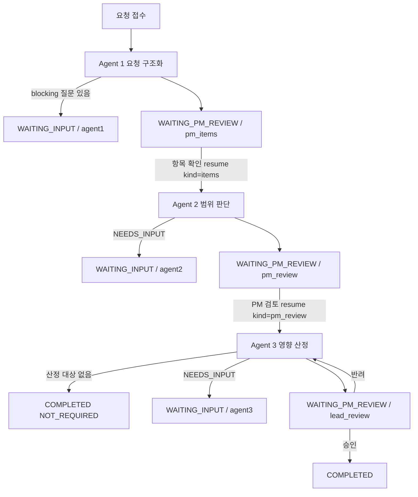

# 현행 오케스트레이션 구현: 순차 엔진

**구현 기준:** 2026-11-10 로컬 코드 기준 · **적용 범위:** Agent 1 → Agent 2 → Agent 3 순차 실행 경로

이 문서는 현재 동작하는 순차 엔진과 API를 설명합니다. 총괄 LLM이 결과를 보고 다음 도구를 선택하는 목표 구조와 우선순위는 [통합 요청 분석 오케스트레이션 계획](integrated-request-analysis-plan.md)을 참고하세요. 아래 중간 PM 검토와 단계 전이는 기존 실행 경로의 동작입니다. 에이전트별 연동 계약은 각 `docs/agent*/orchestration-integration-contract-v1.md`를 기준으로 합니다.

## 1. 목적과 원칙

- 고객 요청 한 건을 **Agent 1(요청 구조화) → Agent 2(범위 판단) → Agent 3(영향 산정)** 순서로 실행하고, 사람 확인이 필요한 지점에서 멈춥니다.
- 엔진은 **판단하지 않는 결정적 워크플로**입니다. LLM을 호출하지 않고 순서, 멈춤, 재개, 재실행, 무효화, 상태 저장만 담당합니다.
- 에이전트 간 공유 계약(`schema/schemas.py`)은 변경하지 않습니다. API 전용 모델은 `app/api/models.py`, 화면용 응답은 `app/dto/analysis.py`에 둡니다.
- 무효화된 결과는 삭제하지 않고 `stale_result_ids`와 `archive`에 보존합니다.

## 2. 계층 구조

```
prototype 화면 (analysis-demo.js, api.js)
        │  POST /api/v1/analyses, /cases/{id}/resume
        ▼
API 계층      app/api/analysis_routes.py   (화면용, /api/v1/analyses)
              app/api/routes.py            (엔진 직접 호출, /cases/{id}/...)
        ▼
서비스 계층   app/services/analysis_service.py   (analysis_id ↔ case_id, DTO 조립)
        ▼
엔진          app/orchestration/engine.py        (상태 전이)
        ▼
에이전트      app/agents/registry.py 의 AgentSet (fixture 또는 llm)
```

| 구성 | 파일 | 역할 |
|---|---|---|
| 엔진 | `app/orchestration/engine.py` | 단계 전이, 재시도, 무효화, 이벤트 기록 |
| 상태 저장소 | `app/orchestration/state_store.py` | `CaseRecord` 저장. 현재는 메모리(`InMemoryStore`) |
| 사전 검사 | `app/orchestration/preflight.py` | Agent 3 실행 전 입력 검사 |
| 서비스 | `app/services/analysis_service.py` | 화면용 결과(`AnalysisResultDTO`) 조립, `schedule_reference` 생성 |
| DTO | `app/dto/analysis.py` | 단계별로 결과가 누적되는 응답 모델 |
| 매핑 | `app/services/prototype_result_mapper.py` | DTO를 기존 프로토타입 응답 형태로 변환 |
| 에이전트 선택 | `app/agents/registry.py` | `AGENT_MODE`에 따라 fixture 또는 LLM 에이전트 구성 |

## 3. 실행 흐름



### 단계와 상태

`WorkflowState.status`는 `QUEUED`, `RUNNING`, `WAITING_INPUT`, `WAITING_PM_REVIEW`, `COMPLETED`, `FAILED` 중 하나이고, `stage`는 `agent1`, `pm_items`, `agent2`, `pm_review`, `agent3`, `lead_review` 중 하나입니다.

| 멈춤 지점 | status / stage | 재개 방법 |
|---|---|---|
| Agent 1이 blocking 질문을 남김 | `WAITING_INPUT` / `agent1` | 질문 답변 |
| 항목 확인 | `WAITING_PM_REVIEW` / `pm_items` | `resume` `kind=items` |
| Agent 2가 추가 정보를 요청 | `WAITING_INPUT` / `agent2` | 질문 답변 |
| 범위 판정 PM 검토 | `WAITING_PM_REVIEW` / `pm_review` | `resume` `kind=pm_review` |
| Agent 3가 추가 정보를 요청 | `WAITING_INPUT` / `agent3` | 질문 답변 |
| 리드 검토 | `WAITING_PM_REVIEW` / `lead_review` | `resume` `kind=lead` |

### 단계별 규칙

- **Agent 1 이후**: blocking이고 open 상태인 질문이 있으면 멈춥니다. 없으면 PM 항목 확인(`pm_items`)을 기다립니다. 단, 시작 시 `auto_confirm_items=true`이면 Agent 1 항목을 PM 확정 없이 그대로 `items`로 확정하고(`items_auto_confirmed` 이벤트) Agent 2로 넘어갑니다. 기본값은 `false`입니다. 재실행으로 `items`가 무효화돼도 이 플래그가 유지되어 같은 방식으로 다시 확정합니다.
- **Agent 2 입력**: 확인된 항목 중 `intent`가 `change_request`, `confirmation`, `defect`, `issue_report`, `status_check`, `estimate_only`인 항목만 넘깁니다. 해당 항목이 없으면 판단·산정할 것이 없다고 보고 `COMPLETED`로 종료합니다.
- **제약 항목 전달**: `item_type`이 `constraint`, `deadline`, `dependency`인 항목은 `constraints`로 Agent 2·3에 넘깁니다. 견적 요청(`question`) 항목은 넘기지 않습니다.
- **Agent 3 실행 전**: `preflight_a3`가 입력을 검사합니다. 검토 대기이면 `pm_review`에서 다시 멈추고, 그 외 실패는 재시도 불가 `FAILED`로 처리합니다.
- **산정 대상 없음**: Agent 3를 호출하지 않고 `NOT_REQUIRED` 결과를 만들어 `COMPLETED`로 종료합니다.

## 4. 상태·결과 저장

`CaseRecord`가 한 요청의 모든 상태를 가집니다.

| 필드 | 내용 |
|---|---|
| `inp` | 원본 요청(`Agent1Input`) |
| `a1`, `items` | Agent 1 결과, PM이 확인한 항목 |
| `a2`, `pm_review`, `a3` | Agent 2 결과, PM 검토, Agent 3 결과 |
| `answers`, `questions` | 질문과 답변 |
| `archive` | 무효화된 결과 보존 |
| `state` | `WorkflowState` (`state_revision`, 결과 ID, `history` 등) |

- 이벤트가 기록될 때마다 `state_revision`이 1씩 오르고 저장소에 저장됩니다.
- 모든 재개 요청은 `state_revision`을 함께 보내며, 현재 값과 다르면 `VersionConflict`(409)로 거부합니다. 오래된 화면의 덮어쓰기를 막기 위한 장치입니다.
- 현재 저장소는 메모리입니다. 서버를 재시작하면 상태가 사라집니다. 운영용 영속 저장소와 재시작 복구 방식은 별도 설계 과제입니다.

## 5. 재실행과 무효화

`schema/schemas.py`의 `RERUN_TABLE` 기준입니다.

| 변경 종류 | 재실행 시작 | 무효화 대상 |
|---|---|---|
| `request_changed` | agent1 | a1, a2, pm_review, a3 |
| `baseline_or_evidence` | agent2 | a2, pm_review, a3 |
| `pm_review_changed` | agent3 | a3 |
| `estimate_input_changed` | agent3 | a3 |

- 원문이 바뀐 재요청은 `request_revision`이 올라가야 하고 새 `analysis_id`가 필요합니다. 아니면 `VersionConflict`입니다.
- PM 검토를 다시 제출하면 기존 검토와 a3를 무효화하고 Agent 3부터 다시 실행합니다. `new_evidence=true`이면 Agent 2부터 다시 실행합니다.
- 질문 답변은 Agent 1의 `analyze_answer` 결과(`rerun_from`)에 따라 해당 단계부터 무효화합니다. 답변 분석이 실패해도 흐름은 중단하지 않고 질문을 `answered`로 남깁니다.
- Agent 3 질문이 해소됐고 별도 `rerun_from` 지정이 없다면, 기존 Agent 3 결과를 무효화하고 답변을 반영해 Agent 3부터 재산정합니다. 이전 결과는 이력에 보존합니다.
- 리드 반려는 Agent 3부터 다시 실행합니다.

## 6. 실패 처리

`Engine._run`이 에이전트 호출을 감쌉니다.

| 상황 | 처리 |
|---|---|
| 시간 초과 | `MODEL_TIMEOUT`(retryable)로 `FAILED`. 제한은 `stage_timeout_sec`(기본 60초) |
| retryable 실패 | 최대 `tool_max_retries`(기본 2)회 재시도 후 `FAILED` |
| 출력 형식 오류 | 1회 재요청 후 `OUTPUT_INVALID` |
| 도구 입력 오류 | `INVALID_INPUT` |
| 출력의 context 불일치 | 출력 오류로 처리 |

실패한 단계의 부분 출력은 다음 단계로 넘기지 않습니다. `retry`로 새 `result_id`를 받아 해당 단계부터 다시 실행합니다.

## 7. API

### 엔진 직접 호출 (`app/api/routes.py`)

| 메서드 | 경로 | 용도 |
|---|---|---|
| POST | `/cases/{id}/run` | 시작. 기본은 Agent 1 실행 후 PM 항목 확정(`pm_items`)을 기다리며 멈춤. 본문에 `auto_confirm_items: true`를 주면 Agent 1 항목을 그대로 확정하고 Agent 2까지 실행한 뒤 `pm_review`에서 멈춤 |
| GET | `/cases/{id}/state` | 현재 상태와 단계별 결과 |
| POST | `/cases/{id}/resume` | `kind`가 `items`, `pm_review`, `lead` 중 하나 |
| POST | `/cases/{id}/questions/{qid}/answer` | 질문 답변, 필요 시 재실행 |
| POST | `/cases/{id}/retry` | `FAILED` 단계 재시도 |
| POST | `/cases/{id}/email-draft` | 최신 Agent 3 결과를 바탕으로 고객 협의 메일 초안 생성 |

이메일 초안 생성은 로컬 실행 경로이며, 고객 발송·공식 업무 백엔드 저장·변경합의서 생성과는 구분합니다.

`ConfirmItems`(항목 확인)의 입력 스키마는 공통 스키마에 정의되어 있지 않아 임시안입니다. 팀 합의 후 확정이 필요합니다.

### 화면용 (`app/api/analysis_routes.py`, prefix `/api/v1/analyses`)

| 메서드 | 경로 | 용도 |
|---|---|---|
| POST | `/api/v1/analyses` | 분석 시작. `AnalysisResultDTO` 반환 |
| GET | `/api/v1/analyses/{analysis_id}` | 누적 결과 조회 |
| GET | `/api/v1/analyses/{analysis_id}/status` | 단계, 상태, 열린 질문, 오류 |

오류 응답은 `AnalysisNotFound` 404, `VersionConflict`·`InvalidTransition` 409, `InvalidInput` 422입니다.

### `AnalysisResultDTO`

단계가 진행될수록 필드가 누적됩니다.

| 필드 | 채워지는 시점 |
|---|---|
| `contract_request` | 항상 |
| `structured_request` | Agent 1 완료 |
| `scope_analysis` | Agent 2 완료 |
| `cost_estimation` | Agent 3 완료 |
| `schedule_reference` | 기한·제약 항목이 있을 때 |
| `workflow` | 항상 (`WorkflowState`) |

### 기존 일정 참고 정보 (`schedule_reference`)

기한·제약(`deadline`, `constraint`) 항목이 있으면 서비스가 `get_schedule(project_id, baseline_as_of)`로 계약 문서상의 일정을 찾아 붙입니다. LLM 판단이 아니라 결정적 조회입니다.

- 포함 내용: 대상 항목 ID, 기준일(`as_of`), 계약 종료일, 근거(`contract_end_ref`), 반영된 변경합의서, 마일스톤, 안내 문구
- 계약 문서에는 오픈일이 따로 없어, 계약 종료(최종 인수)일을 기존 일정의 기준으로 표시하고 그 사실을 `note`에 적습니다.
- 프로젝트를 찾지 못하면 `null`입니다.

## 8. 프로토타입 화면 흐름

`prototype/analysis-demo.js`의 실제 API 경로입니다.

1. 요청 입력 후 `POST /api/v1/analyses`로 Agent 1을 실행합니다.
2. Agent 1이 `pm_items`에서 멈추면 화면이 항목을 그대로 `resume kind=items`로 보내 Agent 2를 자동 실행합니다.
3. Agent 2 판정과 근거 문서, 기존 일정을 보여 주고 "범위 판정 결과를 확인해 주세요" 창으로 PM 확인을 받습니다. 선택지는 확인하고 진행, 보류, 직접 입력입니다.
4. PM이 확인하면 `resume kind=pm_review`로 Agent 3를 실행합니다.
5. Agent 1이 blocking 질문을 남기거나 Agent 2가 `NEEDS_INPUT`이면 자동 진행하지 않고 멈춥니다.

화면 표시는 `analysisSnapshot`이 서버 결과(`realA1`, `realA2`)가 있으면 그대로 쓰고, 없을 때만 고정 시연값을 씁니다. 서버가 준 항목 유형, 원문 구간, 질문, 판정은 덮어쓰지 않습니다.

항목 확인 정책은 엔진의 `auto_confirm_items` 옵션으로 정합니다. 화면(프로토타입)은 지금 이 옵션을 쓰지 않고 `resume kind=items`로 직접 통과시키므로, 실제 프론트는 옵션을 켜거나 항목 확정 화면을 두는 쪽을 선택하면 됩니다. 항목을 PM이 직접 편집하는 단계가 필요하면 옵션을 끄고 `kind=items`로 수정본을 보냅니다.

## 9. 실행 모드와 설정

| 설정 | 의미 |
|---|---|
| `AGENT_MODE` | `fixture`이면 데이터셋 정답을 반환, `llm`이면 실제 에이전트 |
| `AGENT1_MODE`, `AGENT2_MODE` | fixture 모드에서 해당 에이전트만 `llm`으로 실행 |
| `VECTOR_STORE` | `pgvector`이면 `psycopg`, `pgvector` 패키지와 DB가 필요 |
| `RETRIEVAL_MODE` | `hybrid`, `vector`, `lexical` |

- `python prototype/run_demo.py --lab`은 `--mode` 기본값이 `fake`라서 `.env`와 무관하게 fixture 모드로 실행합니다. 실제 에이전트로 보려면 `--mode openai`를 지정합니다.
- Agent 2가 근거를 찾으려면 위 벡터 저장소 설정과 패키지가 갖춰져 있어야 합니다.
- fixture 모드에서 gold 데이터에 없는 `case_id`로 요청하면 문장 단위로 쪼갠 모든 항목을 `function`으로 만드는 대체 결과가 나옵니다.

## 10. 테스트

| 파일 | 내용 |
|---|---|
| `tests/test_engine.py` | 단계 전이, 재개, 충돌 차단, 재시도, 무효화 |
| `tests/test_api.py` | 엔진 API |
| `tests/test_analysis_api.py` | 화면용 API, 누적 DTO, `schedule_reference` |
| `tests/test_agent1_agent.py` | LLM Agent 1 연결과 `pm_items` 도달 |
| `prototype/tests/analysis-demo.test.mjs` | 화면 스냅샷 보존, Agent 2 자동 실행 후 PM 확인 흐름 |

```bash
python -m pytest tests/test_analysis_api.py tests/test_engine.py tests/test_api.py -q
node --test prototype/tests/analysis-demo.test.mjs
```

검증 결과는 실행한 커밋 기준으로 기록합니다.

## 11. 알려진 한계와 후속 과제

- 상태 저장소가 메모리라 재시작 시 `WAITING_*` 상태가 복원되지 않습니다.
- PM 항목 확인 입력 스키마(`ConfirmItems`)가 임시안입니다.
- 서버 결과가 없는 시연 경로의 공수·금액은 고정 예시값입니다.
- 범위 검토 화면의 PM 검토는 AI 판정을 그대로 확정하는 방식이며, 항목별 판정 수정 UI는 없습니다.
- 사용자 답변 재분석(`analyze_answer`)은 키워드 기반이며 완성되지 않았습니다 (`docs/agent1/agent1-current-status.md` 참고).
