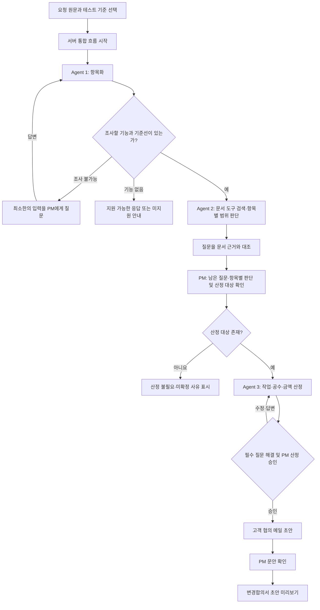

# 통합 요청 분석 프로토타입 계획

작성일: 2026-11-03 · 상태: 구현 전 제안

## 1. 목표와 범위

테스트 화면의 맨 앞에 **요청 분석** 메뉴를 추가한다. PM이 고객 요청 원문을 붙여넣으면 필요한 에이전트를 순서대로 실행하고, 중요한 항목은 화면에서 확인하거나 질문에 답한 뒤 계속한다. 최종적으로 **고객과 검토할 변경합의서 초안**을 화면에 표시한다.

이 계획은 로컬 프로토타입 기준이다. 프로젝트·기준선·단가표는 준비된 합성 데이터를 기본으로 사용하고 사용자가 변경할 수 있게 한다. 실제 인증, 고객 발송·회신 수집, 전자서명, 업무 DB와 자동 기준선 확정은 이번 구현에 포함하지 않는다. 임시 공수 기준과 단가표는 실제 견적 기준이 아니다.

**문서 단계 구분:** 산정 승인 → 고객 전달용 협의 메일 초안 → PM 문안 확인 → 고객과 협의할 변경합의서 초안. 프로토타입에서 고객 회신 없이 생성한 합의서는 '고객 협의 전 초안'으로 표시한다. 생성·다운로드는 고객 합의나 서명이 아니다. 향후 고객 협의가 완료되면 그 결과를 별도로 반영해야 한다.

## 2. 현재 구현과 새로 필요한 작업

| 구분 | 현재 확인된 코드 | 통합 화면에서 필요한 작업 |
|---|---|---|
| 공통 흐름 | `app/orchestration/engine.py`와 `/cases/...`에 실행·질문 답변·재개·재시도 및 Agent 1→2→3 흐름이 있다. 현재는 Agent 1의 필수 질문 또는 항목 확인에서 멈춘다. | Agent 1의 질문을 잠정 보류한 채 안전하게 조사할 수 있는 항목을 Agent 2에 넘기도록 변경한다. 현재 동작이 이 계획을 이미 지원하는 것은 아니다. |
| 개별 API | `/agent1/items`, `/agent2/assessments`, `/agent3/impacts`가 있다. 기존 화면에도 개별 실행과 수동 연결이 있다. | 통합 메뉴는 단일 서버 측 실행 흐름을 사용한다. 브라우저가 세 에이전트를 따로 호출하며 상태를 조립하는 중복 경로는 만들지 않는다. 기존 개별 화면은 진단용으로 유지한다. |
| Agent 3 검토 | 별도 `Agent3Workflow`에 공수 수정·재계산·PM 승인과 고객 전달용 메일 초안 생성이 있다. | 공통 엔진의 기존 `lead_review`를 산정 승인으로 간주하지 않는다. Agent 3 Workflow를 통합 상태와 연결해 결과·버전·승인 소유자를 하나로 정리한다. 구체적인 계약은 팀 협의가 필요하다. |
| 질문 | 질문·답변 스키마와 `/cases/{id}/questions/{qid}/answer`가 있으며 답변 분석 후 재실행을 시도한다. | 각 에이전트 질문의 화면 표시, 답변·재개, 미해결 상태와 실제 Agent 1 답변 분석 연동을 검증하고 보완한다. 단순 답변 등록을 질문 해결로 취급하지 않는다. |
| 변경합의서 | 고객 전달용 협의 메일 초안은 있으나 변경합의서 생성은 구현 확인되지 않았다. | 검토된 사실을 양식에 채우는 초안 생성, 누락 항목 표시와 미리보기를 추가한다. PDF 다운로드는 별도 후속 작업으로 둔다. |
| 저장 | 공통 엔진과 Agent 3 세션 모두 메모리 기반이다. | 로컬 세션으로 시연하고, 재시작 시 초기화되는 한계를 표시한다. 서버 재시작 후 복원·여러 사용자 접근은 별도 저장 설계가 필요하다. |

## 3. 화면 구성

왼쪽 메뉴 맨 앞에 **요청 분석**을 배치한다. 기존 변경 요청 목록과 에이전트별 테스트 메뉴는 유지한다.

```text
┌ 요청 분석 ─────────────────────────────────────────────┐
│ 프로젝트 [합성 프로젝트 ▼]  기준선 [BL-2 ▼]             │
│ 고객 요청 원문                                          │
│ ┌────────────────────────────────────────────────────┐ │
│ │ 고객 메일이나 메시지를 여기에 붙여넣으세요.        │ │
│ └────────────────────────────────────────────────────┘ │
│ 모델 [GPT ▼]   단가표 [합성 단가표 ▼]   [분석 시작]    │
├────────────────────────────────────────────────────────┤
│ 진행  요청 분석 → 범위 검토 → 영향 산정 → 문서 초안   │
│                                                        │
│ AI: 요청을 기능 2건, 일정 조건 1건으로 정리했습니다. │
│ [항목·원문 카드]       관련 문서를 먼저 확인합니다…  │
│                                                        │
│ AI: R1의 사진 저장 방식을 확인해 주세요.              │
│ [기존 기능 재사용] [별도 구축] [미정] [직접 입력]     │
│                                      [답변하고 계속]  │
│                                                        │
│ 최신 결과: [요청 항목] [범위·근거] [산정] [문서]     │
└────────────────────────────────────────────────────────┘
```

- **입력 영역:** 원문은 수정 없이 보존한다. 첫 화면은 원문 붙여넣기가 주 동작이며, 프로젝트·기준선·단가표·모델의 로컬 기본값과 그 의미를 보여준다. 기본값이 유효하지 않으면 시작 전에 선택을 요청한다. 프로젝트·기준선과 Agent 1 필수 입력값은 로컬 프로토타입의 명시된 기본값 또는 선택값으로 채운다. 외부 업무 시스템에서 자동으로 확인했다고 표시하지 않는다.
- **대화형 진행 영역:** 실행 단계, 에이전트 결과 요약, 질문과 사용자의 답변을 시간순으로 표시한다. 실제 문서 근거와 PM 결정은 대화 문장만이 아니라 구조화된 카드로 함께 보존한다. 비동기 실행 중 진행 표시와 실패 시 재시도 버튼을 제공한다.
- **결과 패널:** 단계별 상세를 열어 요청 항목과 원문 위치, 각 범위 판단의 문서·버전·조항·인용, 작업·공수·금액·가정, 메일과 변경합의서 초안을 볼 수 있게 한다. 찾지 못한 문서 위치는 '없음'으로 표시한다.
- **모델 설정:** 테스트용 GPT/Gemini 선택과 모델 ID를 제공한다. 동일한 입력에도 모델별 제안은 다를 수 있고 재호출이 발생할 수 있음을 표시한다. 자격 증명은 서버에서만 읽는다.

## 4. 단계와 PM 질문

| 순서 | 실행·화면 | 사용자 확인 및 다음 단계 |
|---|---|---|
| 0. 시작 | 원문, 프로젝트, 기준선, 단가표, 모델을 확인하고 분석을 시작한다. | 필수값 누락이나 기준선 불일치는 입력을 요청하고 호출하지 않는다. |
| 1. 요청 구조화 | Agent 1이 원문을 여러 기능 항목, 일정·제약, 질문 등으로 나누고 원문 문맥과 항목 ID를 보존한다. | 기본 경로에서는 여기서 PM을 기다리지 않는다. 확인이 필요한 항목과 질문은 잠정 상태로 보존해 Agent 2의 조사에 함께 넘긴다. |
| 2. 경로 선택 | 문서를 검색할 만큼 식별 가능한 기능 항목이 있으면 Agent 2에 모두 전달한다. 일정·제약, 원문, 잠정 질문은 별도 문맥으로 함께 넘긴다. | 기능이 없는 일반 문의·진행 상황 요청은 Agent 2·3을 억지로 호출하지 않는다. 진행 현황 조회 도구는 별도 후속 과제다. 검색할 요청 자체나 프로젝트·기준선을 특정할 수 없다면 그 정보만 먼저 물어본다. |
| 3. 범위 검토와 확인 | Agent 2가 선택된 기준선 문서를 검색해 각 기능 항목의 범위·근거와 Agent 1 질문 중 문서로 확인 가능한 사항을 검토한다. | 문서에 근거해 해소된 질문은 출처를 붙여 보여주고, 그래도 남는 질문·항목별 판정만 PM에게 확인받는다. PM은 R1/R2별 판단과 산정 대상을 선택한다. 원문의 고객 의도나 최신 작업 사실을 문서만으로 만들어내지 않는다. |
| 4. 영향 산정 | 선택된 여러 항목을 Agent 3에 함께 전달한다. 작업·직군·임시 공수 기준과 가정을 제안하고 서버가 공수×단가를 계산한다. | PM이 작업·공수·가정과 금액을 검토·수정한다. 미산정 항목, 기준 누락 및 일정 미산정은 이유를 보여준다. 필요한 질문에 답하고, 전체 산정 결과를 명시적으로 승인하거나 반려한다. |
| 5. 메일 초안 | 최신 승인 산정 결과를 기반으로 고객 전달용 협의 메일 초안을 생성한다. 내부 원가·마진은 고객용에서 제외한다. | PM이 문안을 확인·수정하고 '문안 확인 완료'를 선택한다. 이는 고객 발송이나 고객 동의가 아니다. |
| 6. 변경합의서 초안 | 확인된 요청·범위·금액·일정과 PM이 입력한 조건을 양식에 채운다. | 빠진 항목은 '미정' 또는 빈칸으로 두고 PM이 입력·수정한다. 검토 후 복사 또는 초안 저장. 고객 협의 전이면 이를 표시하고 확정 상태로 바꾸지 않는다. |

Agent 2에서 범위 밖으로 분류했다고 자동으로 유상 또는 고객 합의로 확정하지 않는다. 현재 계약은 `estimate=true`를 PM이 범위 밖으로 결정한 항목에만 허용한다. 범위 내·판단 보류·승인된 변경에 대한 산정이나 안내 메일 필요성은 별도 분기와 팀 합의가 필요하다. 산정 대상이 없을 때 합의서를 임의 생성하지 않고 그 이유를 표시한다.

## 5. 질문·중단·재개 설계

1. Agent 1 질문은 먼저 잠정 질문으로 보관하고, Agent 2가 문서로 검토한 뒤 `문서로 해소`, `PM/고객 답변 필요`, `추가 조사 실패`로 구분한다. 문서로 해소할 때는 실제 확인된 문서·버전·조항·인용과 질문의 연관성을 남긴다. 문서가 확인해 주는 기존 계약 조건과 고객이 이번에 원하는 바는 구별한다.
2. Agent 2 조사 후에도 남는 필수 질문은 답변하기 전 관련 단계의 계속 버튼을 비활성화한다. 선택 질문은 미답변을 표시하고 계속할 수 있다. 질문마다 `question_id`, 발생 단계·관련 항목, 문구, 이유, 답변 대상, `blocking`, 상태와 근거를 보존한다. 버튼형 선택지와 자유 입력을 제공한다. **무응답 시 자동 진행이나 임의 답변은 하지 않는 안**이며, 상세 운영 규칙은 기획과 협의한다.
3. PM이 직접 답할 수 없는 고객 대상 질문은 '고객 확인 필요'로 남긴다. 발송된 것처럼 기록하지 않는다. 확인 답변이 들어오면 출처·시점을 기록해 입력한다.
4. 답변을 받은 뒤 관련 단계에서 해소 여부를 확인한다. Agent 1 항목 변경은 1 이후, 새 문서·범위 근거는 2 이후, 공수 가정 변경은 3 이후 결과를 재검토한다. 실제 무효화 범위는 기존 엔진과 Agent 3 Workflow 연결 시 구현·검증한다.
5. 상위 입력이나 산정 공수·단가가 바뀌면 이전 산정 승인·메일·합의서 초안을 최신 결과로 사용하지 않는다. 이전 버전은 이력에 남기고 다시 승인한다. 충돌된 `state_revision`이나 결과 ID에는 최신 상태를 다시 보여준다.
6. 모델 오류·타임아웃은 업무상 정보 부족과 구별해 표시하고 실패 단계 재시도를 제공한다. 중복 클릭이나 동일 요청 재전송으로 승인·문서가 중복 생성되지 않도록 요청 ID와 버전 검증을 설계한다.

**예시:** Agent 1이 '기존 계약에 리뷰 기능이 포함됐나요?'라고 질문했다면 Agent 2가 기준선 기능명세에서 관련 조항을 확인하고 출처와 함께 해소를 제안할 수 있다. 반면 '이번 요청의 선택 사항인 사진을 실제로 포함할까요?'는 고객의 현재 의도이므로 기존 계약서에 사진 기능이 있다는 사실만으로 대신 답하지 않고 PM 또는 고객에게 확인한다.

## 6. 호출과 상태 연결 제안



- **호출 방식 재검토:** 위 그림만으로는 '에이전트가 다른 에이전트를 도구 호출한다'는 의미가 아니다. 현재 `Engine`은 코드로 순서를 정해 각 Agent의 `run()`을 직접 호출하는 **규칙 기반 오케스트레이션**이다. `ToolAgent2`는 그 내부에서 구조화된 행동 선택으로 `search_docs`, `get_section`, `verify_quote`를 호출하지만, 전체 매니저가 Agent 1·2·3을 LLM 도구로 선택하는 구조는 현재 확인되지 않았다. 매니저가 사용하는 각 Agent 도구 호출과 Agent 2가 문서를 검색하는 내부 도구 호출은 서로 다른 수준이다.
- **제안하는 통합 방식:** 기존 `Engine`을 상태·검증·버전의 단일 소유자로 사용하고, 그 위에 매니저 에이전트의 구조화된 도구 선택 계층을 둔다. 매니저에 `analyze_request`(Agent 1), `assess_scope`(Agent 2), `estimate_impact`(Agent 3), `ask_pm`/`wait_for_pm`, `create_draft`를 도구로 제공한다. 매니저가 다음 행동을 선택하면 서버가 허용된 단계인지 검사하고 해당 함수를 실행해 결과를 다시 매니저에 전달한다. 이는 **구현 제안**이며, 기존 `run()` 직접 호출만으로 이미 이 방식이 동작하는 것은 아니다.
- **서버가 강제할 경계:** 기능 항목·유효 기준선이 있어야 Agent 2를 실행하고, 미해결 필수 질문 및 PM 범위 판단 전에는 Agent 3 산정을 실행하지 않는다. PM 산정 승인 없이 메일·합의서 초안을 진행하지 않으며, 오래된 결과·중복 실행·무한 반복은 버전 검사와 호출 횟수 제한으로 차단한다. 도구가 필요 없는 일반 문의는 적절히 종료하거나 미지원으로 안내한다. 매니저의 선택은 이 제한을 우회할 수 없다.
- Agent 1 결과의 `NEEDS_INPUT`과 미해결 질문을 삭제·해결 처리해서 Agent 2에 넘기지 않는다. 현재 `Agent2Input`에는 Agent 1의 질문 목록을 담는 필드가 없고 현재 엔진도 먼저 멈춘다. **잠정 항목·질문 및 출처 전달, 문서 기반 질문 해소 결과, 보류 상태에서의 조사 허용**에 대한 공유 스키마·가드·상태 전이·회귀 테스트를 Agent 1·2 담당자와 합의해 추가해야 한다. 질문별 문서 근거가 없거나 사용자 의도를 물어야 하면 미해결로 남긴다.
- Agent 3의 산정 편집·승인·메일 생성은 `Agent3Workflow`를 통합해 중복 실행과 서로 다른 승인 상태가 생기지 않도록 한다. 화면은 `run`/`state`/`resume`/`answer`/`retry`를 기반으로 하고 필요하면 승인·문서 동작을 추가한다. 정확한 엔드포인트와 요청 형식은 구현 전 설계안이다. 필요 이상의 LLM 호출 비용·지연을 줄이기 위해 매니저를 쓰지 않고 코드 라우팅만 사용하는 대안과 비교한다.
- 상태는 적어도 `분석 중`, `PM 항목 확인 대기`, `질문 답변 대기`, `범위 검토 대기`, `산정 검토 대기`, `메일 검토 대기`, `합의서 초안`, `실패`를 구분한다. 기존 `WorkflowState`와의 매핑·추가 enum은 검토 후 확정한다.
- Agent 1의 모든 기능 항목과 원문·제약·답변을 Agent 2에 보낸다. Agent 2의 전체 `assessments`와 근거, 항목별 PM 판단, 원문 문맥과 제약을 Agent 3 입력에 보존한다. 선택한 산정 대상만 비용을 계산하고 연결 항목을 표시한다.
- 통합 실행 단위에 `case_id`/`analysis_id`/`request_revision`/`state_revision`, 각 Agent 결과 ID, 기준선 ID·시점, 단가·공수 기준 버전, 질문·답변, PM 결정과 초안이 참조한 승인 버전을 연결한다. 실제 문서 버전 목록·상태 전달은 백엔드와 협의한다.

## 7. 변경합의서 초안 항목

참조 양식: `Data/261019_B2B_dataset-commerce/01_모노마켓/CO-A-001-v1.0.pdf`는 **출력 양식의 예시**다. 기존 계약 범위 판단을 위해 자동으로 넣는 근거 문서가 아니다. 다만 별도로 이미 양측이 확정한 과거 변경합의서가 선택된 유효 기준선에 포함되어 있다면, Agent 2가 그 문서를 기존 범위의 근거로 검색할 수 있다. 이번에 생성 중인 미확정 초안은 기준선에 넣지 않는다.

| 항목 | 입력 출처 / 표시 |
|---|---|
| 문서명·작성일·프로젝트·고객사 | 로컬 입력 또는 PM 작성. 누락 시 미정 |
| 원계약·대상 변경 요청·기준선 | 확인된 식별자만 표시. 문서 원문 링크는 확인된 경우 제공 |
| 변경 전·후 범위, 제외 범위 | PM 확인된 항목과 근거를 바탕으로 작성. 미확정은 미정 |
| 작업·공수·고객 제안 금액·부가세 | 최신 PM 승인 산정 결과에서 코드로 채움. 내부 원가·마진 제외 |
| 일정 영향·적용일 | 확인된 값만 표기. 미산정·미확정은 명시 |
| 가정·의존성·고객 확인 사항 | 산정 결과와 PM 입력을 그대로 유지 |
| 검수·인도 기준 및 서명란 | 확인된 항목 또는 입력란. 실제 합의·서명 완료로 표시하지 않음 |

LLM은 서술 초안을 제안할 수 있지만, 금액·공수·날짜·승인 상태를 임의로 확정하지 않는다. 수치와 출처는 승인된 구조화 데이터에서 렌더링하고, 문안에 추가된 사실과 수치 불일치를 검증한다. 초안은 PM이 수정·확인하며 최종 문서 양식은 기획·백엔드와 협의한다.

## 8. 구현 순서와 완료 기준

1. **연결 설계:** 공통 엔진과 Agent 3 Workflow의 상태·버전·승인 소유권, 질문 답변과 재실행 계약을 정리하고 실제 API·에이전트와 맞춘다.
2. **통합 실행:** 로컬 원문 입력 → Agent 1의 잠정 항목·질문 → Agent 2 문서 조사 → 남은 질문·다중 항목 판정의 PM 확인 → Agent 3 산정·승인까지 서버에서 연결한다. 기능 없는 요청은 별도 분기한다.
3. **대화형 화면:** 진행 메시지, 단계별 결과 카드, 질문 선택·직접 입력·재개와 오류 복구를 연결한다. 기존 화면과 합성 기본값을 유지한다.
4. **문서 초안:** 산정 승인에 연결된 고객 메일 초안, PM 문안 확인, 변경합의서 초안 미리보기·수정을 추가한다. PDF는 문서 양식 확정 후 검토한다.
5. **통합 검증:** Agent 1 질문이 문서로 해소된 경우, 해소되지 않아 PM/고객 답변이 필요한 경우, 원문 의도를 문서로 오인하는 경우, 조사에 필요한 기준선이 없는 경우를 확인한다. 한 항목·여러 기능과 일정 혼합·기능 없는 요청·판단 보류·근거 없음·부분 미산정·필수/선택 질문·잘못된 답변·모델 실패·재시도·중복 요청·구버전 충돌도 검증한다. 상위 입력 수정 시 승인·초안 무효화와 재승인, 고객 문서의 내부 원가·마진 제외를 확인한다.
6. **모델 비교:** 같은 합성 입력으로 GPT와 Gemini 각각 실제 실행해 근거·가정·공수 선택·질문·초안을 비교한다. 외부 호출 테스트 여부와 결과를 가상 응답 테스트와 구분해 기록한다.

완료 기준: 한 화면에서 원문만 붙여넣고 기본 합성 설정으로 시작할 수 있고, 각 PM 확인과 질문에서 멈췄다가 이어가며, 여러 기능을 누락 없이 검토한다. 최신 승인 산정과 PM이 확인한 내용을 바탕으로 변경합의서 **초안**이 표시되고, 미확정·고객 미합의 상태가 분명해야 한다.

## 9. 팀과 확인할 사항

- PM이 반드시 확인할 단계, 미응답·고객 답변 대기 처리, 고객 협의 전 합의서 초안의 명칭과 허용 시점.
- 산정 대상의 범위 내·승인된 변경 처리와 PM의 금액 직접 수정 허용 여부. 현재 API는 주로 공수·작업·단가 재계산을 지원한다.
- Agent 1·2의 다중 항목 계약, 원문 맥락과 질문·답변 재실행, Agent 3의 공유 작업 중복 방지 및 공수 기준의 타당성.
- 백엔드가 전달할 프로젝트·기준선 상태와 문서 버전, 확정된 변경합의서의 기준선 편입 시점, 과거 기준선 허용 여부.
- Agent 3 통합 승인 상태, 메일 확인·합의서 초안 상태의 저장 주체, 재시작 복구·권한과 실제 배포 경계.
- 변경합의서 표준 양식·PDF 필요 시점, 실제 고객 전달·회신·서명 담당과 시스템 경계.
- 모델·검색 비용과 재시도 횟수, 테스트에서 사용할 문서·모델·임베딩 환경. Bedrock과 실제 백엔드 연동은 별도 검증.

## 근거

- AI 회의 후속 과업 정리(작성자 개인 대화 참고): 필요한 에이전트만 호출, 문맥 보존, PM 검토, 기준선·문서 버전 협의 및 로컬 통합 테스트 방향. 해당 대화에는 제안과 미확정 사항이 섞여 있으며 팀 공유 회의록은 별도 확인이 필요하다.
- [공통 엔진](../../app/orchestration/engine.py), [상태 저장](../../app/orchestration/state_store.py), [공통 API](../../app/api/routes.py), [Agent 3 API](../../app/api/agent3_routes.py), [공유 스키마](../../schema/schemas.py): 현재 구현 확인.
- [Agent 3 MVP 아키텍처](../agent3/architecture-mvp.md)와 [프로토타입 사용법](run.md): 고객 메일 및 향후 변경합의서 범위.
